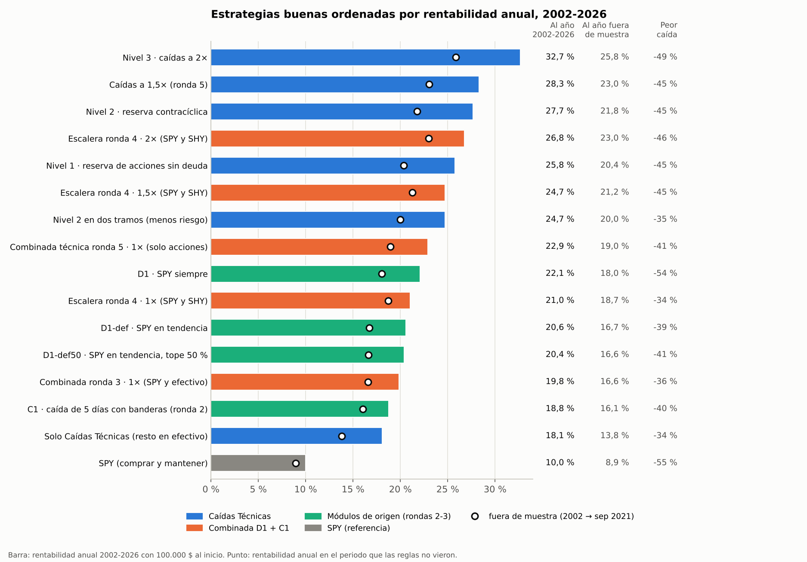
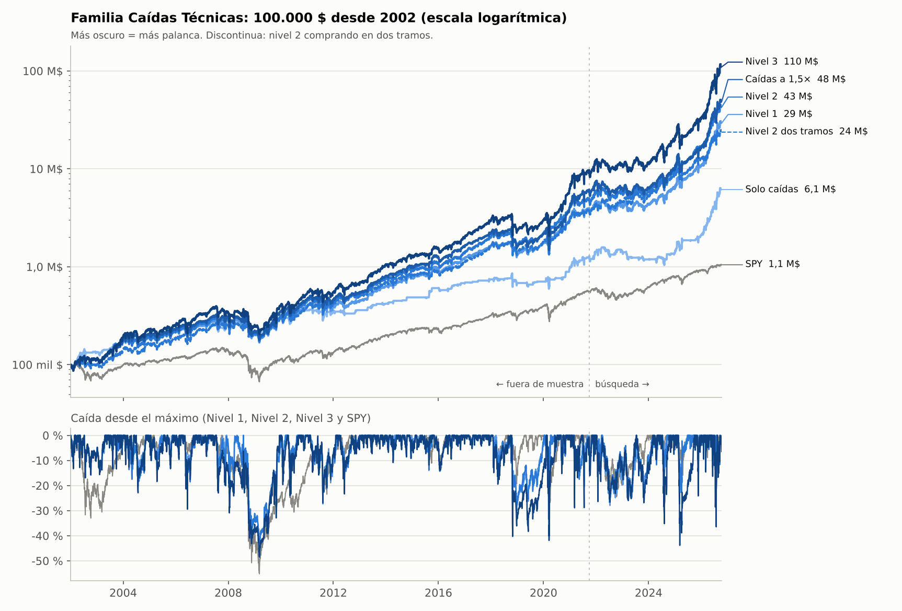
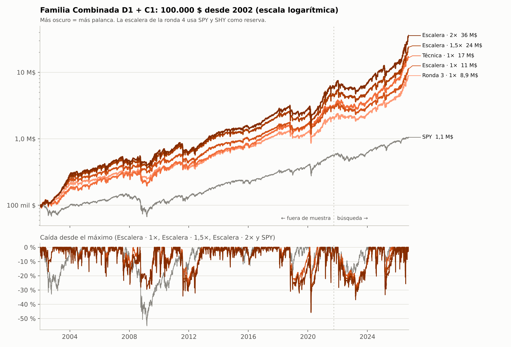
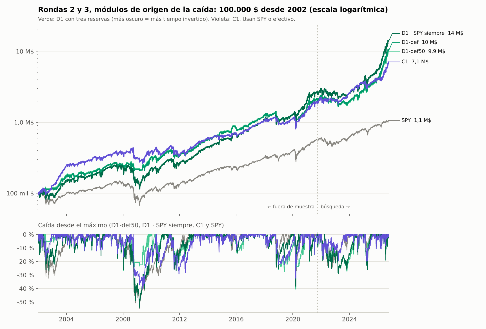

# Dossier · Compra de caídas en acciones del S&P 500

**Qué es esto.** Todo lo necesario para llevarse las estrategias de este estudio a otro
sitio y compararlas con otras bajo las mismas reglas: qué hace cada una (reglas exactas,
replicables), por qué, cómo llegamos a ella, qué resultados da en un marco común de
métricas y ventanas, qué falló por el camino y qué queda por hacer.

- Datos hasta el **12-oct-2026**. Dossier generado el 25-oct-2026.
- Código: rama `claude/trading-earnings-reports-p6qt2c`, carpeta `research/caidas/`.
  Los datos de esta carpeta se regeneran con `python research/caidas/dossier.py`.
- Todas las cifras son **simuladas** (backtest), netas de costes y sin impuestos.

## Índice

0. [Cómo usar este dossier](#0-cómo-usar-este-dossier)
1. [Resumen en un minuto](#1-resumen-en-un-minuto)
2. [Marco común para comparar estrategias](#2-marco-común-para-comparar-estrategias)
3. [Teoría: por qué funciona y cuándo falla](#3-teoría-por-qué-funciona-y-cuándo-falla)
4. [Reglas replicables](#4-reglas-replicables)
5. [Resultados en el marco común](#5-resultados-en-el-marco-común)
6. [Cómo llegamos aquí: historia por rondas](#6-cómo-llegamos-aquí-historia-por-rondas)
7. [Lo que no funcionó](#7-lo-que-no-funcionó)
8. [Lecciones de método que sirven para cualquier estrategia](#8-lecciones-de-método-que-sirven-para-cualquier-estrategia)
9. [Cómo juntarlas con otras estrategias](#9-cómo-juntarlas-con-otras-estrategias)
10. [Próximos pasos](#10-próximos-pasos)
11. [Reproducir](#11-reproducir)
12. [Glosario](#12-glosario)

---

## 0. Cómo usar este dossier

**Archivos** (todo en esta carpeta):

| Archivo | Contenido |
|---|---|
| `DOSSIER.md` | este documento |
| `datos/diario.csv` | rentabilidad **diaria** neta de las 15 estrategias y SPY, 2002-01-02 → 2026-10-12 (una columna por estrategia) |
| `datos/mensual.csv`, `datos/anual.csv` | rentabilidad por mes y por año natural |
| `datos/metricas.csv` | métricas estándar (sección 2.3) en las ventanas estándar (sección 2.2) |
| `datos/crisis.csv` | rentabilidad en 10 caídas de SPY y 3 rebotes |
| `datos/correlaciones_mensuales.csv`, `datos/correlaciones_diarias.csv` | correlaciones entre todas |
| `datos/exposicion.csv` | dónde está el dinero y cómo son las operaciones (familia Caídas Técnicas) |
| `datos/estres.csv` | niveles 1-3 con costes más altos, reserva con costes reales, un día de retraso, deuda más cara y sin el modelo |
| `datos/estrategias.json` | lo mismo en formato máquina: convenciones, bloques de reglas, ficha y métricas de cada estrategia |
| `graficas/` | ranking por CAGR y una gráfica por familia (valor de 100.000 $ y caída desde máximos) |

**Para el otro chat.** Pásale `DOSSIER.md` y la carpeta `datos/` (o el zip) y pega esto:

> Te paso el dossier de mis estrategias de compra de caídas del S&P 500 (`DOSSIER.md` y la
> carpeta `datos/`). Quiero comparar todas mis estrategias, las de este chat y las tuyas,
> en un mismo marco y ver cómo combinarlas.
> 1. Lee la sección 2 (marco común) y usa sus convenciones. Si alguna de tus estrategias
>    usa otras (otro universo, sin costes, ejecución al cierre de la señal, sin dividendos,
>    universo de hoy en vez de point-in-time…), dilo y, si puedes, recalcúlala con las del
>    marco.
> 2. Rellena para cada estrategia tuya la plantilla de la sección 2.5, con reglas exactas,
>    la ventana con la que se eligieron, cuántas variantes se probaron y su nivel de
>    evidencia (sección 2.4).
> 3. Calcula las métricas de la sección 2.3 en las ventanas de la 2.2 y exporta la
>    rentabilidad diaria neta en el formato de `datos/diario.csv` (sección 2.7), con un
>    prefijo propio en los identificadores.
> 4. Haz una tabla única con todas las estrategias de los dos chats, ordenada por CAGR
>    fuera de muestra, con peor caída, Sharpe, Calmar y nivel de evidencia.
> 5. Cruza las rentabilidades (correlación mensual y comportamiento en los tramos de
>    `datos/crisis.csv`) y propón combinaciones según la sección 9, empezando por probar tus
>    estrategias siempre invertidas como reserva del motor de caídas (`CAI_SOLO`).
> 6. No des por buena ninguna cifra sin validación fuera de muestra; marca lo que esté
>    dentro de la muestra con la que se eligieron las reglas.

Si el otro chat es otra sesión de Claude Code con acceso a este repositorio, basta con
decirle que lea `research/caidas/dossier/`.

---

## 1. Resumen en un minuto

**La idea.** Comprar acciones del S&P 500 (las que eran miembros en cada fecha) que venían
subiendo y caen de golpe un 15 % o más, **cuando la caída parece forzada y no
informativa**: cae con su sector o con el mercado, sin noticia propia, estirada muy por
debajo de sus medias cortas y con señales de capitulación. Se compran a la apertura
siguiente y se venden en cuanto rebotan (primer cierre sobre su media de 10 sesiones, como
mucho 20 sesiones). Como esas caídas son escasas (de media solo ocupan el 23 % del
capital y el 65 % de los días no hay ninguna), **el resto del dinero espera en una reserva
de acciones** que va a las 100 más líquidas cuando el mercado va bien y a las 50 menos
volátiles cuando va mal.

**Estrategias vigentes** (sin ETFs ni efectivo salvo `CAI_SOLO`):

| ID | Nombre | Qué cambia | CAGR 2002-26 | Fuera de muestra (2002 → sep-21) | Peor caída | Sharpe | Veredicto |
|---|---|---|---|---|---|---|---|
| `CAI_N1` | Nivel 1 · sin deuda | reserva de acciones sin deuda | 25,8 % | 20,4 % | -45 % | 0,97 | **Sí, recomendada**: la más simple, sin deuda y, con costes reales, igual que el nivel 2 fuera de muestra |
| `CAI_N2` | Nivel 2 · reserva contracíclica | reserva hasta 1,5× en calma | 27,7 % | 21,8 % | -45 % | 0,99 | **Sí**, equivalente: con el coste real de su reserva, 26,4 % y 20,4 % fuera de muestra (5.5) |
| `CAI_15X` | Caídas a 1,5× | el nivel 1 + compras con deuda hasta 1,5× en tendencia | 28,3 % | 23,0 % | -45 % | 0,93 | **Quizás**: la forma más sencilla de añadir palanca; sus costes ya eran reales |
| `CAI_N3` | Nivel 3 · caídas a 2× | el nivel 2 + compras con deuda hasta 2× | 32,7 % | 25,8 % | -49 % | 0,94 | **Quizás**: la de más rentabilidad (24,4 % fuera de muestra con costes reales, lo mismo con la reserva del nivel 1), más riesgo |
| `CAI_N2_TRAMOS` | Nivel 2 en dos tramos | compra en dos mitades | 24,7 % | 20,0 % | **-35 %** | 0,96 | **Quizás**: modo prudente (con costes reales, 18,5-18,6 % fuera de muestra) |
| `CAI_SOLO` | Solo el motor de caídas | sin reserva (resto en efectivo) | 18,1 % | 13,8 % | -34 % | 0,82 | Pieza para **combinar** con otras estrategias (correlación mensual con SPY de 0,21) |
| `SPY` | referencia | comprar y mantener | 10,0 % | 8,9 % | -55 % | 0,60 | |

**Lo que hay que saber antes de fiarse:**

- **Fuera de muestra = 2002 → sep-2021**, un periodo que no se usó para elegir nada: las
  reglas se eligieron con oct-2021 → oct-2026 y se validaron hacia atrás. Es la cifra que
  cuenta (20,4 % para el nivel 1). Lo de 2021-2026 (51-56 % al año en los niveles 1 y 2)
  está dentro de la muestra y además incluye un tramo extraordinario (abr-2024 → oct-2026:
  más del +100 % al año; 2026: +160-177 %).
- **Hallazgo de este dossier, los costes de la reserva:** el estudio cobraba los ajustes de
  la reserva contracíclica como si fuera un ETF (2 pb por unidad). Con el coste real de
  mover cestas de acciones (10 pb por lado sobre lo negociado), el nivel 2 baja de 21,8 % a
  20,4 % fuera de muestra, lo mismo que el nivel 1, que ya tenía costes reales. A igualdad
  de resultado, la recomendada pasa a ser el nivel 1: sin deuda y más simple. Y si se
  quiere palanca, rinde más en las compras que en la reserva: caídas a 1,5× (`CAI_15X`)
  da un 23,0 % fuera de muestra con la misma peor caída que el nivel 1 (-45 %).
- **Nivel de evidencia B** (sección 2.4): sólida en histórico con universo sin sesgo de
  supervivencia, costes y ejecución realistas, pero aún **sin paper trading**. Sharpe
  deflactado del nivel 1: 0,54 con todas las pruebas (~10.500) y 0,996 con las pruebas
  efectivas (205); del nivel 2, 0,59 y 0,997. Zona gris: prometedora, no demostrada.
- **Riesgos:** caídas del 25-30 % cada 2-3 años y una del -45 % (2008); años malos cuando el
  mercado sube estrecho (2023: +3 % frente al +26 % de SPY); la ejecución a la apertura
  importa mucho (entrar un día tarde cuesta 5-7 puntos al año).

---

## 2. Marco común para comparar estrategias

Para que estrategias de estudios distintos se puedan comparar y combinar, todas tienen
que medirse con las mismas reglas de juego. Estas son las de este estudio y se proponen
como estándar.

### 2.1 Reglas de juego

| Aspecto | Estándar | Por qué importa |
|---|---|---|
| Universo | acciones que eran **miembros del S&P 500 en cada fecha** (point-in-time), con las que luego quebraron o salieron | con el universo de hoy, la ronda 1 se inventaba hasta 12 puntos de CAGR |
| Liquidez | precio real ≥ 5 $ y volumen medio en dólares de 20 sesiones ≥ 5 M$ (si la fuente no da volumen, no se excluye) | excluir las deslistadas sin volumen reintroducía sesgo de supervivencia |
| Datos | release pública `Johnbrick123/sp500-data` (Yahoo + CRSP + Tiingo + Wiki), ~1.040 tickers, 2002 → 2026 | cobertura ≈100 % de los miembros desde 2001 |
| Precios | cierre ajustado por splits **y dividendos** (rentabilidad total) en ~83 % de las series; el filtro de 5 $ usa el precio real | sin dividendos, una estrategia siempre invertida pierde ~1,5-2 puntos al año |
| Señal | al cierre de t, solo con datos hasta t | |
| Ejecución | **apertura de t+1** (deslistadas: último cierre) | ejecutar al cierre de la señal infla resultados; un día tarde cuesta 5-7 puntos aquí |
| Costes | 10 pb por lado en cada compra y venta; 10 pb por mover dinero entre la reserva de acciones y las compras (2 pb con ETF); 10 pb por lado sobre lo negociado en los rebalanceos y cambios de cesta | cada 10 pb por lado de más cuestan ~2 puntos al año en estas estrategias. Excepción conocida: los ajustes diarios de la reserva contracíclica se cobraron a 2 pb por unidad, como un ETF (optimista; con su coste real, sección 5.5) |
| Deuda | 5 % anual, día a día; el tope cuenta la exposición real | |
| Régimen de mercado | tendencia = SPY > SMA200 al cierre anterior; se aplica en la apertura siguiente | aplicarlo en el mismo cierre inflaba ~0,4 puntos |
| Efectivo | rinde 0 % (solo en las versiones que lo usan) | |
| Rentabilidad | neta de costes, sobre el valor de la cartera al cierre; sin impuestos | |
| Capital inicial | 100.000 $ el 2-ene-2002 (para curvas en dólares) | |

### 2.2 Ventanas estándar

| Ventana | Fechas | Uso |
|---|---|---|
| Total | 2002-01-02 → 2026-10-12 | resumen; mezcla dentro y fuera de muestra |
| **Fuera de muestra** | 2002-01-02 → 2021-09-30 | **la que cuenta**: nada se eligió con ella |
| 2002-2025 | 2002-01-02 → 2025-12-31 | total sin el año excepcional 2026 |
| Búsqueda | 2021-10-01 → 2026-10-12 | donde se eligió todo (dentro de muestra) |
| Mitades de la búsqueda | 2021-10-01 → 2024-03-31 y 2024-04-01 → 2026-10-12 | una regla solo se acepta si mejora en las dos |
| Últimos 10 / 5 / 1 años | desde 2016-10-12 / 2021-10-12 / 2025-10-13 | para el inversor de hoy (los dos últimos, dentro de muestra) |
| Crisis y rebotes | 10 caídas de SPY de pico a mínimo y 3 rebotes de 12 meses (`datos/crisis.csv`) | comportamiento en estrés y complementariedad |
| Rodantes | rentabilidad a 1, 3 y 5 años desde cualquier semana | qué esperar |

Si otra estrategia se eligió con otra ventana, su "fuera de muestra" es la suya: hay que
indicarla, y la comparación justa es en la ventana fuera de muestra común a las dos.

### 2.3 Métricas estándar

Todas sobre la curva de valor diaria neta (`datos/metricas.csv`), con la base en el primer
cierre de la ventana:

| Métrica | Definición |
|---|---|
| CAGR | (valor final / valor inicial)^(365,25 / días naturales) - 1 |
| Volatilidad | desviación típica diaria × √252 |
| Sharpe | media diaria / desviación típica diaria × √252, **con tipo libre de riesgo 0** (igual para todas, así que no cambia el orden) |
| Sortino | media diaria × 252 / (√(media de min(r, 0)²) × √252) |
| Peor caída | mínimo de valor / máximo previo - 1, con fechas de pico, mínimo y recuperación |
| Calmar | CAGR / \|peor caída\| |
| Días bajo máximos | periodo más largo (días naturales) sin superar el máximo anterior |
| Úlcera | √(media de la caída desde máximos al cuadrado): dolor medio, no solo el peor |
| Tiempo en caída | % de días con caída desde máximos > 10 % y > 20 % |
| Meses | % de meses positivos, mes mediano, peor y mejor mes, asimetría y curtosis mensuales |
| Cola diaria | VaR 5 % y CVaR 5 % de la rentabilidad diaria |
| Frente a SPY | CAGR de SPY en la misma ventana, exceso de CAGR, beta diaria, correlación diaria y mensual |
| Operaciones | operaciones al año, acierto, retorno medio y mediano neto, sesiones en cartera (`datos/exposicion.csv`) |
| Exposición | % del capital en la estrategia (no en la reserva), % de días con posiciones, exposición bruta media / p95 / máxima |
| Robustez | CAGR con costes ×2 y ×3, entrando un día tarde, con deuda más cara, vecinos de cada parámetro, Sharpe deflactado (DSR) con el número de pruebas |

### 2.4 Nivel de evidencia

| Nivel | Requisitos | Aquí |
|---|---|---|
| **A · probada** | todo lo de B y además ≥ 6-12 meses de paper trading o dinero real dentro de lo esperado | ninguna todavía |
| **B · sólida en histórico** | reglas fijadas antes de validar; ≥ 10 años fuera de muestra con universo point-in-time, costes y ejecución realistas; aguanta costes ×2, un día de retraso y los vecinos de sus parámetros; DSR con N efectivo ≥ 0,95 | niveles 1, 2 y 3, caídas a 1,5×, dos tramos y el motor de caídas |
| **C · prometedora** | positiva fuera de muestra pero con una pata floja: pocos casos (< 300 operaciones), sensible a un parámetro, la anulan costes ×2 o DSR < 0,95 | stop de catástrofe, añadir a perdedoras |
| **D · sin validar** | solo dentro de muestra o con un sesgo conocido (supervivencia, ejecución al cierre de la señal, sin costes) | las curvas con universo de hoy de la ronda 1 |
| **X · descartada** | falla fuera de muestra o empeora la cartera | sección 7 |

### 2.5 Plantilla de ficha (rellenar para cada estrategia)

```text
### <ID> · <nombre>
- Familia / concepto:
- Hipótesis (por qué debería funcionar, quién pierde el dinero que ganamos):
- Universo y datos (point-in-time, fuente, periodo, sesgos conocidos):
- Señal de entrada (fórmula exacta y cuándo se calcula):
- Filtros:
- Prioridad si hay más señales que huecos:
- Tamaño (por posición, máximo, convicción):
- Salida:
- Dinero no invertido (reserva / efectivo / otra estrategia):
- Palanca y deuda:
- Ejecución (momento y tipo de orden) y costes:
- Ventana con la que se eligieron las reglas / ventana fuera de muestra:
- Nº de variantes probadas hasta llegar aquí:
- Métricas estándar (2.3) en las ventanas estándar (2.2):
- Robustez: costes ×2 y ×3, un día tarde, vecinos de parámetros, DSR:
- Qué esperar: meses positivos, peor mes, rachas, caídas típicas:
- Riesgos y cuándo falla:
- Nivel de evidencia (2.4) y veredicto (sí / quizás / no):
- Código o pasos para reproducirla:
```

### 2.6 Lista de normalización antes de comparar

1. **¿Universo point-in-time con deslistadas?** Si no, nivel D o recalcular.
2. **¿Ejecuta en la apertura siguiente a la señal (o después)?** Si ejecuta al cierre de la
   propia señal, recalcular.
3. **¿Costes ≥ 10 pb por lado, incluido mover el dinero ocioso?**
4. **¿Dividendos incluidos?** Si no, añadir ~1,5-2 puntos al año a lo que esté invertido en
   acciones, o quitárselos a la otra.
5. **¿Misma ventana?** Comparar en la intersección de periodos y, sobre todo, en la ventana
   fuera de muestra común.
6. **¿Misma palanca?** Comparar también a igual volatilidad (por ejemplo, escalando a un
   15 % anual) o por Sharpe y Calmar.
7. **¿Fuera de muestra de verdad?** Decir qué ventana se usó para elegir; sus cifras no
   cuentan como evidencia.
8. **¿Cuántas variantes se probaron?** Sin ese número no se puede deflactar el Sharpe.
9. **¿Años excepcionales?** Dar la cifra con y sin el mejor año (aquí, 2026).
10. **¿Capacidad?** Volumen de lo que se compra frente al tamaño de la cuenta.

### 2.7 Formato de intercambio de datos

- `diario.csv`: columna `fecha` (AAAA-MM-DD, sesiones de NYSE) y una columna por estrategia
  con la **rentabilidad simple diaria neta** en tanto por uno (0,0123 = +1,23 %); el primer
  día vale 0. Identificadores con prefijo por estudio (`CAI_` aquí). La curva de valor es
  el producto acumulado de (1 + r).
- Si la estrategia usa efectivo o deuda, añadir su exposición diaria (bruta y % invertido).
- Para usar una estrategia como **reserva** del motor de caídas (sección 9), hace falta su
  valor a la **apertura y al cierre** de cada sesión; con solo cierres se puede aproximar
  (toda la rentabilidad del día va al tramo apertura → cierre).

---

## 3. Teoría: por qué funciona y cuándo falla

### 3.1 De dónde sale la rentabilidad

- **Reversión a corto plazo** (Lehmann, 1990; Jegadeesh, 1990): las acciones que más caen
  en días o semanas tienden a recuperar parte. La lectura moderna es que quien compra
  **provee liquidez** a quien necesita vender (ventas forzadas, reembolsos, rebalanceos,
  márgenes) y cobra por ello; ese cobro sube cuando la liquidez escasea y la volatilidad
  es alta (Nagel, 2012).
- **Caídas sin información frente a caídas con información** (Chan, 2003; Da, Liu y
  Schaumburg, 2014): las caídas sin noticia revierten; las que traen noticia siguen
  cayendo (deriva). Por eso los "módulos de origen" separan caídas de flujo (cae con su
  sector, con el mercado, sin hueco con volumen anómalo) de caídas informativas (cae sola,
  con noticia, fuera de lo normal para ella).
- **Tendencia y calidad:** comprar caídas de acciones en tendencia alcista (sobre su
  SMA200, con momentum de 12 meses fuerte, líderes de su grupo) evita el lado perdedor del
  momentum: las caídas lentas desde máximos anuales siguen cayendo (Jegadeesh y Titman,
  1993; en nuestros datos, -1,3 % a 60 días, t -2,4).
- **Capitulación técnica:** las mejores compras son las más estiradas bajo sus medias
  cortas y bajo el precio medio de quien compró en las dos últimas semanas (VWAP de 10
  días), mejor con volumen de clímax y el OBV desplomándose: el vendedor forzado está
  terminando.

### 3.2 Lo que confirman los datos de este estudio

| Hallazgo | Evidencia |
|---|---|
| Importa la **velocidad** de la caída, no su tamaño | -30 % en 20 días en tendencia: +5,5 % a 60 días; -30 % desde el máximo anual: -1,3 % |
| Caer **con el grupo** es mejor que caer solo | ≥ 60 % de los pares cayendo, gemela también cayendo: mejora en las 4 definiciones de caída y en las dos ventanas |
| Caída **con noticia** (hueco ≤ -5 % con volumen ≥ 3×) es peor | sale como módulo en contra en las dos ventanas |
| **Estirada** bajo EMA5 / EMA10 / WMA20 / VWAP10, clímax de volumen | 11 banderas elegidas solo con 2021-26, las 11 mejoran también en 2002-21 |
| Más **beta** y abrir aún más abajo el día de compra, mejor | IC de rangos de +0,19 / +0,17 (beta) y -0,15 / -0,14 (hueco) en búsqueda / validación |
| Contar **condiciones explicables** generaliza mejor que un modelo | en la ronda 3, la cuenta de módulos supera fuera de muestra al ridge y al gradient boosting |

### 3.3 Por qué hace falta una reserva y por qué es contracíclica

- La estrategia está **limitada por las oportunidades, no por el capital**: hay compras
  abiertas solo el 35 % de los días y ocupan de media el 23 % del capital. Cualquier
  operación rinde mucho más que el dinero parado, así que filtrar más, salir antes o
  cortar perdedoras empeora (rondas 7 y 8).
- Por eso el resto del dinero tiene que trabajar en otra cosa: con efectivo, 18,1 % al
  año; con la reserva de acciones del nivel 1, 25,8 %.
- La reserva **contracíclica** encaja con las caídas: las oportunidades de compra aparecen
  con volatilidad alta, justo cuando la reserva se desapalanca; en calma, cuando no hay
  caídas, la deuda libre trabaja en la reserva (gestión por volatilidad, Moreira y Muir,
  2017; acciones de baja volatilidad como defensa, Baker, Bradley y Wurgler, 2011).

### 3.4 Cuándo falla

- **Ventas que no paran:** 2008 (-42 % en el tramo de SPY de pico a mínimo), cuarto
  trimestre de 2018 (-29 % frente a -19 % de SPY), 2022, y la corrección de 2023 (-19 a
  -23 % frente a -10 %). Comprar caídas compra lo que sigue cayendo.
- **Mercados estrechos al alza:** en 2023 subían pocas megacapitales; las caídas no
  rebotaban y la reserva de baja volatilidad se quedó atrás (+3 % frente al +26 % de
  SPY).
- **Crash en tendencia con palanca:** el Covid llegó con SPY sobre su SMA200 y la palanca
  puesta (nivel 3: -37 % en un mes).
- **Concentración:** con posiciones de hasta el 50 % y sin límite por sector, un tema domina
  (2026: memoria, almacenamiento y óptica).
- **Ejecución:** casi todo el rebote llega en los primeros días; un día de retraso cuesta
  5-7 puntos al año.
- **Dependencia del régimen de liquidez:** si muchos hacen lo mismo o la liquidez mejora,
  la prima de reversión se reduce.

---

## 4. Reglas replicables

### 4.1 Rasgos (todos con datos hasta el cierre de t)

| Rasgo | Definición |
|---|---|
| `dd20` | cierre / máximo de los cierres de 20 sesiones - 1 |
| `r5`, `r10` | rentabilidad de 5 y 10 sesiones |
| `sobre_sma200` | cierre > SMA200 |
| `beta` | beta a SPY con 252 sesiones, recalculada cada fin de mes |
| `idio10` | r10 - beta × rentabilidad de SPY en 10 sesiones (parte propia de la caída) |
| pares y gemela | al cierre de cada mes, las 10 acciones más correlacionadas (252 sesiones, solo miembros de ese momento) se usan durante el mes siguiente; la n.º 1 es la gemela (KO↔PEP, HD↔LOW, V↔MA…) |
| `gem10`, `gem_corr`, `gem_z` | rentabilidad de 10 sesiones de la gemela, su correlación y el z de 60 sesiones de log(precio / precio de la gemela) |
| `noche_min10` | peor hueco de apertura (apertura / cierre anterior - 1) de las 10 últimas sesiones |
| `volmax10` | máximo en 10 sesiones de (volumen / media de las 20 sesiones previas) |
| `ibs` | (cierre - mínimo) / (máximo - mínimo) del día de la señal |
| `mom252` | rentabilidad de 252 sesiones |
| `dist_sma200` | cierre / SMA200 - 1 |
| `pares_frac_caen` | fracción de sus 10 pares con r10 ≤ -5 % |
| `tam` | percentil del volumen medio en dólares de 60 sesiones entre los miembros del día |
| `spy_dd252`, `spy10` | SPY / su máximo de 252 sesiones - 1; rentabilidad de SPY en 10 sesiones |
| `pares10`, `rel_pares10` | rentabilidad media de los 10 pares en 10 sesiones; r10 - pares10 |
| `volreal_spy` | volatilidad realizada anualizada de SPY en 20 sesiones |
| `frac_caen` | fracción de miembros con r5 ≤ -5 % |
| `dist_ema5`, `dist_ema10` | cierre / EMA(5 o 10) - 1 (EMA con span n) |
| `dist_wma20` | cierre / media ponderada lineal de 20 sesiones - 1 |
| `dist_vwap10` | cierre / VWAP de 10 sesiones - 1 (precio típico (H+L+C)/3 × volumen) |
| `bb_z20` | (cierre - SMA20) / desviación típica de 20 sesiones |
| `estoc14` | (cierre - mínimo de 14) / (máximo de 14 - mínimo de 14) |
| `dist_sma50` | cierre / SMA50 - 1 |
| `vol_climax` | volumen de hoy / máximo del volumen de las 60 sesiones previas |
| `obv_pend20` | (OBV - OBV de hace 20 sesiones) / (20 × volumen medio de 20) |
| `rsi2` | RSI de Wilder de 2 sesiones |

### 4.2 Los 11 módulos de origen de la caída (`score_v2` = cuántos se cumplen)

Elegidos **solo con oct-2021 → oct-2026**, exigiendo que mejoren el retorno en 4
definiciones de caída y en las dos mitades de esa ventana:

1. Parte propia de la caída entre el 50 % y el 80 %: 0,5 ≤ idio10 / r10 < 0,8.
2. La gemela también cae: gem_corr ≥ 0,6 y gem10 ≤ -5 %.
3. Sin divergencia con la gemela: gem_corr ≥ 0,6 y gem_z > -2.
4. Hueco sin noticia: noche_min10 ≤ -5 % y volmax10 < 3.
5. Cierra en mínimos: ibs ≤ 0,2.
6. Momentum de 12 meses fuerte: mom252 ≥ 30 %.
7. Muy extendida sobre su SMA200: dist_sma200 ≥ 15 %.
8. Cae con su grupo: pares_frac_caen ≥ 60 %.
9. Grande del índice: tam ≥ 2/3.
10. SPY en corrección: spy_dd252 ≤ -10 %.
11. SPY algo caído: -10 % < spy_dd252 ≤ -3 %.

(Los módulos 10 y 11 son excluyentes, así que el máximo real es 10.)

### 4.3 Las 11 banderas técnicas (`score_tec` = cuántas se cumplen)

Cortes fijados con los cuantiles de la ventana de búsqueda; las 11 mejoran también en
2002-21:

| Bandera | Mejora fuera de muestra (D1 / C1) |
|---|---|
| dist_ema5 ≤ -5,319 % | +0,90 / +0,80 pp |
| dist_ema5 < -3,449 % | +0,75 / +0,32 pp |
| dist_ema10 < -5,533 % | +0,63 / +0,54 pp |
| dist_wma20 < -7,219 % | +0,57 / +0,67 pp |
| dist_vwap10 < -6,401 % | +0,80 / +0,71 pp |
| bb_z20 < -1,663 | +0,45 / +0,08 pp |
| estoc14 < 0,1087 | +0,85 / +0,20 pp |
| dist_sma50 ≤ -12,58 % | +0,63 / +1,71 pp |
| dist_sma50 < -7,131 % | +0,24 / +0,21 pp |
| vol_climax ≥ 0,609 | +0,51 / +0,09 pp |
| obv_pend20 ≤ -0,3111 | +0,38 / +0,21 pp |

### 4.4 Las 13 banderas de C1 (ronda 2)

spy10 ≤ -5 %; pares10 ≤ -7 %; rel_pares10 > -6 %; 0,5 ≤ idio10 / r10 < 0,8; idio10 / r10 <
0,5; gem_corr ≥ 0,6 y gem10 ≤ -5 %; gem_corr ≥ 0,6 y gem_z > -2; noche_min10 ≤ -5 % y
volmax10 < 3; ibs ≤ 0,2; volreal_spy ≥ 25 %; frac_caen ≥ 20 %; mom252 ≥ 30 %; beta ≥ 1,3.

### 4.5 Entradas

| Bloque | Regla |
|---|---|
| **D1-técnica** (familia Caídas Técnicas) | miembro líquido, cierre > SMA200, **dd20 ≤ -15 %**, **score_v2 ≥ 5** y **score_tec ≥ 2**. Prioridad = score_v2 + 0,99 × meta_pct. Peso = clip((score_v2 - 4) / 2; 0,5; 2) con tope 1 → **posición = 50 % × peso del capital: 25 % con 5 módulos, 50 % con 6 o más** |
| D1 de la ronda 3 | igual sin las banderas técnicas; hueco de 1/3 (K=3); peso clip((score_v2 - 4) / 2; 0,5; 2); en *def50*, peso ≤ 1,5 (ninguna posición > 50 %) |
| C1 | miembro líquido, cierre > SMA200, **r5 ≤ -7 %**, ≥ 6 de las 13 banderas de C1. Prioridad = n.º de banderas + clip(-r10; 0; 0,99). Hueco 1/K, peso 1 |
| C1-técnica | C1 con score_tec ≥ 2, que también suma a la prioridad |

**`meta_pct`, el desempate.** Percentil, entre las candidatas del día, de la predicción de
un gradient boosting (scikit-learn `HistGradientBoostingRegressor`, max_depth 3,
learning_rate 0,03, 300 iteraciones, min_samples_leaf 400, l2 1,0, random_state 0)
entrenado **solo con oct-2021 → oct-2026** sobre las caídas candidatas en tendencia: 41
rasgos pasados a percentil dentro de cada fecha (r1, r3, r5, r10, r20, dd20, dd252,
mom252, spy5, spy10, pares5, pares10, rel_pares10, idio10, gem10, gem_z, gem_corr,
pares_corr, beta, vol_rel, vol_rel5, noche1, noche_min10, volmax10, ibs, volreal_spy,
frac_caen, sobre_sma200, dias_candidata, sigma5, sigma10, vol60, dist_sma200, dist_sma50,
pares_mom252, rel_mom252, pares_frac_caen, tam, spy_dd252, vol_pico_spy,
sesiones_fin_mes); objetivo = retorno de la operación con salida por SMA5, acotado a ±30 %,
menos la media de ese día. Solo ordena candidatas con los mismos módulos. **Sin él**
(desempate por la más estirada bajo su EMA5) el nivel 2 baja 1,2 puntos fuera de muestra
(sección 5.5): es una ayuda real pero no la base de la estrategia.

### 4.6 Salidas

- **SMA10:** vender a la apertura siguiente al primer cierre por encima de la SMA10
  (se mira desde el cierre del día de compra) o tras 20 sesiones en cartera.
- **RSI2:** igual con RSI(2) ≥ 70 (solo C1).
- Deslistadas: venta al último cierre disponible.

### 4.7 Reservas (dónde espera el dinero que no está en caídas)

| Reserva | Regla | Usa |
|---|---|---|
| `liq100_dv` | 100 miembros más líquidos (volumen en dólares de 60 sesiones), ponderados por ese volumen; se eligen al cierre de fin de mes y se rebalancean a la apertura siguiente | acciones |
| `minvol50` | 50 miembros líquidos con menor volatilidad de 252 sesiones, equiponderados, mensual | acciones |
| **`liq100_tend_minvol`** (nivel 1) | `liq100_dv` si SPY > SMA200, `minvol50` si no; el cambio se hace en la apertura siguiente y cuesta 20 pb | acciones |
| **`liq100_vg_minvol`** (niveles 2 y 3, contracíclica) | en tendencia, exposición e = min(1,5; 15 % / volatilidad de 20 sesiones de SPY) a `liq100_dv`; si e < 1, el resto en `minvol50`; si e > 1, deuda al 5 %. Fuera de tendencia, todo en `minvol50`. e se decide al cierre anterior y se ajusta en la apertura | acciones (+ deuda) |
| `spy`, `spy_tend` | SPY siempre / SPY en tendencia y efectivo fuera | ETF, efectivo |
| `spy_tend_shy`, `spy_vg_shy` | SPY en tendencia (o gestionado por volatilidad, 15 %, máx. 1,5×) y SHY fuera | ETF |

**Cómo se financia una compra:** con la reserva en acciones, se vende reserva a la
apertura (10 pb); en el nivel 3, primero deuda hasta el tope de palanca y luego reserva.
Las ventas devuelven primero la deuda y el resto vuelve a la reserva.

**Palanca:** el tope cuenta la exposición real (compras + reserva × su exposición interna).
En el nivel 3 el tope es 2× con SPY > SMA200, con el exceso sobre 1 escalado por min(1;
15 % / volatilidad de 20 sesiones de SPY), y 1× fuera de tendencia. Si la exposición supera
un 20 % el tope, se vende reserva para devolver deuda.

### 4.8 Plan de acción diario (niveles 1 y 2)

Lo hace `python research/caidas/senales_hoy.py --nivel 1 --refrescar` (o `--nivel 2`), que
descarga los precios, recalcula todo con reglas congeladas y muestra posiciones, órdenes,
estado de la reserva y, para cada candidata, qué módulos y banderas cumple. A mano sería:

1. **Después del cierre:** actualizar OHLCV de los miembros actuales del S&P 500 y de SPY.
2. **Régimen:** ¿SPY > SMA200? En el nivel 1, la reserva va a las 100 líquidas si sí y a
   las 50 de baja volatilidad si no. En el nivel 2, calcular e = min(1,5; 0,15 /
   volatilidad de 20 sesiones de SPY) (0 si no hay tendencia).
3. **Ventas:** marcar para vender a la apertura las posiciones cuyo cierre de hoy supera
   su SMA10 o que cumplen 20 sesiones.
4. **Candidatas:** miembros líquidos con cierre > SMA200 y dd20 ≤ -15 %; calcular los 11
   módulos y las 11 banderas; quedarse con score_v2 ≥ 5 y score_tec ≥ 2; ordenar por
   score_v2 y desempatar por meta_pct (o por la más estirada bajo su EMA5).
5. **Huecos:** como mucho 5 posiciones. Para cada candidata, por orden: 25 % del capital
   (5 módulos) o 50 % (6 o más), hasta agotar el capital disponible. En los niveles 1 y 2
   las compras no piden deuda: se pagan vendiendo reserva.
6. **Órdenes a la apertura** (orden "al abrir"): ventas, compras y la venta de reserva que
   las financia; si cambió el régimen, rotar la reserva; en el nivel 2, ajustar su
   exposición a e (mejor solo si se desvía más de 0,10: ahorra costes, sección 5.5).
7. **Fin de mes:** recalcular las cestas `liq100_dv` y `minvol50` y rebalancear en la
   apertura siguiente.
8. **Registrar** señales, precios de ejecución frente a la apertura oficial, comisiones y
   posiciones para compararlos con la simulación.

**Diferencias:** nivel 3, como el nivel 2 y las compras pueden usar deuda hasta el tope de
2× escalado por volatilidad en tendencia; dos tramos, se compra la mitad y la otra mitad a
la apertura siguiente solo si el cierre del día de compra queda ≥ 3 % por debajo del
precio medio de compra.

### 4.9 Fichas de las estrategias vigentes

#### `CAI_N1` · Nivel 1 · reserva de acciones sin deuda (recomendada)

| Campo | Contenido |
|---|---|
| Familia | Caídas Técnicas (solo acciones) |
| Hipótesis | provisión de liquidez en caídas forzadas de acciones en tendencia; mientras no hay caídas, el dinero está en acciones grandes y líquidas (o en las menos volátiles si el mercado va mal) |
| Universo y datos | sección 2.1 |
| Entrada | D1-técnica (4.5) |
| Tamaño | 25 % / 50 % del capital por posición según módulos; máximo 5 posiciones |
| Salida | SMA10, máximo 20 sesiones |
| Reserva | `liq100_tend_minvol`: 100 más líquidas con SPY > SMA200, 50 de menor volatilidad si no |
| Palanca | ninguna (exposición siempre 1,00×) |
| Ejecución y costes | apertura de t+1; 10 pb por lado; 10 pb por mover reserva; 20 pb por cambio de régimen de la reserva; 10 pb en los rebalanceos mensuales |
| Ventanas | elegida con oct-2021 → oct-2026; fuera de muestra 2002 → sep-2021 |
| Variantes probadas | ~11.000 carteras en ocho rondas (todas cuentan en el DSR) |
| Métricas | CAGR 25,8 % (fuera de muestra 20,4 %; 2002-2025 21,4 %), peor caída -45 %, Sharpe 0,97, Sortino 1,46, Calmar 0,57 |
| Robustez | costes ×2: 23,6 % (fuera de muestra 18,5 %); ×3: 21,4 % (16,7 %); un día tarde: 19,0 % (15,1 %); todo ×2 a la vez: 20,8 % (15,9 %); sin el modelo: 23,6 % (19,2 %); DSR 0,54 con N bruto / 0,996 con N efectivo |
| Qué esperar | 68 % de meses positivos (mediana +2,0 %); peor mes -22 % (oct-2008); hasta 4 meses negativos seguidos; a 12 meses (fuera de muestra) mediana +20,6 %, 1 de cada 10 por debajo de -7 % y un 14 % de tramos en negativo; a 3 años, un 4 % en negativo; a 5 años, prácticamente nunca |
| Riesgos | sección 3.4; caídas del 25-30 % cada 2-3 años |
| Evidencia y veredicto | B · **sí, recomendada**: con costes reales rinde lo mismo que el nivel 2 fuera de muestra, sin deuda y con menos piezas |
| Código | `definitiva.curva(componentes_tec(), "D1", D1_CFG, 1.0, reserva="liq100_tend_minvol")` |

#### `CAI_N2` · Nivel 2 · reserva contracíclica

| Campo | Contenido |
|---|---|
| Qué cambia frente al nivel 1 | la reserva `liq100_vg_minvol`: en tendencia, exposición e = min(1,5; 15 % / volatilidad de SPY) a las 100 líquidas (si e > 1, con deuda), el resto en las 50 de baja volatilidad; fuera de tendencia, todo en estas |
| Palanca | solo dentro de la reserva, en calma y en tendencia; exposición real media 1,19×, máxima 1,50× |
| Métricas | CAGR 27,7 % (fuera de muestra 21,8 %), peor caída -45 %, Sharpe 0,99, Sortino 1,48, Calmar 0,61 |
| **Con el coste real de su reserva** | 26,4 % (fuera de muestra 20,4 %); ajustando solo si se desvía más de 0,10: 26,6 % (20,6 %) |
| Robustez | costes ×2: 25,4 %; ×3: 23,2 %; un día tarde: 20,8 %; deuda al 7 %: 27,2 %; todo ×2 a la vez: 21,0 % (15,6 %); DSR 0,59 / 0,997 |
| Qué esperar | 64 % de meses positivos (mediana +2,2 %); peor mes -24 % (oct-2018); hasta 4 meses negativos y 7 operaciones perdedoras seguidas; 37 % de meses sin compras; a 12 meses (fuera de muestra) mediana +22,7 %, 1 de cada 10 por debajo de -6 %; a 5 años, nunca negativa |
| Evidencia y veredicto | B · **sí, equivalente al nivel 1**: solo compensa si su reserva se gestiona más barata que con cestas de acciones |
| Código | `definitiva.curva(componentes_tec(), "D1", D1_CFG, 1.0, reserva="liq100_vg_minvol")` |

#### `CAI_15X` · Caídas a 1,5× (deuda solo en las compras)

La reserva del nivel 1 y, en tendencia, las compras pueden llevar la exposición real hasta
1,5× (el exceso sobre 1 escalado por min(1; 15 % / volatilidad de 20 sesiones de SPY)); 1×
fuera de tendencia. Como su reserva ya tenía costes reales, sus cifras no cambian: CAGR
28,3 % (fuera de muestra 23,0 %), peor caída -45 %, Sharpe 0,93, exposición real media
1,08× y máxima 1,76×. Robustez: costes ×2 25,8 %, ×3 23,2 %, un día tarde 22,2 %, deuda al
7 % 28,2 %; DSR 0,48 / 0,994. Evidencia B · **quizás**: con costes reales es la forma más
sencilla de añadir palanca, +2,6 puntos al año fuera de muestra sobre el nivel 1 con la
misma peor caída, a cambio de usar margen en las compras.
Código: `definitiva.curva(componentes_tec(), "D1", D1_CFG, 1.5, reserva="liq100_tend_minvol")`.

#### `CAI_N3` · Nivel 3 · caídas a 2×

El nivel 2 y, además, las compras pueden llevar la exposición real hasta 2× en tendencia
(escalada por volatilidad); 1× fuera de tendencia. CAGR 32,7 % (fuera de muestra 25,8 %),
peor caída -49 %, Sharpe 0,94, exposición real media 1,33× y máxima 2,38×. Con el coste
real de su reserva: 31,2 % (fuera de muestra 24,4 %; peor caída -50 %); con la reserva del
nivel 1 (deuda solo en las compras), 30,7 % (24,4 %) y peor caída -48 %. Robustez: costes ×2
29,7 %, un día tarde 25,4 %, deuda al 7 % 31,8 %, todo ×2 a la vez 25,4 % (19,3 %).
Evidencia B · **quizás**: la de más rentabilidad también con costes reales, pero los crash
en tendencia (Covid: -37 %) pegan más fuerte y necesita margen.

#### `CAI_N2_TRAMOS` · Nivel 2 en dos tramos (modo prudente)

El nivel 2 comprando la mitad y la otra mitad a la apertura siguiente solo si el cierre
del día de compra queda ≥ 3 % por debajo del precio de compra. CAGR 24,7 % (fuera de
muestra 20,0 %), **peor caída -35 %**, Sharpe 0,96, Calmar 0,70 (el mejor). Con el coste
real de su reserva: 23,3 % (18,6 %); con la reserva del nivel 1, sin deuda: 22,7 % (18,5 %)
y peor caída -35 %. Evidencia B · **quizás**: unos 2 puntos al año menos que el nivel 1
fuera de muestra a cambio de 10 puntos menos de peor caída.

#### `CAI_SOLO` · Solo el motor de caídas

Las compras del nivel 1 sin reserva (el resto en efectivo al 0 %). CAGR 18,1 % (fuera de
muestra 13,8 %), peor caída -34 %, correlación mensual con SPY 0,21, invertida solo el 35 %
de los días. Evidencia B como motor · **no** como cartera (77 % del capital parado), **sí**
como pieza para superponer a otras estrategias (sección 9).

### 4.10 Estrategias históricas (superadas)

| ID | Nombre | Reglas | Por qué se superó |
|---|---|---|---|
| `CAI_COMB_TEC` | Combinada técnica · 1× (ronda 5) | 50 % D1-técnica + 50 % C1-técnica (K=5, hueco 1/3), rebalanceo mensual, reserva `liq100_tend_minvol` | C1 diluye: 22,9 % frente a 25,8 % del nivel 1 |
| `CAI_ESC_1X` / `_15X` / `_2X` | Escalera ronda 4 | 50 % D1 de la ronda 3 + 50 % C1, cada una K=5 y hueco 1/3; reserva SPY en tendencia y SHY fuera (1×) o SPY gestionado por volatilidad (1,5× y 2×) | usa ETF; superada por la familia técnica |
| `CAI_D1_SPY` / `_DEF` / `_DEF50` | D1 de la ronda 3 | D1 de la ronda 3 con K=3; reserva SPY siempre / SPY en tendencia y efectivo / ídem con tope del 50 % | usa SPY y efectivo; superada por D1-técnica |
| `CAI_COMB_R3` | Combinada ronda 3 · 1× | 50 % D1-def50 + 50 % C1, rebalanceo mensual | usa SPY y efectivo |
| `CAI_C1` | C1 (ronda 2) | C1 con K=5, salida RSI2, reserva SPY en tendencia y efectivo | superada por D1 |

---

## 5. Resultados en el marco común

### 5.1 Todas, ordenadas por CAGR fuera de muestra

| # | ID | Estrategia | Fuera de muestra | 2002-2026 | 2002-2025 | Peor caída | Sharpe | Sortino | Calmar | Beta | Corr. mensual SPY | Solo acciones | Evidencia · veredicto |
|---|---|---|---|---|---|---|---|---|---|---|---|---|---|
| 1 | `CAI_N3` | Nivel 3 · caídas a 2× | **25,8 %** | 32,7 % | 27,2 % | -49 % | 0,94 | 1,44 | 0,67 | 1,27 | 0,60 | sí | B · quizás |
| 2 | `CAI_15X` | Caídas a 1,5× (ronda 5) | **23,0 %** | 28,3 % | 23,6 % | -45 % | 0,93 | 1,41 | 0,63 | 1,14 | 0,61 | sí | B · quizás |
| 3 | `CAI_ESC_2X` | Escalera ronda 4 · 2× | **23,0 %** | 26,8 % | 22,7 % | -46 % | 0,92 | 1,40 | 0,58 | 1,04 | 0,61 | no | B (superada) · no |
| 4 | `CAI_N2` | Nivel 2 · contracíclica | **21,8 %** | 27,7 % | 23,7 % | -45 % | 0,99 | 1,48 | 0,61 | 1,09 | 0,62 | sí | B · sí |
| 5 | `CAI_ESC_15X` | Escalera ronda 4 · 1,5× | **21,2 %** | 24,7 % | 20,9 % | -45 % | 0,93 | 1,39 | 0,55 | 0,98 | 0,62 | no | B (superada) · no |
| 6 | `CAI_N1` | Nivel 1 · sin deuda | **20,4 %** | 25,8 % | 21,4 % | -45 % | 0,97 | 1,46 | 0,57 | 1,03 | 0,61 | sí | B · sí |
| 7 | `CAI_N2_TRAMOS` | Nivel 2 en dos tramos | **20,0 %** | 24,7 % | 22,3 % | -35 % | 0,96 | 1,42 | 0,70 | 1,06 | 0,71 | sí | B · quizás |
| 8 | `CAI_COMB_TEC` | Combinada técnica · 1× | **19,0 %** | 22,9 % | 19,9 % | -41 % | 0,93 | 1,39 | 0,56 | 1,04 | 0,73 | sí | B (superada) · no |
| 9 | `CAI_ESC_1X` | Escalera ronda 4 · 1× | **18,7 %** | 21,0 % | 18,2 % | -34 % | 0,94 | 1,42 | 0,61 | 0,83 | 0,62 | no | B (superada) · no |
| 10 | `CAI_D1_SPY` | D1 · SPY siempre | **18,0 %** | 22,1 % | 18,1 % | -54 % | 0,87 | 1,30 | 0,41 | 1,14 | 0,74 | no | B (superada) · no |
| 11 | `CAI_D1_DEF` | D1-def | **16,7 %** | 20,6 % | 16,8 % | -39 % | 0,90 | 1,36 | 0,52 | 0,76 | 0,50 | no | B (superada) · no |
| 12 | `CAI_D1_DEF50` | D1-def50 | **16,6 %** | 20,4 % | 16,6 % | -41 % | 0,90 | 1,36 | 0,50 | 0,75 | 0,51 | no | B (superada) · no |
| 13 | `CAI_COMB_R3` | Combinada ronda 3 · 1× | **16,6 %** | 19,8 % | 16,9 % | -36 % | 0,95 | 1,41 | 0,55 | 0,78 | 0,64 | no | B (superada) · no |
| 14 | `CAI_C1` | C1 (ronda 2) | **16,1 %** | 18,8 % | 16,7 % | -40 % | 0,89 | 1,32 | 0,47 | 0,81 | 0,67 | no | B (superada) · no |
| 15 | `CAI_SOLO` | Solo el motor de caídas | **13,8 %** | 18,1 % | 13,5 % | -34 % | 0,82 | 1,30 | 0,53 | 0,54 | 0,21 | no | B · no como cartera (de media, 77 % del capital en efectivo) |
| 16 | `SPY` | SPY | **8,9 %** | 10,0 % | 9,7 % | -55 % | 0,60 | 0,85 | 0,18 | 1,00 | 1,00 | no | — · — |

- Ordenadas por la cifra que cuenta: la rentabilidad anual fuera de muestra (2002 → sep-2021).
  Sharpe, Sortino, Calmar, beta (diaria) y correlación mensual con SPY, en 2002-2026.
- Las que no son "solo acciones" usan SPY, SHY o efectivo y quedan como referencia.
- Para los niveles 1-3 y dos tramos con el coste real de su reserva, ver 5.5.

### 5.2 Por ventana (CAGR)

| ID | 2002-26 | Fuera de muestra | 2002-25 | Búsqueda 21-26 | Mitad 1 (oct-21 → mar-24) | Mitad 2 (abr-24 → oct-26) | 10 años | 5 años | 1 año |
|---|---|---|---|---|---|---|---|---|---|
| `CAI_N3` | 32,7 % | 25,8 % | 27,2 % | 65,1 % | 17,4 % | 131,0 % | 51,1 % | 67,6 % | 282,3 % |
| `CAI_15X` | 28,3 % | 23,0 % | 23,6 % | 53,2 % | 10,0 % | 112,4 % | 41,7 % | 55,4 % | 233,8 % |
| `CAI_ESC_2X` | 26,8 % | 23,0 % | 22,7 % | 43,2 % | 13,7 % | 80,1 % | 35,8 % | 44,3 % | 193,9 % |
| `CAI_N2` | 27,7 % | 21,8 % | 23,7 % | 55,7 % | 16,7 % | 107,0 % | 42,5 % | 57,9 % | 180,9 % |
| `CAI_ESC_15X` | 24,7 % | 21,2 % | 20,9 % | 39,7 % | 11,7 % | 74,5 % | 32,3 % | 40,8 % | 177,1 % |
| `CAI_N1` | 25,8 % | 20,4 % | 21,4 % | 51,2 % | 12,0 % | 103,4 % | 38,8 % | 53,3 % | 203,1 % |
| `CAI_N2_TRAMOS` | 24,7 % | 20,0 % | 22,3 % | 46,0 % | 24,5 % | 70,9 % | 37,4 % | 47,3 % | 100,4 % |
| `CAI_COMB_TEC` | 22,9 % | 19,0 % | 19,9 % | 40,5 % | 13,4 % | 73,6 % | 32,8 % | 41,7 % | 136,7 % |
| `CAI_ESC_1X` | 21,0 % | 18,7 % | 18,2 % | 30,9 % | 6,5 % | 60,8 % | 26,2 % | 31,9 % | 122,5 % |
| `CAI_D1_SPY` | 22,1 % | 18,0 % | 18,1 % | 40,3 % | 4,6 % | 87,6 % | 33,8 % | 41,6 % | 191,2 % |
| `CAI_D1_DEF` | 20,6 % | 16,7 % | 16,8 % | 37,8 % | 2,8 % | 84,2 % | 28,0 % | 39,1 % | 181,4 % |
| `CAI_D1_DEF50` | 20,4 % | 16,6 % | 16,6 % | 37,3 % | 2,6 % | 83,3 % | 27,3 % | 38,6 % | 178,1 % |
| `CAI_COMB_R3` | 19,8 % | 16,6 % | 16,9 % | 34,0 % | 10,9 % | 61,9 % | 26,3 % | 35,0 % | 128,5 % |
| `CAI_C1` | 18,8 % | 16,1 % | 16,7 % | 30,0 % | 19,3 % | 41,6 % | 24,7 % | 30,6 % | 85,1 % |
| `CAI_SOLO` | 18,1 % | 13,8 % | 13,5 % | 38,2 % | -0,4 % | 91,1 % | 25,0 % | 39,9 % | 230,4 % |
| `SPY` | 10,0 % | 8,9 % | 9,7 % | 13,8 % | 9,4 % | 18,4 % | 15,6 % | 13,9 % | 18,7 % |

Peor caída por ventana (fuera de muestra / búsqueda / 5 años): `CAI_N1` -45 % / -28 % / -28 %; `CAI_N2` -45 % / -26 % / -26 %; `CAI_N3` -49 % / -44 % / -44 %; `CAI_N2_TRAMOS` -35 % / -26 % / -26 %; `CAI_SOLO` -34 % / -34 % / -34 %; `SPY` -55 % / -24 % / -24 %.

- La mitad 2 de la búsqueda (abr-2024 → oct-2026) es extraordinaria en todas: no es lo
  esperable. En la mitad 1 (oct-2021 → mar-2024), el motor solo (`CAI_SOLO`) no ganó nada
  (-0,4 %) y el nivel 1 hizo un 12,0 % frente al 9,4 % de SPY.
- 10, 5 y 1 años: las dos últimas, dentro de la muestra con la que se eligieron las reglas.

### 5.3 Crisis y rebotes (rentabilidad en el tramo)

| Tramo | Fechas | `CAI_N1` | `CAI_N2` | `CAI_N3` | `CAI_N2_TRAMOS` | `CAI_SOLO` | `CAI_ESC_1X` | `SPY` |
|---|---|---|---|---|---|---|---|---|
| Fin de la burbuja puntocom | 2002-01-04 → 2002-10-09 | +4 % | +5 % | +4 % | -8 % | +32 % | +14 % | -33 % |
| Crisis financiera | 2007-10-09 → 2009-03-09 | -42 % | -42 % | -45 % | -35 % | -11 % | -19 % | -55 % |
| Flash crash | 2010-04-23 → 2010-07-02 | -11 % | -9 % | -12 % | -14 % | -2 % | -15 % | -16 % |
| Deuda de EE. UU. y del euro | 2011-04-29 → 2011-10-03 | -16 % | -16 % | -17 % | -11 % | -13 % | -23 % | -19 % |
| China y petróleo | 2015-05-21 → 2016-02-11 | +5 % | +1 % | +4 % | -4 % | +19 % | +2 % | -13 % |
| Cuarto trimestre de 2018 | 2018-09-20 → 2018-12-24 | -29 % | -29 % | -34 % | -26 % | -16 % | -24 % | -19 % |
| Covid | 2020-02-19 → 2020-03-23 | -27 % | -26 % | -37 % | -31 % | -18 % | -31 % | -34 % |
| Inflación y tipos | 2022-01-03 → 2022-10-12 | -18 % | -14 % | -19 % | -7 % | +1 % | -18 % | -24 % |
| Corrección de 2023 | 2023-07-31 → 2023-10-27 | -19 % | -23 % | -26 % | -22 % | -7 % | -8 % | -10 % |
| Aranceles | 2025-02-19 → 2025-04-08 | -19 % | -19 % | -36 % | -25 % | -11 % | -17 % | -19 % |
| Rebote: 12 meses desde el mínimo de 2009 | 2009-03-09 → 2010-03-09 | +86 % | +82 % | +94 % | +80 % | +42 % | +51 % | +72 % |
| Rebote: 12 meses desde el mínimo del Covid | 2020-03-23 → 2021-03-23 | +141 % | +146 % | +241 % | +141 % | +74 % | +103 % | +78 % |
| Rebote: 12 meses desde el mínimo de 2022 | 2022-10-12 → 2023-10-12 | +8 % | +7 % | +13 % | +22 % | -14 % | +1 % | +24 % |

- En las caídas largas pierde casi como SPY (2008: -42 % frente a -55 %) y en algunas,
  más (cuarto trimestre de 2018: -29 % frente a -19 %; corrección de 2023: -19 / -23 %
  frente a -10 %).
- En los rebotes gana mucho más (12 meses tras el mínimo del Covid: +141-146 % frente a
  +78 %), salvo en el de 2022-23, estrecho y de megacapitales (+7-8 % frente a +24 %).
- El motor solo (`CAI_SOLO`) cae mucho menos en las crisis porque casi siempre está fuera:
  es la pieza que menos se parece a SPY.

### 5.4 Año a año

| Año | `CAI_N1` | `CAI_N2` | `CAI_N3` | `CAI_N2_TRAMOS` | `CAI_SOLO` | `SPY` |
|---|---|---|---|---|---|---|
| 2002 | +12,5 % | +13,5 % | +13,0 % | -0,1 % | +34,3 % | -22,4 % |
| 2003 | +51,6 % | +53,2 % | +70,5 % | +40,2 % | +32,8 % | +28,2 % |
| 2004 | +11,2 % | +12,6 % | +19,8 % | +19,3 % | +7,8 % | +10,7 % |
| 2005 | +11,7 % | +9,1 % | +6,0 % | +7,3 % | +11,8 % | +4,8 % |
| 2006 | +18,6 % | +22,6 % | +33,0 % | +25,5 % | +15,1 % | +15,8 % |
| 2007 | +12,7 % | +13,2 % | +5,1 % | +11,5 % | +2,4 % | +5,1 % |
| 2008 | -26,8 % | -26,6 % | -26,6 % | -16,3 % | -12,9 % | -36,8 % |
| 2009 | +43,3 % | +40,5 % | +58,2 % | +40,9 % | +34,7 % | +26,4 % |
| 2010 | +33,2 % | +43,0 % | +32,5 % | +28,9 % | +20,3 % | +15,1 % |
| 2011 | -2,8 % | +2,1 % | +3,7 % | +9,7 % | -0,4 % | +1,9 % |
| 2012 | +15,6 % | +17,0 % | +22,9 % | +18,6 % | +1,0 % | +16,0 % |
| 2013 | +43,7 % | +47,3 % | +57,9 % | +41,7 % | +16,4 % | +32,3 % |
| 2014 | +23,4 % | +21,3 % | +21,8 % | +17,4 % | +16,1 % | +13,5 % |
| 2015 | +21,0 % | +16,6 % | +19,4 % | +7,4 % | +24,3 % | +1,2 % |
| 2016 | +25,0 % | +25,0 % | +26,2 % | +23,3 % | +11,0 % | +12,0 % |
| 2017 | +34,5 % | +45,0 % | +50,1 % | +43,2 % | +10,5 % | +21,7 % |
| 2018 | -18,2 % | -15,8 % | -20,2 % | -10,7 % | -8,9 % | -4,6 % |
| 2019 | +31,9 % | +31,4 % | +27,5 % | +28,2 % | +4,2 % | +31,2 % |
| 2020 | +83,3 % | +86,8 % | +111,0 % | +66,5 % | +39,5 % | +18,3 % |
| 2021 | +44,5 % | +44,3 % | +93,9 % | +45,6 % | +45,2 % | +28,7 % |
| 2022 | -7,4 % | -2,2 % | -8,8 % | +7,7 % | +1,6 % | -18,2 % |
| 2023 | +3,2 % | +3,5 % | +4,1 % | +15,6 % | -18,0 % | +26,2 % |
| 2024 | +42,2 % | +53,4 % | +69,0 % | +54,5 % | +15,3 % | +24,9 % |
| 2025 | +69,8 % | +78,8 % | +63,9 % | +49,4 % | +51,8 % | +17,7 % |
| 2026 (hasta 12-oct) | +176,6 % | +160,5 % | +243,5 % | +91,2 % | +194,9 % | +15,0 % |

Años negativos: 4 de 25 en el nivel 1 (2008, 2011, 2018, 2022) y 3 en el nivel 2. El peor
año frente a SPY fue 2023 (+3 % frente a +26 %).

### 5.5 Estrés: ¿aguantan costes y ejecución peores?

| Escenario | `CAI_N1` total / fuera | `CAI_N2` total / fuera | `CAI_N3` total / fuera | `CAI_N2_TRAMOS` total / fuera |
|---|---|---|---|---|
| base (costes del estudio) | 25,8 % / 20,4 % | 27,7 % / 21,8 % | 32,7 % / 25,8 % | 24,7 % / 20,0 % |
| reserva con su coste real de cesta (10 pb por lado sobre lo negociado) | — | 26,4 % / 20,4 % | 31,2 % / 24,4 % | 23,3 % / 18,6 % |
| ídem, ajustando solo si la exposición se desvía más de 0,10 | — | 26,6 % / 20,6 % | 31,5 % / 24,6 % | 23,6 % / 18,7 % |
| con la reserva del nivel 1 (sin deuda) | — | — | — | 22,7 % / 18,5 % |
| con la reserva del nivel 1 (deuda solo en las compras) | — | — | 30,7 % / 24,4 % | — |
| compras y ventas a 20 pb por lado (×2) | 23,6 % / 18,5 % | 25,4 % / 19,9 % | 29,7 % / 23,4 % | — |
| compras y ventas a 30 pb por lado (×3) | 21,4 % / 16,7 % | 23,2 % / 18,0 % | 26,8 % / 21,0 % | — |
| mover dinero entre reserva y compras a 20 pb (×2) | 24,0 % / 18,8 % | 25,9 % / 20,2 % | 31,3 % / 24,7 % | — |
| gestión de la reserva a ×2 de su coste real | 24,7 % / 19,3 % | 24,9 % / 19,0 % | 29,6 % / 22,8 % | — |
| todo a ×2 a la vez (compras, mover reserva y gestión de la reserva) | 20,8 % / 15,9 % | 21,0 % / 15,6 % | 25,4 % / 19,3 % | — |
| entrar 1 día tarde | 19,0 % / 15,1 % | 20,8 % / 16,4 % | 25,4 % / 20,1 % | — |
| deuda al 7 % | 25,8 % / 20,4 % | 27,2 % / 21,3 % | 31,8 % / 25,1 % | — |
| sin el modelo: desempate por distancia a la EMA5 | 23,6 % / 19,2 % | 25,5 % / 20,6 % | 30,6 % / 24,8 % | — |
| sin el modelo: desempate neutro | 23,0 % / 19,1 % | 24,9 % / 20,5 % | 31,3 % / 24,7 % | — |

- **La ejecución es lo que más pesa:** entrar un día tarde cuesta 5-7 puntos al año; los
  costes de las compras, ~2 puntos por cada 10 pb por lado.
- **Costes reales de la reserva contracíclica:** el estudio cobraba sus ajustes como un ETF
  (2 pb por unidad); con cestas de acciones (10 pb por lado sobre lo negociado) el nivel 2
  pierde 1,3 puntos y queda en un 20,4 % fuera de muestra, igual que el nivel 1, cuyos
  costes ya eran reales. Ajustar solo con desvíos de más de 0,10 recupera 0,2 puntos: casi
  toda la rotación (17,5 veces el valor de la reserva al año; 15,2 con la banda) viene de
  los cambios de régimen, unos 6,7 al año por los cruces repetidos de SPY con su SMA200.
- **La reserva contracíclica no aporta con costes reales en ningún nivel:** el nivel 3 da
  lo mismo fuera de muestra con la reserva del nivel 1 (24,4 %) y con mejor peor caída
  (-48 % frente a -50 %). La palanca rinde en las compras, no en la reserva.
- **Todo ×2 a la vez:** el nivel 1 aún da un 20,8 % (15,9 % fuera de muestra), casi el
  doble que SPY.
- **El modelo de desempate** aporta ~1,2 puntos fuera de muestra y mejora la peor caída
  (sin él, entre -48 % y -51 %).
- **Dos tramos con costes reales:** 18,5-18,7 % fuera de muestra con una peor caída del -35
  al -37 %. Con la reserva del nivel 1 (18,5 %) cuesta ~1,9 puntos al año frente al nivel
  1, a cambio de 10 puntos menos de peor caída.

### 5.6 Dónde está el dinero y cómo son las operaciones

| ID | Capital en caídas (media / p95) | Días con alguna caída | Exposición bruta (media / p95 / máx.) | Operaciones (al año) | Acierto | Retorno neto medio / mediano | Sesiones |
|---|---|---|---|---|---|---|---|
| `CAI_SOLO` | 23 % / 100 % | 35 % | 0,23 / 1,00 / 1,00 | 693 (28,0) | 68 % | +1,8 % / +2,9 % | 6,6 |
| `CAI_N1` | 23 % / 100 % | 35 % | 1,00 / 1,00 / 1,00 | 686 (27,7) | 68 % | +1,8 % / +2,9 % | 6,6 |
| `CAI_N2` | 23 % / 100 % | 35 % | 1,19 / 1,50 / 1,50 | 687 (27,7) | 68 % | +1,8 % / +2,9 % | 6,6 |
| `CAI_N2_TRAMOS` | 18 % / 100 % | 37 % | 1,20 / 1,50 / 1,50 | 863 (34,8) | 69 % | +2,0 % / +3,1 % | 6,8 |
| `CAI_15X` | 28 % / 146 % | 36 % | 1,08 / 1,50 / 1,76 | 775 (31,3) | 67 % | +1,8 % / +2,8 % | 6,8 |
| `CAI_N3` | 31 % / 171 % | 37 % | 1,33 / 1,94 / 2,38 | 811 (32,7) | 68 % | +1,8 % / +2,9 % | 6,8 |

El motor ocupa de media el 23 % del capital y tiene alguna posición el 35 % de los días:
unas 28 operaciones al año, con un 68 % de acierto y un +1,8 % neto de media (mediana
+2,9 %) en 6,6 sesiones. Retornos por operación netos de 10 pb por lado; en dos tramos,
con todos sus flujos.

### 5.7 Correlaciones mensuales

| | `CAI_N1` | `CAI_N2` | `CAI_N3` | `CAI_N2_TRAMOS` | `CAI_SOLO` | `CAI_C1` | `CAI_ESC_1X` | `SPY` |
|---|---|---|---|---|---|---|---|---|
| `CAI_N1` | 1,00 | 0,99 | 0,94 | 0,90 | 0,80 | 0,66 | 0,83 | 0,61 |
| `CAI_N2` | 0,99 | 1,00 | 0,94 | 0,93 | 0,75 | 0,65 | 0,81 | 0,62 |
| `CAI_N3` | 0,94 | 0,94 | 1,00 | 0,93 | 0,76 | 0,67 | 0,83 | 0,60 |
| `CAI_N2_TRAMOS` | 0,90 | 0,93 | 0,93 | 1,00 | 0,56 | 0,67 | 0,78 | 0,71 |
| `CAI_SOLO` | 0,80 | 0,75 | 0,76 | 0,56 | 1,00 | 0,43 | 0,66 | 0,21 |
| `CAI_C1` | 0,66 | 0,65 | 0,67 | 0,67 | 0,43 | 1,00 | 0,90 | 0,67 |
| `CAI_ESC_1X` | 0,83 | 0,81 | 0,83 | 0,78 | 0,66 | 0,90 | 1,00 | 0,62 |
| `SPY` | 0,61 | 0,62 | 0,60 | 0,71 | 0,21 | 0,67 | 0,62 | 1,00 |

Las de la familia técnica son casi la misma estrategia (0,90-0,99 entre ellas). El motor
solo tiene una correlación mensual de 0,21 con SPY: es la serie que hay que cruzar con las
estrategias del otro chat (`datos/diario.csv`, columna `CAI_SOLO`).

### 5.8 Gráficas









---

## 6. Cómo llegamos aquí: historia por rondas

| Ronda | Pregunta | Qué se probó | Qué salió | Decisión y por qué |
|---|---|---|---|---|
| Eventos | ¿Qué caída predice rebote? | estudio de eventos con 5 definiciones de caída, exceso sobre el equiponderado, t de Newey-West | caídas **rápidas** en tendencia rebotan (+5,5 % a 60 días); caídas lentas desde máximos anuales siguen cayendo (-1,3 %); RSI2 ≤ 5 y rachas bajistas: efecto real pero menor que los costes | centrarse en caídas rápidas de acciones en tendencia |
| 1 | ¿Basta con comprar caídas? | 2.478 carteras; elección con 2002-15, validación 2016-26 | solo el 7,5 % bate a SPY; el orden dentro de muestra apenas predice el de fuera (Spearman 0,18; PBO 0,40); con el universo de hoy se inventan hasta 12 puntos | hay que filtrar **por qué** cae y usar universo point-in-time |
| 2 | ¿Por qué cae? | 56 rasgos point-in-time, 554.471 caídas candidatas, módulos de origen (mercado, pares, gemela, noticia, IBS, calidad, régimen); pares tipo KO/PEP como cartera largo-corto | caer con el grupo y sin noticia, cerrar en mínimos y ser líder, mejor; caer sola o con noticia, peor; los pares largo-corto dan 0-3 % al año | C1 (16,7 % fuera de muestra); pares descartados como cartera, su información se usa en los módulos |
| 3 | ¿Puntuación explicable y cómo construir la cartera? | auditoría de datos (dos sesgos corregidos), `score_v2` con 11 módulos elegidos solo con la búsqueda y en sus dos mitades; ridge y gradient boosting; 5.184 carteras (tamaño por convicción, límite por grupo) | la cuenta de módulos gana a los modelos fuera de muestra; el tamaño por convicción mejora; el límite por grupo empeora; el 94 % de las carteras bate a SPY en la validación | D1 (18,0 % fuera de muestra con SPY), D1-def50, combinada D1 + C1 (peor caída -35 %) |
| 4 | ¿Más CAGR con reserva y palanca? | reservas fijadas de antemano (SPY, SPY en tendencia con efectivo, SHY o IEF fuera, momentum, gestión por volatilidad, SPY a 2×), motor con deuda y régimen en la apertura siguiente, capacidad (5 huecos de 1/3), un fondo único, caídas de ETFs | la capacidad suma 1-2 puntos; palanca solo en tendencia aplicada a las compras: más CAGR con el mismo Sharpe; un fondo único: peor caída -52 %; momentum como reserva falla fuera de muestra | escalera D1 + C1 a 1×, 1,5× y 2× (18,7 / 21,3 / 23,0 % fuera de muestra) |
| 5 | Sin ETFs ni efectivo y con mejores entradas técnicas | 32 indicadores técnicos, 128 banderas (11 elegidas solo con la búsqueda; las 11 mejoran también fuera de muestra en D1 y en C1), órdenes límite, reservas solo de acciones | las más estiradas bajo EMA5 / EMA10 / WMA20 / VWAP10 y con capitulación son las mejores compras; las órdenes límite pierden las mejores señales; C1 diluye | D1-técnica con reserva de acciones (20,4 % fuera de muestra sin deuda) |
| 6 | ¿Qué hacer cuando no hay caídas? | 8 complementos (saltos con noticia, máximos de 52 semanas, expulsadas del índice, retrocesos suaves, caídas del índice, estacionalidad, volumen anómalo, segunda fila) y la reserva contracíclica | ningún complemento aguanta; la reserva contracíclica rinde 11,1 % fuera de muestra sola y suma +1,4 puntos a la cartera | niveles 1, 2 y 3 (20,4 / 21,8 / 25,8 % fuera de muestra) |
| 7 | ¿Cómo se comporta? ¿Mejoran rasgos, tamaño, tramos o salidas? | anatomía de 4.701 candidatas, 104 rasgos (14 estables), 55 variantes de cartera | ninguna mejora fuera de muestra; dos tramos baja la peor caída a -36 % por -1,8 puntos; stop de catástrofe -20 %: -39 % por -0,6 puntos | se mantiene el nivel 2; dos tramos como modo prudente |
| 8 | ¿Gestionar la operación ya abierta? | 21 condiciones × 4 días (84 pruebas, FDR 10 %), ridge del recorrido, 13 reglas de añadir y 3 de salir en cartera, con t de Newey-West y bootstrap pareado | cortar perdedoras: -5,6 puntos (t -2,8); añadir: ventaja por dólar pero no mueve la cartera; salir por el modelo: pico aislado | sin cambios: el límite son las oportunidades |
| Dossier | ¿Aguantan costes realistas de la reserva? | reserva contracíclica con el coste real de cesta, con banda de ajuste, todos los costes ×2 a la vez, sin el modelo de desempate | con el coste real, el nivel 2 baja a 20,4 % fuera de muestra, igual que el nivel 1 (20,6 % ajustando solo si se desvía más de 0,10); todo ×2 a la vez: 15,6-15,9 %; sin el modelo, -1,2 puntos | nivel 1 como recomendada por sencillez; si se quiere palanca, en las compras (caídas a 1,5× o a 2× con la reserva del nivel 1); el nivel 2 queda como equivalente; el modelo se mantiene |

---

## 7. Lo que no funcionó

| Idea | Ronda | Resultado | Por qué falla |
|---|---|---|---|
| Comprar caídas a secas (sin filtros) | 1 | solo el 7,5 % de 2.478 carteras bate a SPY; peores caídas del -70 % al -90 % | acumula quiebras (2008) y caídas informativas |
| Caídas lentas desde máximos anuales | eventos | -1,3 % a 60 días (t -2,4) | es el lado perdedor del momentum |
| RSI2 ≤ 5, 4 cierres bajistas seguidos | eventos | +0,08 % a 5 días | real pero menor que los costes |
| Pares tipo KO/PEP como cartera largo-corto | 2 | 0-3 % al año, Sharpe 0,05-0,3 | cuatro patas de costes y préstamo de la corta |
| Modelos (ridge, gradient boosting) como puntuación principal | 3 | por debajo de la cuenta de módulos fuera de muestra | sobreajustan a la ventana de búsqueda; se usan solo para desempatar |
| Límite de posiciones por grupo de pares | 3 | menos CAGR, misma caída | las mejores compras son caídas de sector entero |
| Un único fondo de capital para todas las señales | 4 | peor caída -52 % frente a -34 % | concentra el capital en las ventas generales |
| Cesta de momentum como reserva | 4 | 6,1 % fuera de muestra (25,7 % en 2021-26) | apuesta de régimen |
| SPY con palanca 2× como reserva | 4 | Sharpe 0,47 | la palanca rinde más aplicada a las compras |
| Caídas de ETFs como tercer componente | 4 | diversifica pero diluye el CAGR | menos ventaja que las acciones |
| Salida más rápida (SMA5) | 4 | rinde más por día y peor la cartera | no hay suficientes candidatas para reinvertir |
| Órdenes límite para comprar más barato | 5 | +0,6-1,7 puntos por operación ejecutada, pero se pierde el 30-65 % de las señales | las que no bajan intradía son las que rebotan fuerte |
| Ampliar a caídas menores (≥ 10-12 %) | 5 | más operaciones con menos ventaja | desplazan a las buenas |
| Mezclar D1 con C1 técnicas | 5 | 22,9 % frente a 25,8 % | C1 tiene menos ventaja y quita capital a D1 |
| Saltos al alza con noticia | 6 | negativo en la búsqueda, nada en la validación | |
| Máximos de 52 semanas (George y Hwang, 2004) | 6 | exceso negativo en las grandes (t -1,9) | |
| Expulsadas del S&P 500 | 6 | +24 % a 60 días en la validación con t 1,4 y negativo en la búsqueda | 60 casos: anecdótico |
| Retrocesos suaves de líderes | 6 | +1,4 % en la mitad 1 de la búsqueda, ~0 en el resto | |
| Caídas del propio índice | 6 | inestable | |
| Estacionalidad por acción (Heston y Sadka, 2008) como reserva | 6 | 7,8 % | peor que la equiponderada |
| Volumen anómalo (Gervais et al., 2001) | 6 | 12,9 % en la validación, 5,5 % en la búsqueda | efecto diluido |
| Segunda fila de caídas solo con la cartera vacía | 6 | empeora | las caídas de peor calidad acaban mal |
| Filtrar por rasgos (quitar el quintil bajo) | 7 | 21,4 % frente a 21,8 % | hasta el peor quintil gana +1,4 % por operación |
| Salir por tiempo (5 sesiones) / stop -8 % / trailing 5 % / objetivo +5 % | 7 | 9,7 / 13,1 / 15,8 / 19,9 % fuera de muestra | los stops venden a las ganadoras (1 de cada 4 pasa por -5 % antes de ganar) |
| Tamaño por volatilidad | 7 | elegido en la búsqueda, 20,7 % fuera de muestra | no aguanta |
| Cortar perdedoras al día 5 | 8 | -5,6 puntos al año (t -2,8) | se vende en el peor momento; recuperan parte |
| Salir del quintil bajo del modelo | 8 | +1,6 puntos, pero sus vecinas dan de -1,6 a +0,6 | pico aislado |
| Añadir a las que siguen cayendo | 8 | ventaja por dólar real, ±0,5 puntos en la cartera | casi nunca se da con posiciones abiertas y lo limita el tope |

---

## 8. Lecciones de método que sirven para cualquier estrategia

1. **Universo point-in-time o nada.** Con el universo de hoy, la ronda 1 ganaba hasta 12
   puntos de CAGR inventados.
2. **Auditar los datos:** el precio ajustado por splits expulsaba a AAPL, NVDA o AMZN del
   filtro de 5 $ durante años, y tratar como ilíquidas las deslistadas sin volumen
   reintroducía sesgo de supervivencia.
3. **Ejecutar a la apertura siguiente**, también el cambio de régimen (aplicarlo en el
   mismo cierre inflaba 0,4 puntos).
4. **Elegir con una ventana y validar con otra que no se toca**, exigiendo que la mejora
   aparezca en las dos mitades de la ventana de elección; mirar los vecinos de cada
   parámetro (meseta frente a pico); deflactar el Sharpe con el número de pruebas; FDR
   cuando hay muchas pruebas.
5. **Contar condiciones explicables generaliza mejor que un modelo** entrenado en la misma
   ventana.
6. **Ventaja por operación no es ventaja de cartera** cuando la estrategia está limitada
   por oportunidades: filtrar deja dinero parado.
7. **Los stops destruyen la reversión a la media:** venden lo que iba a rebotar.
8. **El dinero ocioso es una decisión:** la reserva pesa tanto como la señal.
9. **Informar con y sin el año excepcional** (aquí 2026) y separar lo que está dentro de
   la muestra de elección.
10. **Los costes de implementación cuentan en cada pieza**, también en la reserva (sección
    5.5): una ventaja de 1-2 puntos puede ser solo un coste mal modelado.

---

## 9. Cómo juntarlas con otras estrategias

### 9.1 Cuatro formas de combinar

| Forma | Cómo | Qué vimos aquí | Cuándo usarla |
|---|---|---|---|
| **Motor + reserva** (superposición) | el motor de caídas toma capital solo cuando hay señal; el resto está siempre en otra estrategia | pasar de efectivo a la reserva de acciones sube el CAGR del 18,1 % al 25,8 % | cuando la otra estrategia está siempre invertida, es líquida y se puede vender en parte a la apertura |
| **Mangas con pesos fijos** | cada estrategia con su capital y rebalanceo mensual | D1 + C1 al 50 % (correlación diaria 0,79) mantuvo el CAGR y bajó la peor caída a -35 % | estrategias con Sharpe parecido y correlación baja |
| **Una sola cola de señales** | todas las señales compiten por el mismo capital | empeoró la peor caída a -52 % | casi nunca: concentra el capital en el mismo tipo de día |
| **Por régimen** | cada estrategia en el régimen que le va bien | la propia reserva contracíclica es un ejemplo | si la otra estrategia gana justo cuando esta pierde |

### 9.2 Qué buscar en las estrategias del otro chat

- **Que ganen cuando estas pierden:** ventas que no paran (2008, cuarto trimestre de 2018,
  2022) y mercados estrechos al alza (2023: +3 % frente al +26 % de SPY). Candidatas
  naturales: seguimiento de tendencia o momentum (estar fuera o corto en las caídas
  largas, dentro de las megacapitales que tiran del índice).
- **Que estén invertidas cuando esta no:** el 65 % de los días no hay compras. Cualquier
  estrategia siempre invertida con buen Sharpe es candidata a reserva.
- **Que su señal sea de otra fuente:** resultados (deriva post-resultados), flujos de
  índice, estacionalidad, macro. Aquí la sorpresa de resultados no separó caídas
  ganadoras de perdedoras de forma estable, así que como filtro de esta estrategia se
  espera poco; como estrategia aparte, puede diversificar.

### 9.3 Cómo probar una estrategia X como reserva

1. Exportar el valor de X a la apertura y al cierre de cada sesión (sección 2.7).
2. Construir rn[t] = valor de apertura t / valor de cierre t-1 y rd[t] = valor de cierre t
   / valor de apertura t, el coste de sus cambios internos y su exposición bruta.
3. Meterla como reserva en `motor_v3` (`motor_v3._RES["X"] = (rn, rd, cambio, activa,
   exposición)`) con el coste de mover dinero que le toque (10 pb si son acciones) y
   simular el nivel 1 (sin deuda) con ella.
4. Comparar con la reserva actual en la ventana fuera de muestra común, con la diferencia
   diaria, su t de Newey-West y un bootstrap pareado (como en la ronda 8).

### 9.4 Qué medir para decidir

- **Correlación mensual** y **en los tramos de crisis** (`datos/crisis.csv`): la que
  importa es la de los días malos.
- **Coincidencia de los peores meses:** ¿caen los diez peores meses a la vez?
- **Solapamiento de posiciones:** mismos valores los mismos días = concentración oculta.
- **Contribución marginal:** añadir B a A mejora el Sharpe si Sharpe(B) > correlación ×
  Sharpe(A).
- **Peor caída y úlcera de la mezcla**, no solo su CAGR.
- **Costes y capacidad** de la mezcla (rotación conjunta).

### 9.5 Cuidado con la minería de datos al combinar

Cada combinación probada es una prueba más. Fijar de antemano pocas reglas de mezcla (50 /
50 con rebalanceo mensual; pesos inversos a la volatilidad de 60 sesiones; motor +
reserva), elegirlas con una ventana y validarlas con la ventana fuera de muestra común, y
contar todas las probadas.

---

## 10. Próximos pasos

| # | Paso | Para qué | Estado |
|---|---|---|---|
| 1 | **Paper trading** del nivel 1 (y en paralelo del 2 y de caídas a 1,5×) con `senales_hoy.py --refrescar` cada día; registrar señales y precios de ejecución | la única validación realmente fuera de muestra; medir el deslizamiento en la apertura | pendiente (falta fijar la hora de la rutina) |
| 2 | **Decidir entre nivel 1 y nivel 2** con costes reales de la reserva | con esos costes rinden lo mismo fuera de muestra (sección 5.5) | hecho en este dossier: nivel 1 por sencillez |
| 2b | **Banda o confirmación en el cambio de régimen de la reserva** (por ejemplo, cambiar solo si SPY cruza su SMA200 por más de un 1-2 %, o tras 2-3 cierres) | la reserva cambia de régimen 6,7 veces al año por los cruces repetidos de la SMA200; eso cuesta ~1,3 % al año del dinero en reserva en el nivel 1 y ~1,7 % en el 2 | por probar con 1-2 variantes fijadas de antemano |
| 3 | **Límite por sector o tema** | 2026 se concentró en memoria, almacenamiento y óptica | por probar (el límite por grupo de pares empeoró en la ronda 3) |
| 4 | **Universo más amplio** (S&P 400 / 600 point-in-time) | más oportunidades: es el cuello de botella | faltan datos |
| 5 | **Bajar costes** (bróker, órdenes "al abrir") | cada 10 pb por lado son ~2 puntos al año | por medir en el paper trading |
| 6 | **Mejor reserva**, incluidas estrategias del otro chat (sección 9.3) | la reserva pesa tanto como la señal | por probar |
| 7 | **Modo prudente** (dos tramos) y **stop de catástrofe** (-20 % al cierre) como opciones en las señales | menos riesgo: peor caída -35 % / -39 % | por añadir a `senales_hoy.py` |
| 8 | Actualizar los paneles y `senales_hoy.py` con los nombres nuevos | coherencia | pendiente |
| 9 | **Señales de alarma** en vivo (no automáticas): 12 meses por debajo de -19 % (percentil 5 fuera de muestra), caída desde máximos peor que -50 %, o acierto < 55 % en 50 operaciones | saber cuándo revisar | por definir con el paper trading |
| 10 | Reserva con menos acciones (20-30) para cuentas pequeñas | 100 + 50 valores son muchos para operar a mano | por probar |
| 11 | Revalidar cada año con los datos nuevos, sin cambiar reglas | seguimiento honesto | anual |

---

## 11. Reproducir

```bash
pip install -e ".[research]"
python research/caidas/datos.py        # descarga y panel (≈1 min)
python research/caidas/rasgos.py       # 56 rasgos point-in-time (≈80 s)
python research/caidas/eventos.py      # 554.471 caídas candidatas (≈20 s)
python research/caidas/meta.py --congelado   # módulos y modelo congelados
python research/caidas/tecnicos.py     # rasgos técnicos
python research/caidas/reservas.py     # reservas
python research/caidas/definitiva.py   # niveles 1-3, robustez y DSR (el DSR necesita las matrices de todas las rondas: ver README)
python research/caidas/estrategias_buenas.py   # ranking y gráficas de las 15
python research/caidas/dossier.py      # los datos de este dossier (≈2 min)
python research/caidas/senales_hoy.py --nivel 1 --refrescar   # señales de mañana
```

La secuencia completa por rondas está en `research/caidas/README.md`. Los datos crudos y
los intermedios van a `data/cache/caidas/` (fuera de git). Motores: `motor_v3.py`
(reserva y deuda) y `motor_v4.py` (tramos, stops y calendarios), ambos numba, ~0,02 s por
backtest de 25 años.

---

## 12. Glosario

| Término | Significado |
|---|---|
| Point-in-time (PIT) | con la información y los miembros del índice de cada fecha, sin mirar al futuro |
| Sesgo de supervivencia | usar solo las empresas que siguen hoy: borra las quiebras y infla resultados |
| CAGR | rentabilidad anual compuesta |
| Peor caída | mayor caída desde un máximo hasta el mínimo siguiente |
| Sharpe / Sortino / Calmar | rentabilidad por unidad de volatilidad / de volatilidad bajista / de peor caída |
| DSR | Sharpe deflactado (Bailey y López de Prado, 2014): probabilidad de que el Sharpe no sea suerte dado el número de pruebas |
| FDR | tasa de falsos descubrimientos (Benjamini y Hochberg, 1995) |
| Newey-West | errores estándar robustos a autocorrelación |
| PBO | probabilidad de sobreajuste del backtest (Bailey et al., 2017) |
| Búsqueda / validación | ventana con la que se elige / ventana que no se usa para elegir |
| Reserva | dónde está el dinero que no está en compras de caídas |
| Régimen / tendencia | SPY sobre su media de 200 sesiones |
| Exposición bruta | valor de todo lo invertido (con la palanca interna de la reserva) / patrimonio |
| Hueco | fracción del capital asignada a cada posición |
| Convicción | más tamaño cuantos más módulos cumple |
| SMA / EMA / WMA | media simple / exponencial / ponderada lineal |
| VWAP | precio medio ponderado por volumen |
| IBS | posición del cierre en el rango del día (0 = en el mínimo) |
| Bollinger z | distancia a la media de 20 en desviaciones típicas |
| Estocástico %K | posición del cierre en el rango de 14 sesiones |
| OBV | volumen acumulado con el signo del día |
| Clímax de volumen | volumen del día frente al máximo de los 60 anteriores |
| RSI2 | índice de fuerza relativa de 2 sesiones |
| Gemela | la acción más correlacionada con ella en el último año |
| MAE / MFE | peor y mejor punto de una operación abierta |
