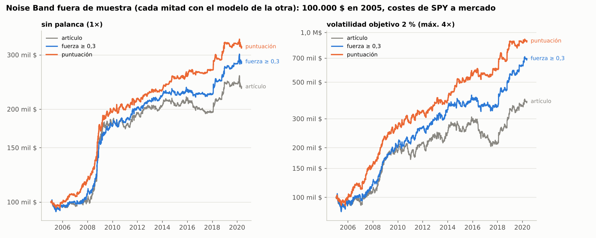
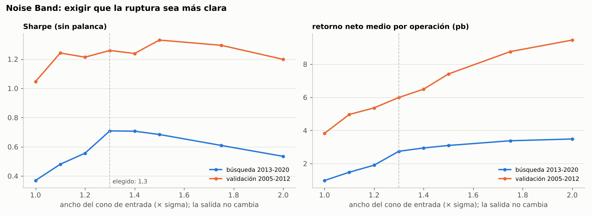
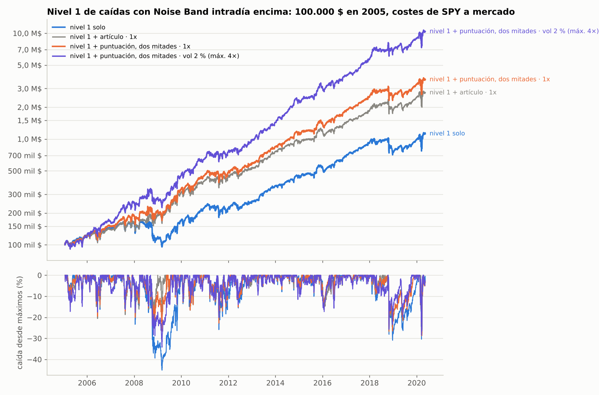

# Noise Band: romper el "cono de ruido" intradía del S&P 500

Cada día nace en la apertura un cono que se abre con las horas: el movimiento "normal" desde
la apertura a esa hora del día. Mientras el precio está dentro, se considera ruido; si lo
rompe, se apuesta a que sigue en esa dirección (momentum intradía). La idea viene de
Zarattini, Aziz y Barbon (2024), "Beat the Market: An Effective Intraday Momentum Strategy
for S&P500 ETF (SPY)", que la llaman *Noise Area*.

> **Dossier para comparar y replicar:** `dossier/DOSSIER.md` (reglas paso a paso, datos en el
> formato común, implementación de referencia `dossier/referencia.py`). Para pasarlo a otro
> chat junto con el de caídas: `research/traspaso/`.

> **Estado (ronda 2, mismos datos y costes): con un filtro y una puntuación de cada ruptura
> mejora de verdad, también fuera de muestra.**
> - **Exigir una ruptura más clara.** Entrar solo si el precio supera la banda en al menos
>   0,3 sigmas (un cono de entrada un 30 % más ancho; la salida, la del artículo): el Sharpe
>   pasa de 0,77 a **1,03** y la peor caída de -12 % a -8,5 %. Es el único indicador que pasa
>   el estudio de rasgos y mejora en la búsqueda y en la validación.
> - **Puntuar cada ruptura con todos los indicadores** (un modelo lineal; cada mitad de la
>   historia se opera con lo aprendido en la otra): Sharpe **1,18**, peor caída **-6,5 %** y
>   5,7 pb netos por operación (el artículo, 2,5). Año a año, como se usaría en real (desde
>   2008), Sharpe 1,22. Con palanca (volatilidad del 2 %, máx. 4×), **15,3 % al año** con una
>   peor caída del -14 % (el artículo: 9,1 % y -34 %).
> - **Qué pesa en la puntuación:** la fuerza de la ruptura, ir a favor del hueco de la noche,
>   el mercado lejos de su máximo anual, ir contra lo que hizo ayer y una volatilidad de 5
>   días baja frente a la de 60. **El volumen casi no aporta.** Un modelo de árboles aprende
>   mucho más dentro de muestra, pero fuera rinde igual que el lineal: sobreajusta.
> - **No funcionaron:** doble tamaño en las caídas, tamaño por volatilidad, salir solo por la
>   banda o solo por la VWAP, más palanca, el momentum de la última media hora y evitar el
>   volumen extremo.
> - **Encima del nivel 1 de caídas** (futuros, peso 1, sin palanca): **26,0 % al año** con
>   una peor caída del -29 % (nivel 1 solo: 16,6 % y -45 %) y **ningún año en pérdidas salvo
>   2018 (-0,2 %)**. Con la palanca de Noise Band, 34,9 % y -34 %.
> - **Solo largo no protege:** rinde la mitad y, encima del nivel 1, en la crisis de 2008 la
>   mezcla cae un -36 % (con largos y cortos, un -11 %).
> - **Evidencia C, en la zona gris del DSR:** Sharpe deflactado de 0,93 contando las 128
>   pruebas y de 0,95-0,96 con las 21 efectivas. La base sigue usando los parámetros del
>   artículo y faltan los datos de 2020 a 2026 para la prueba de verdad.

> **Estado (ronda 1, datos 2005 → may-2020; costes de SPY con órdenes a mercado, ~0,55 pb
> por lado).**
> - **La versión del artículo (largo y corto) es buena, pero no tanto como se publicó.** Con
>   su palanca (volatilidad del 2 %, máximo 4×), desde 2007 da un **11,0 % al año**, con una
>   peor caída del -34 %, frente al 7,5 % de SPY (y su -55 %). Sin palanca, un 6,8 % con una
>   peor caída de solo el -12 % (Sharpe 0,77 frente a 0,50). Gana sobre todo en los pánicos:
>   +60 % en 2008 y +24 % en 2018.
> - **La réplica es correcta.** Con los costes del propio artículo (0,0045 $ por acción de
>   SPY: 0,29 pb por lado de media) sale un 14,1 % al año en 2007-2020, y sin costes, un
>   17,7 %. El ~20 % publicado incluye 2020-2024, que aquí no hay, y supone costes aún más
>   bajos que los de una orden a mercado.
> - **Los costes lo deciden todo:** cada 0,1 pb por lado le quita ~1,4 puntos al año con
>   palanca. Con 1 pb por lado se queda en un 4,6 %; con 2 pb pierde dinero.
> - **Solo largo con stop y objetivo** (la idea original): entre el 1,4 % y el 4 % al año sin
>   palanca y entre el 2 % y el 6,5 % con ella; el stop y el objetivo no ayudan (el objetivo
>   casi nunca se toca) y sin cortos se pierde lo mejor: la ganancia en las crisis.
> - **Dejar correr varios días:** inconsistente (-1,0 % al año en 2005-2012, +5,3 % en
>   2013-2020) y con caídas del -35 % (2008: -26 %).
> - **Como complemento intradía del nivel 1 de caídas** (futuros, sin dormir): correlación
>   mensual de **-0,47**; sube el nivel 1 del 16,6 % al **23,7 %** al año y baja su peor caída
>   del -45 % al **-29 %** (2005 → may-2020). En la crisis de 2008 se queda en -4 % en vez de
>   -42 %; en el Covid no ayudó.
> - **Evidencia C** (marco del dossier): positiva y estable en sus parámetros vecinos, pero
>   los parámetros son los del artículo (elegidos con 2007-2024), depende de costes muy bajos
>   y **faltan datos de 2020 a 2026** para validarla después de su publicación.

## Datos

| Comprobación | Resultado |
|---|---|
| Fuente | repositorio público `FutureSharks/financial-data`: OANDA SPX500_USD (CFD sobre el S&P 500, precio medio), velas de 1 minuto en UTC |
| Periodo | 3-ene-2005 → 13-may-2020: 3.846 sesiones (la red de este entorno no deja descargar fuentes más recientes) |
| Sesión | 9:30-16:00 de Nueva York: 390 velas por día; 95,5 % con cotización, el resto se rellena con el último cierre |
| Días descartados | 23 sin cotización al abrir o con menos de 200 velas (entre ellos el 9 y el 16 de marzo de 2020, con la apertura suspendida) |
| Frente a SPY diario | correlación de 0,988 en la rentabilidad de apertura a cierre y de 0,979 en la de la noche; diferencia media +0,2 pb |
| Frente a HistData (SPXUSD, otra fuente) | correlación de 0,998 (2010-2018) |
| Zona horaria | comprobada con el pico de actividad: 14:30 UTC en invierno y 13:30 en verano (las 9:30 de Nueva York) |
| El cono | movimiento medio desde la apertura: 0,22 % a las 10:00, 0,34 % a las 11:00, 0,50 % a las 14:30 y 0,62 % al cierre |

El CFD sigue a los futuros: en días de pánico su "apertura" es más realista que la oficial
del índice (que mezcla precios viejos de acciones que aún no han abierto).

## Reglas (las del artículo)

Para cada día d y cada minuto k de la sesión:

1. **sigma(d, k)** = media, en las 14 sesiones anteriores, de |precio a esa hora / apertura - 1|.
2. **Banda superior** = max(apertura, cierre anterior) × (1 + sigma); **banda inferior** =
   min(apertura, cierre anterior) × (1 - sigma). Así el cono absorbe el hueco de la noche.
3. **Controles** a las 10:00, 10:30, …, 15:30: si el precio está sobre la banda superior,
   largo; bajo la inferior, corto. Se ejecuta a la apertura del minuto siguiente.
4. **Salida** en un control si el precio vuelve dentro del cono o cruza la VWAP del día (stop
   móvil: para un largo, max(banda superior, VWAP)); todo se cierra al final del día.
5. **Tamaño:** 1× (todo el capital cuando hay posición) o el del artículo: volatilidad objetivo
   del 2 % diario con la de las 14 sesiones anteriores, máximo 4×.
6. **Costes por lado:** base, SPY con órdenes a mercado: 0,0035 $ de comisión + medio céntimo
   de horquilla = 0,0085 $ por acción (SPY cotiza a ~1/10 del índice: 0,25-1,3 pb, 0,55 de
   media). Se prueban también los del artículo (0,0045 $ por acción) y 0-2 pb fijos.

**Variantes solo largo** (la idea original): entrada igual, solo por arriba, y como salida
un stop dentro de la vela en la banda inferior o en el vértice del cono (max(apertura,
cierre anterior)), con o sin objetivo de +2 %, o hasta el cierre. **Dejar correr:** la
posición duerme y se sale cuando el precio rompe el cono por abajo. Todas fijadas de
antemano (`ronda1.py`), sin optimizar nada.

## Resultados sin palanca (costes de SPY a mercado)

| Variante | 2005-2020 | Desde 2007 | Validación 2005-12 | Búsqueda 2013-20 | Mitad 2013-16 | Mitad 2017-20 | Peor caída | Sharpe | Operaciones al año | Acierto |
|---|---|---|---|---|---|---|---|---|---|---|
| Artículo (largo y corto) | 5,8 % | 6,8 % | 9,4 % | 2,1 % | -0,3 % | 5,1 % | -12 % | 0,77 | 237 | 36 % |
| Solo largo, salidas del artículo | 2,8 % | 3,2 % | 4,3 % | 1,3 % | 0,9 % | 1,9 % | -7 % | 0,63 | 116 | 39 % |
| Solo largo, stop en la banda inferior | 1,8 % | 2,6 % | 1,0 % | 2,7 % | 2,8 % | 2,6 % | -13 % | 0,32 | 83 | 54 % |
| Solo largo, stop en el vértice del cono | 2,3 % | 2,8 % | 2,2 % | 2,4 % | 2,2 % | 2,7 % | -8 % | 0,44 | 89 | 45 % |
| Solo largo, stop en la banda inferior y objetivo +2 % | 1,4 % | 2,0 % | 0,3 % | 2,5 % | 2,8 % | 2,2 % | -13 % | 0,26 | 83 | 54 % |
| Solo largo, sin stop, hasta el cierre | 3,2 % | 4,1 % | 4,3 % | 2,0 % | 3,7 % | 0,0 % | -9 % | 0,52 | 82 | 55 % |
| Solo largo, dejar correr (varios días) | 2,2 % | 3,1 % | -1,0 % | 5,3 % | 1,7 % | 9,8 % | -35 % | 0,24 | 46 | 42 % |
| Solo largo, dejar correr con stop en la banda | 0,3 % | 1,1 % | -2,9 % | 3,3 % | 1,5 % | 5,4 % | -25 % | 0,08 | 63 | 46 % |
| Solo largo, stop en la banda, entrada en cualquier minuto | 1,9 % | 2,6 % | 1,6 % | 2,1 % | 2,9 % | 1,2 % | -16 % | 0,28 | 108 | 52 % |
| Solo largo, dejar correr, entrada en cualquier minuto | 2,1 % | 2,8 % | -1,1 % | 5,1 % | 2,3 % | 8,5 % | -46 % | 0,22 | 53 | 43 % |
| Referencia: siempre largo de apertura a cierre | -0,9 % | -0,6 % | -3,6 % | 1,9 % | 3,6 % | -0,0 % | -45 % | 0,01 | — | — |
| Referencia: índice, comprar y mantener (sin dividendos) | 6,0 % | 5,3 % | 2,5 % | 9,3 % | 11,3 % | 6,9 % | -57 % | 0,40 | — | — |
| Referencia: SPY con dividendos | 8,1 % | 7,5 % | 4,7 % | 11,5 % | 13,5 % | 8,9 % | -55 % | 0,50 | — | — |

**Con la palanca del artículo** (volatilidad del 2 %, máximo 4×):

| Variante | 2005-2020 | Desde 2007 | Validación 2005-12 | Búsqueda 2013-20 | Mitad 2013-16 | Mitad 2017-20 | Peor caída | Sharpe |
|---|---|---|---|---|---|---|---|---|
| Artículo (largo y corto) | 9,1 % | **11,0 %** | 11,6 % | 6,6 % | -0,0 % | 15,7 % | -34 % | 0,66 |
| Solo largo, salidas del artículo | 4,8 % | 5,5 % | 5,2 % | 4,4 % | 3,3 % | 6,3 % | -12 % | 0,59 |
| Solo largo, stop en el vértice del cono | 4,3 % | 5,7 % | 2,2 % | 6,7 % | 6,8 % | 6,9 % | -18 % | 0,48 |
| Solo largo, sin stop, hasta el cierre | 4,0 % | 6,5 % | 2,5 % | 5,5 % | 10,4 % | 0,2 % | -29 % | 0,39 |
| Solo largo, dejar correr (varios días) | 0,1 % | 2,4 % | -4,2 % | 3,7 % | -7,2 % | 18,5 % | -51 % | 0,11 |

- Estar siempre comprado **dentro del día** no gana nada: la prima de las acciones se cobra
  de noche. Noise Band sí elige bien cuándo estar dentro, pero su ventaja por operación es
  pequeña (+3,6 pb antes de costes; t de Newey-West de 4,6).
- La versión del artículo pasó cuatro años planos (2013-2016) y gana en los pánicos.

## ¿Fallamos? Por qué el artículo da más (costes, 2007-2020)

| Costes por lado | Artículo 1× | Artículo con su palanca | Peor caída con palanca | Sharpe con palanca | Solo largo, artículo, 1× |
|---|---|---|---|---|---|
| 0 pb | 9,5 % | **17,7 %** | -27 % | 1,18 | 4,5 % |
| 0,2 pb | 8,5 % | 14,9 % | -31 % | 1,02 | 4,0 % |
| 0,3 pb | 8,0 % | 13,6 % | -32 % | 0,94 | 3,8 % |
| 0,5 pb | 7,0 % | 10,9 % | -36 % | 0,78 | 3,3 % |
| 0,75 pb | 5,7 % | 7,7 % | -40 % | 0,57 | 2,7 % |
| 1 pb | 4,5 % | 4,6 % | -47 % | 0,37 | 2,1 % |
| Los del artículo (0,0045 $ por acción, 0,29 pb de media) | 8,1 % | **14,1 %** | -31 % | 0,97 | 3,8 % |
| SPY a mercado (0,0085 $ por acción, 0,55 pb de media) | 6,8 % | **11,0 %** | -34 % | 0,78 | 3,2 % |

1. **La réplica funciona:** las bandas, entradas y salidas coinciden hechas a mano, y con los
   costes del artículo sale un 14,1 % al año en 2007-2020 (17,7 % sin costes).
2. **Los costes del artículo son muy bajos:** 0,001 $ de deslizamiento por acción supone
   casi comprar al precio medio; con una orden a mercado se paga medio céntimo de horquilla.
   Con unas 240 operaciones al año, esa diferencia pesa ~3 puntos al año con palanca.
3. **El periodo:** el artículo llega hasta 2024 e incluye años de mucho movimiento (2020 y
   2022), y aquí los datos terminan en mayo de 2020. Su ~20 % no se puede comprobar sin ellos.
4. **Pequeñas diferencias de ejecución:** aquí se opera el minuto siguiente al control con el
   CFD (que sigue a los futuros) y la VWAP usa el número de cotizaciones como volumen.
5. **Un error mío al principio:** la primera pasada usó 1 pb por lado (el coste de una acción
   suelta, no el de SPY o los futuros), y eso la dejaba en un 4,6 % al año.

## Año a año (costes de SPY a mercado)

| Año | Artículo 1× | Artículo, palanca | Solo largo, artículo | Solo largo hasta el cierre | Solo largo, dejar correr | SPY |
|---|---|---|---|---|---|---|
| 2005 | -3,3 % | -8,8 % | -1,6 % | -4,8 % | -6,7 % | +5,3 % |
| 2006 | +1,7 % | +4,8 % | +2,3 % | -0,1 % | +1,3 % | +15,8 % |
| 2007 | +1,8 % | +11,4 % | +0,6 % | +6,2 % | +7,7 % | +5,1 % |
| 2008 | **+59,9 %** | **+58,3 %** | +15,3 % | +21,0 % | -25,8 % | -36,8 % |
| 2009 | +12,0 % | +13,4 % | +9,7 % | +7,2 % | +16,0 % | +26,4 % |
| 2010 | -2,3 % | -5,9 % | +1,2 % | -0,3 % | +4,7 % | +15,1 % |
| 2011 | +11,2 % | +19,4 % | +0,7 % | +2,7 % | -1,7 % | +1,9 % |
| 2012 | +4,6 % | +11,0 % | +6,8 % | +4,0 % | +2,2 % | +16,0 % |
| 2013 | +0,8 % | +2,9 % | +1,7 % | +6,5 % | +13,9 % | +31,7 % |
| 2014 | +0,9 % | +4,7 % | -1,5 % | -1,6 % | +2,9 % | +14,0 % |
| 2015 | +4,2 % | +15,2 % | +1,7 % | +5,2 % | -4,4 % | +1,2 % |
| 2016 | -6,8 % | -19,7 % | +1,8 % | +5,1 % | -1,2 % | +12,0 % |
| 2017 | -2,8 % | -10,7 % | +1,1 % | +0,8 % | +3,9 % | +21,7 % |
| 2018 | **+23,6 %** | **+60,5 %** | +4,7 % | -4,0 % | +12,5 % | -4,6 % |
| 2019 | +0,3 % | +5,7 % | +1,1 % | +2,5 % | +10,1 % | +31,2 % |
| 2020 (hasta 13-may) | -2,4 % | +5,9 % | -0,9 % | +0,7 % | +6,2 % | -12,0 % |

## Robustez (`robustez.py`; sin palanca, costes de SPY a mercado)

| Prueba | Artículo | Solo largo, artículo | Solo largo hasta el cierre |
|---|---|---|---|
| sigma de 10 / 14 / 20 sesiones | 5,3 / 5,8 / 6,7 % | 3,0 / 2,8 / 3,3 % | 3,7 / 3,2 / 3,3 % |
| Controles cada 15 / 30 / 60 minutos | 3,8 / 5,8 / 4,3 % | 2,1 / 2,8 / 2,2 % | 2,7 / 3,2 / 3,1 % |
| OANDA frente a HistData (2010-2018, días comunes) | 4,0 % / 3,1 % | 2,1 % / 1,7 % | 2,3 % / 2,1 % |

- La ventana de sigma está en meseta; controlar cada 15 minutos multiplica las operaciones y
  los costes; cada 30 (el artículo) es lo mejor.
- Con la otra fuente de datos sale del mismo orden (algo peor: HistData no trae volumen y su
  VWAP pondera igual cada minuto).

## Como complemento del nivel 1 de caídas (`combinar.py`)

El nivel 1 está siempre invertido en acciones. Noise Band se pondría encima con futuros, solo
dentro del día (no duerme, así que no hay palanca por la noche): la rentabilidad de la mezcla
es la del nivel 1 más el peso × la de Noise Band. Ventana 24-ene-2005 → 13-may-2020, con el
calendario del nivel 1 (en los 23 días sin datos intradía Noise Band no opera).

| Mezcla (costes de SPY a mercado) | CAGR | Peor caída | Sharpe | Calmar |
|---|---|---|---|---|
| Nivel 1 solo | 16,6 % | -45 % | 0,74 | 0,37 |
| + Noise Band artículo (largo y corto) 1×, peso 0,5 | 20,2 % | -33 % | 0,86 | 0,60 |
| + Noise Band artículo (largo y corto) 1×, peso 1 | **23,7 %** | **-29 %** | **0,96** | **0,83** |
| + Noise Band artículo con su palanca, peso 1 | 27,8 % | -29 % | 1,02 | 0,96 |
| + solo largo con las salidas del artículo, peso 1 | 19,6 % | -39 % | 0,81 | 0,50 |
| + solo largo hasta el cierre, peso 1 | 19,7 % | -40 % | 0,79 | 0,50 |

- Con los costes del artículo, la mezcla de peso 1 sin palanca llega al 25,2 %; con 1 pb por
  lado, al 21,1 %; con 2 pb, al 15,5 % (por debajo del nivel 1 solo, aunque con mucha menos
  caída).
- La versión con palanca, encima del nivel 1, puede llevar la exposición dentro del día hasta
  5× el capital: es la más rentable sobre el papel y la más exigente de margen.
- La correlación mensual con el nivel 1 es de -0,47 en la versión del artículo y de ~0 en las
  solo largo: **los cortos son los que protegen**.

| Tramo de crisis | Nivel 1 solo | + Noise Band (peso 0,5) | + Noise Band (peso 1) | Noise Band solo (1×) |
|---|---|---|---|---|
| Crisis financiera (oct-07 → mar-09) | -41,7 % | -24,9 % | **-4,0 %** | +61,4 % |
| Flash crash (2010) | -10,6 % | -10,5 % | -10,4 % | +0,1 % |
| Deuda de EE. UU. y del euro (2011) | -15,5 % | -12,1 % | -8,6 % | +7,8 % |
| China y petróleo (2015-16) | +4,7 % | +6,3 % | +7,9 % | +2,9 % |
| Cuarto trimestre de 2018 | -29,0 % | -25,3 % | -21,5 % | +10,0 % |
| Covid (feb-mar 2020) | -26,5 % | -27,6 % | -28,6 % | -2,9 % |

## Conclusiones de la ronda 1

1. **No fallamos en la réplica:** con los costes del artículo da un 14,1 % al año en
   2007-2020 (17,7 % sin costes); el resto de la distancia con lo publicado está en los años
   2020-2024 y en unos costes muy optimistas.
2. **Con costes realistas es una estrategia correcta, no espectacular:** 11 % al año con su
   palanca (SPY: 7,5 %), con menos caída que SPY, ganando en los pánicos y pasando años
   planos en los mercados tranquilos.
3. **La versión solo largo con stop y objetivo no aporta:** quitar los cortos le quita lo
   mejor, y el stop y el objetivo no mejoran la salida al cierre.
4. **Dejar correr varios días** cambia de signo entre ventanas: no es robusto.
5. **Su mejor uso es combinarla:** gana cuando la compra de caídas pierde. Como capa intradía
   con futuros sobre el nivel 1, mejora rentabilidad y caída a la vez, si los costes se
   mantienen por debajo de ~1 pb por lado.

## Ronda 2: más indicadores, con método

La pregunta: ¿se puede hacer Noise Band más rentable con más indicadores (volumen,
volatilidad de los días previos, tendencia, hueco, hora, calendario...) sin engañarnos? Todo
sobre la estrategia del artículo (largo y corto), con costes de SPY a mercado y la misma
partición: **búsqueda** 2013 → may-2020 (y sus mitades 2013-2016 y 2017-2020) para elegir y
**validación** 2005-2012 para comprobar.

### 1. Qué separa las rupturas buenas de las malas (`rasgos.py`, `eventos.py`)

En cada control (10:00, 10:30, ..., 15:30) se miden 24 rasgos con lo que se sabe en ese
momento, orientados al lado de la operación:

| Grupo | Rasgos |
|---|---|
| La ruptura | fuerza (cuántas sigmas pasa de la banda), movimiento desde la apertura, distancia a la VWAP, rango del día, hora |
| La noche | hueco (apertura frente al cierre de ayer), con signo y en valor absoluto |
| Días previos | volatilidad de 5, 14 y 60 días y su cociente; cono de 14 frente a 60 sesiones; caída desde el máximo de un año; distancia a la SMA50 y a la SMA200; rentabilidad de ayer (cierre a cierre y apertura a cierre) |
| Volumen | volumen del día y de la última media hora frente al de los 14 días anteriores a esa hora; volatilidad de los minutos de la última media hora |
| Calendario | día de la semana, vencimiento (tercer viernes), primera y última sesión del mes |

Las operaciones pierden poco muchas veces y ganan mucho pocas (acierto del 36 %), así que se
mide el **retorno medio**: la pendiente del retorno neto sobre el percentil del rasgo (≈ lo
que gana de más el valor más alto frente al más bajo), con errores agrupados por mes, y un FDR
del 10 % sobre las 26 pruebas. Se elige un rasgo si pasa el FDR en la búsqueda y tiene el
mismo signo en sus dos mitades.

| Rasgo (orientado al lado) | Búsqueda: pb (t) | 2013-16 / 2017-20 | Validación: pb (t) | ¿Elegido? |
|---|---|---|---|---|
| **fuerza de la ruptura** | **+7,9 (2,96)** | +5,7 / +10,1 | **+11,6 (2,51)** | **sí, el único** |
| tamaño del hueco | +6,2 (2,15) | +7,7 / +2,6 | +9,4 (2,01) | no (no pasa el FDR) |
| ayer, de apertura a cierre, a favor | -4,9 (-1,78) | -8,5 / -0,4 | -12,4 (-2,32) | no |
| hueco a favor | +4,6 (1,36) | +7,1 / 0,0 | +22,2 (3,96) | no |
| cercanía al máximo anual | -3,4 (-1,03) | -0,1 / -4,9 | -17,1 (-3,33) | no |
| volumen de la última media hora | -1,0 (-0,34) | -1,5 / -0,2 | +0,6 (0,18) | no |

- **Fuerza** por quintiles: de -2,5 a +3,8 pb por operación en la búsqueda y de +2,2 a +11,4
  pb en la validación.
- **Volumen, rango y volatilidad de los minutos** tienen forma de U invertida (el quintil más
  alto es el peor en las dos ventanas), pero como filtro no aguantan (apartado 2).

### 2. Variantes fijadas de antemano (`ronda2.py`)

Sin palanca, largo y corto. Una variante es **elegible** si mejora a la base en la búsqueda y
en sus dos mitades, por CAGR (lo fijado al principio) y por Sharpe (la CAGR premia a quien
solo añade exposición); la validación solo se mira. La t es la de la diferencia de Sharpe con
la base en la validación (Ledoit y Wolf, 2008).

| Variante | Origen | Sharpe búsqueda (2013-16 / 2017-20) | Sharpe validación (t) | CAGR 2005-20 | Peor caída | ¿Elegible? |
|---|---|---|---|---|---|---|
| Artículo (base) | — | 0,37 (-0,03 / 0,76) | 1,05 | 5,8 % | -11,8 % | — |
| **Fuerza ≥ p50 (0,30 sigmas)** | estudio de rasgos | **0,72 (0,29 / 1,10)** | **1,25 (1,36)** | 7,0 % | -8,5 % | **sí** |
| Fuerza ≥ p40 / ≥ p60 | estudio de rasgos | 0,52 / 0,68 | 1,19 / 1,29 | 6,4 / 6,8 % | -9,7 / -8,6 % | sí |
| Tamaño por fuerza (0,5× / 1,5×) | estudio de rasgos | 0,69 (0,21 / 1,12) | 1,20 (1,01) | 9,3 % | -13,9 % | sí |
| Doble tamaño con el mercado ≥ 5 % bajo su máximo | literatura | 0,24 (-0,14 / 0,54) | 1,10 (0,72) | 10,0 % | -18,0 % | no |
| Tamaño por volatilidad relativa | literatura | 0,32 (-0,15 / 0,66) | 0,98 (-0,54) | 8,3 % | -18,0 % | no |
| Momentum de la última media hora, sola | literatura | 0,19 (0,62 / -0,06) | 0,80 | 3,2 % | -19,0 % | no |
| Base + última media hora | literatura | 0,36 (0,26 / 0,45) | 1,13 (0,40) | 9,0 % | -18,4 % | no |
| A favor del hueco | vista en la validación | 0,54 (0,50 / 0,62) | 1,54 (2,47) | 7,4 % | -8,7 % | no (falla 2017-20) |
| Fuerza ≥ p50 y a favor del hueco | vista en la validación | 0,83 (0,76 / 0,92) | 1,68 (2,84) | 7,8 % | -8,7 % | sí, pero su validación no es limpia |
| Sin volumen extremo / sin minutos agitados | mirado en las dos ventanas | 0,53 / 0,53 | 1,15 / 1,14 | 6,5 / 6,3 % | -8,3 / -9,3 % | no (fallan 2017-20) |
| Salir solo por la banda | salidas | 0,40 (0,11 / 0,70) | 1,07 (0,46) | 6,1 % | -11,6 % | no |
| Salir solo por la VWAP | salidas | 0,55 (0,10 / 1,00) | **0,61 (-2,47)** | 4,7 % | -13,5 % | sí... y se hunde en la validación |

- **Salir solo por la VWAP** es el aviso de por qué hace falta validar: mejora en la búsqueda
  y en sus dos mitades, y en la validación pierde casi la mitad del Sharpe.
- **El momentum de la última media hora** (Gao et al., 2018) se ha apagado: en 2017-2020 ya no
  gana.
- **Palanca:** con el artículo, subir el máximo de 2× a 4× baja el Sharpe (0,75 → 0,66) y
  lleva la peor caída de -22 % a -34 %.
- **Solo largo:** las mismas mejoras (con la fuerza, Sharpe de 0,63 a 0,87), sobre una base que
  rinde la mitad.

### 3. Todos los indicadores a la vez (`modelos.py`)

Un modelo aprende, con las operaciones de una ventana, qué retorno esperar de cada ruptura
según los 25 rasgos (los 24 y el lado); en la otra ventana, que no ha visto, se entra solo si
la predicción supera su mediana en el entrenamiento. **Lineal** = ridge sobre los percentiles,
con la penalización elegida dejando fuera un año cada vez; **árboles** = gradient boosting de 3
niveles. Sharpe sin palanca:

| Modelo (filtro) | Entrena 2013-20 → prueba 2005-12 | Entrena 2005-12 → prueba 2013-20 | Sharpe dentro de muestra (las dos) |
|---|---|---|---|
| Sin filtro (artículo) | 1,05 | 0,37 | — |
| Un rasgo: fuerza | 1,25 | 0,72 | 0,72 / 1,21 |
| **Lineal, todos los rasgos** | **1,39** | **0,91** | 0,93 / 1,94 |
| Árboles, todos los rasgos | 1,38 | 0,87 | 1,96 / 2,52 |
| Lineal, sin la fuerza | 1,48 | 0,87 | 0,93 / 1,78 |
| Árboles, sin la fuerza | 1,38 | 0,55 | 1,96 / 2,74 |

- **Meter más indicadores ayuda, en las dos direcciones:** el lineal saca +0,14 y +0,20 de
  Sharpe a la fuerza sola (y +0,34 y +0,54 al artículo).
- **Los árboles sobreajustan:** dentro de muestra llegan a Sharpe 2-2,7 y fuera rinden como el
  lineal o peor.
- **Sin la fuerza también funciona:** el resto de indicadores tiene información propia, sobre
  todo el hueco y lo que hizo el mercado ayer.
- Usar la predicción para el tamaño (1,5× / 0,5×) en vez de para filtrar da más CAGR, pero
  menos Sharpe y más caída.

Qué usa la puntuación final (entrenada con 2005 → may-2020; pb de retorno neto esperado entre
el percentil más bajo y el más alto de cada rasgo, con el resto igual):

| Rasgo | pb | Lectura |
|---|---|---|
| hueco a favor | +5,1 | operar en la dirección del hueco de la noche |
| fuerza de la ruptura | +5,0 | rupturas más claras |
| cercanía al máximo anual | -3,7 | mejor con el mercado en caída |
| ayer, de apertura a cierre, a favor | -3,5 | mejor si ayer fue en contra |
| volatilidad de 5 días / de 60 | -2,1 | mejor con la volatilidad reciente baja |
| tamaño del hueco | +2,0 | mejor con huecos grandes |
| día de la semana | -1,9 | algo mejor al principio de la semana |
| distancia a la SMA200, a favor | -1,7 | algo contraria a la tendencia larga |
| volumen del día / de la media hora / minutos agitados | +0,5 / +0,1 / -1,1 | casi nada |

### 4. Las versiones, siempre fuera de muestra (`elegida.py`)

- **Fuerza ≥ 0,3:** la regla simple, sin modelo. El 0,3 es la mediana de la fuerza de las
  rupturas en las dos ventanas (0,30 y 0,31).
- **Puntuación, dos mitades:** 2005-2012 con el modelo entrenado en 2013-2020 y al revés (es
  validación cruzada: la primera mitad no se habría podido operar así).
- **Puntuación, año a año:** cada año con el modelo entrenado con todos los anteriores, desde
  2008: como se operaría en real.

| Versión (largo y corto) | Tamaño | CAGR | Peor caída | Sharpe | Validación / búsqueda | Operaciones al año | pb netos por operación | t frente al artículo |
|---|---|---|---|---|---|---|---|---|
| Artículo | 1× | 5,8 % | -11,8 % | 0,77 | 1,05 / 0,37 | 239 | 2,5 | — |
| Fuerza ≥ 0,3 | 1× | 7,1 % | -8,5 % | 1,03 | 1,26 / 0,71 | 158 | 4,5 | 2,5 |
| **Puntuación, dos mitades** | 1× | **7,9 %** | **-6,5 %** | **1,18** | 1,39 / 0,91 | 137 | 5,7 | 3,0 |
| Puntuación, año a año (desde 2008) | 1× | 8,2 % | -7,1 % | 1,22 | — | 137 | 6,0 | 2,1 |
| Artículo | vol 2 % (máx. 4×) | 9,1 % | -33,9 % | 0,66 | 0,80 / 0,51 | 239 | 2,5 | — |
| Fuerza ≥ 0,3 | vol 2 % (máx. 4×) | 13,5 % | -22,3 % | 1,00 | 1,09 / 0,91 | 158 | 4,5 | 3,4 |
| **Puntuación, dos mitades** | vol 2 % (máx. 4×) | **15,3 %** | **-14,2 %** | **1,20** | 1,33 / 1,06 | 137 | 5,7 | 3,7 |
| Puntuación, año a año (desde 2008) | vol 2 % (máx. 4×) | 14,9 % | -16,7 % | 1,23 | — | 137 | 6,0 | 2,7 |
| Solo largo: artículo / fuerza / puntuación | 1× | 2,8 / 3,4 / 3,4 % | -7,0 / -3,7 / -3,6 % | 0,63 / 0,87 / 0,83 | — | 117 / 74 / 68 | 2,5 / 4,6 / 5,0 | — |



| Año | Artículo 1× | Fuerza ≥ 0,3 1× | Puntuación 1× | Puntuación vol 2 % (máx. 4×) |
|---|---|---|---|---|
| 2005 | -3,3 % | -3,5 % | -0,6 % | -2,1 % |
| 2006 | +1,7 % | +3,8 % | +6,1 % | +20,3 % |
| 2007 | +1,8 % | +5,5 % | +11,1 % | +31,8 % |
| 2008 | +59,9 % | +47,8 % | +50,2 % | +49,6 % |
| 2009 | +12,0 % | +13,3 % | +11,5 % | +14,9 % |
| 2010 | -2,3 % | +2,8 % | +1,7 % | +6,5 % |
| 2011 | +11,2 % | +11,7 % | +8,6 % | +18,5 % |
| 2012 | +4,6 % | +5,0 % | +4,9 % | +11,5 % |
| 2013 | +0,8 % | +3,7 % | +1,6 % | +3,3 % |
| 2014 | +0,9 % | +2,3 % | +9,4 % | +29,5 % |
| 2015 | +4,2 % | +2,1 % | +1,7 % | +10,2 % |
| 2016 | -6,8 % | -2,8 % | +2,4 % | +1,5 % |
| 2017 | -2,8 % | -0,6 % | +1,8 % | +6,8 % |
| 2018 | +23,6 % | +21,5 % | +21,1 % | +45,9 % |
| 2019 | +0,3 % | +3,6 % | -0,0 % | -1,1 % |
| 2020 (hasta 13-may) | -2,4 % | +1,3 % | -1,8 % | +2,7 % |

**Ancho del cono de entrada** (fuerza mínima de 0 a 1 sigma, la salida igual): en la
validación, cualquier ancho de 1,1 a 2 sigmas mejora el Sharpe (de 1,05 a 1,20-1,33); en la
búsqueda, el máximo está en 1,3-1,4 (0,71 frente a 0,37). Cuanto más ancho, más gana cada
operación, pero hay menos. Es una meseta, no un pico.



**Robustez** (Sharpe 2005-2020, sin palanca):

| Prueba | Artículo | Fuerza ≥ 0,3 | Puntuación |
|---|---|---|---|
| Base | 0,77 | 1,03 | 1,18 |
| Sigma de 10 / 20 sesiones | 0,72 / 0,89 | 0,93 / 1,11 | 1,08 / 1,26 |
| Costes del artículo (0,29 pb por lado) | 0,93 | 1,14 | 1,30 |
| Costes de 1 pb por lado (casi ×2) | 0,49 | 0,82 | 1,03 |
| Corte del modelo en el 40 % / 60 % | — | — | 1,09 / 1,36 |
| Penalización del ridge ×10 / ÷10 | — | — | 1,21 / 1,24 |

Como opera menos y gana más por operación, la puntuación aguanta mucho mejor los costes: con
1 pb por lado conserva un Sharpe de 1,03 (el artículo cae a 0,49).

**Otros índices** (`indices.py`): las mismas reglas en el Nasdaq-100 y el Russell 2000 (OANDA,
mismo periodo), con la puntuación aprendida **solo con operaciones del S&P 500** y en dos
mitades: fuera de muestra por índice y por fechas. Sharpe sin palanca, 0,55 pb por lado:

| Índice | Artículo | Fuerza ≥ 0,3 | Puntuación del S&P 500 |
|---|---|---|---|
| S&P 500 | 0,77 | 1,03 | 1,19 |
| Nasdaq-100 | 0,44 | 0,59 | 0,74 |
| Russell 2000 | 0,56 | 0,48 | 0,92 |
| Los tres a partes iguales | 0,67 | 0,78 | 1,11 |

La puntuación del S&P 500 también mejora dos índices que nunca vio: lo que aprende no es ruido
de un índice. Aun así, ninguno de los dos supera al S&P 500 y mezclar los tres no mejora al
S&P 500 solo. Con el coste por acción de QQQ (caro en 2005-2009), el Nasdaq-100 se queda en
0,02 / 0,28 / 0,45.

**Sharpe deflactado** (128 pruebas distintas de las rondas 1 y 2; 21 grupos con correlación
> 0,9, la regla del repo):

| Versión | Sharpe | DSR con 128 pruebas | DSR con 21 efectivas |
|---|---|---|---|
| Artículo 1× | 0,77 | 0,40 | 0,48 |
| Fuerza ≥ 0,3 1× | 1,03 | 0,79 | 0,84 |
| Puntuación, dos mitades 1× | 1,18 | 0,93 | 0,95 |
| Puntuación, año a año 1× (desde 2008) | 1,22 | 0,94 | 0,96 |
| Puntuación, dos mitades, vol 2 % | 1,20 | 0,94 | 0,96 |

El Sharpe que cabría esperar del mejor de tantos intentos por puro azar es de 0,79-0,83. La
puntuación lo supera con un 93-96 % de confianza: **zona gris** (con N efectivo aprueba, con N
bruto no), así que no se promociona hasta verla con datos nuevos.

### 5. Encima del nivel 1 de caídas

Como en `combinar.py`: nivel 1 siempre invertido en acciones y Noise Band encima con futuros,
solo dentro del día; calendario del nivel 1 (24-ene-2005 → 13-may-2020).

| Mezcla (peso 1 salvo que se diga) | CAGR | Peor caída | Sharpe | Calmar | Correlación mensual |
|---|---|---|---|---|---|
| Nivel 1 solo | 16,6 % | -45,1 % | 0,74 | 0,37 | — |
| + artículo 1× | 23,7 % | -28,6 % | 0,96 | 0,83 | -0,47 |
| + fuerza ≥ 0,3 1× | 25,1 % | -28,9 % | 1,01 | 0,87 | -0,43 |
| + puntuación 1×, peso 0,5 | 21,3 % | -36,4 % | 0,90 | 0,59 | -0,39 |
| **+ puntuación 1×** | **26,0 %** | **-28,7 %** | **1,04** | **0,91** | -0,39 |
| + artículo vol 2 % (máx. 4×) | 27,8 % | -28,8 % | 1,02 | 0,97 | -0,37 |
| + fuerza ≥ 0,3 vol 2 % | 32,8 % | -31,6 % | 1,17 | 1,04 | -0,32 |
| **+ puntuación vol 2 %** | **34,9 %** | -34,2 % | **1,25** | 1,02 | -0,32 |
| + puntuación solo largo 1× | 20,3 % | -40,4 % | 0,84 | 0,50 | -0,09 |
| Desde 2008: nivel 1 solo / + puntuación año a año 1× / + vol 2 % | 17,0 / 26,7 / 34,8 % | -45 / -32 / -35 % | 0,74 / 1,03 / 1,23 | — | — |

| Tramo de crisis | Nivel 1 solo | + artículo 1× | + puntuación 1× | + puntuación solo largo 1× | + puntuación vol 2 % |
|---|---|---|---|---|---|
| Crisis financiera (oct-07 → mar-09) | -41,7 % | -4,0 % | -10,8 % | -36,0 % | -12,1 % |
| Flash crash (2010) | -10,6 % | -10,4 % | -11,0 % | -11,2 % | -6,9 % |
| Deuda de EE. UU. y del euro (2011) | -15,5 % | -8,6 % | -13,4 % | -17,9 % | -10,1 % |
| China y petróleo (2015-16) | +4,7 % | +7,9 % | +10,6 % | +7,0 % | +21,2 % |
| Cuarto trimestre de 2018 | -29,0 % | -21,5 % | -21,4 % | -29,7 % | -10,6 % |
| Covid (feb-mar 2020) | -26,5 % | -28,6 % | -27,6 % | -24,7 % | -25,7 % |

- Con la puntuación 1× encima, **ningún año en pérdidas salvo 2018 (-0,2 %)**; el nivel 1 solo
  perdió en 2008 (-26,8 %), 2011 (-2,8 %) y 2018 (-18,2 %).
- La puntuación protege algo menos que el artículo en 2008 (opera menos), pero rinde más el
  resto del tiempo.
- **Los cortos son los que protegen:** la versión solo largo no se mueve en contra del nivel 1
  (correlación -0,09) y en 2008 apenas ayuda.



### 6. Cómo se operaría (puntuación)

1. Cada día, con velas de 1 minuto de ES/MES: sigma de cada minuto (media de |precio /
   apertura - 1| a esa hora en las 14 sesiones anteriores), bandas y VWAP, como en el
   artículo.
2. En cada control (10:00, 10:30, ..., 15:30), sin posición y con el precio fuera del cono,
   calcular los 25 rasgos del lado de la ruptura (los marcados "con signo" se multiplican por
   +1 si es largo y por -1 si es corto) y pasarlos a su percentil con
   `resultados/puntuacion_percentiles.csv`.
3. Puntuación = 2,01 + Σ coeficiente × (percentil - 0,5), con los coeficientes de
   `resultados/puntuacion_coeficientes.csv`. **Entrar solo si la puntuación es ≥ 1,90 pb**;
   si no, esperar al siguiente control.
4. Salida del artículo: stop móvil en max(banda superior, VWAP) para los largos y min(banda
   inferior, VWAP) para los cortos, mirado en cada control; todo cerrado al cierre.
5. Tamaño: 1× el capital, o volatilidad objetivo del 2 % con máximo 4× (más rentable y más
   exigente de margen; encima del nivel 1, la exposición dentro del día llega a 5×).
6. Cada enero, reentrenar el modelo con todas las operaciones hasta la fecha
   (`elegida.puntuacion_final`).
7. Sin modelo: entrar solo si el precio supera la banda en al menos 0,3 sigmas.

Encima del nivel 1 se haría con futuros (MES/ES): ni ETFs ni efectivo parado. La posición no
duerme, así que basta el margen intradía, que es pequeño; sus costes (~0,4-0,6 pb por lado
con orden a mercado) son del orden de los de la base.

### 7. Conclusiones de la ronda 2

1. **Sí hay una versión más rentable y más estable**, y lo es fuera de muestra: la puntuación
   sube el Sharpe de 0,77 a 1,18-1,22, reduce la peor caída a la mitad y gana el doble por
   operación.
2. **El indicador que más vale es el más simple:** la fuerza de la ruptura (entrar con el cono
   1,3 veces más ancho). El resto (hueco, lo que hizo ayer, caída del mercado, volatilidad
   reciente) suma algo más; **el volumen casi nada**. Lo aprendido en el S&P 500 también
   mejora el Nasdaq-100 y el Russell 2000.
3. **Más complejidad no es mejor:** los árboles sobreajustan, y dar tamaño por la puntuación
   rinde menos por riesgo que usarla como filtro.
4. **Casi todo lo demás falla al validarlo** (salidas, palanca, tamaño por régimen, última
   media hora): la mayoría de ideas que mejoran en la búsqueda no aguantan.
5. **Su sitio sigue siendo encima del nivel 1**, con largos y cortos: 26,0 % al año con una
   peor caída del -29 % sin palanca en Noise Band.
6. **Pendiente:** la prueba con datos de 2020 a 2026, sin la que no pasa de evidencia C.

## Siguientes pasos

1. **Datos de jun-2020 a oct-2026** (futuros ES/MES o SPY en velas de 1 minuto): son la prueba
   de verdad de la puntuación y de la fuerza, con el modelo ya congelado. Esta sesión no puede
   descargarlos: hace falta permitir un dominio de datos en la red del entorno (por ejemplo,
   `datafeed.dukascopy.com`) o subir los archivos.
2. **Probar en papel** la puntuación con MES encima del nivel 1, con los costes reales de
   futuros (tick de 0,25 puntos y comisión) y la ejecución al precio del control.
3. **Decidir si se aceptan cortos** (con futuros): son los que dan la protección.
4. **Decidir la palanca:** 1× (26,0 % y -29 % encima del nivel 1) o volatilidad del 2 % (34,9 % y
   -34 %, exposición dentro del día de hasta 5×).
5. Añadirla al marco del dossier como capa intradía (`NB_PUNT` y `NB_F03`) para el otro chat.

## Reproducir

```bash
python research/noise_band/datos.py      # clona los datos (≈330 MB) y prepara la sesión regular
python research/noise_band/ronda1.py     # variantes, costes y ventanas
python research/noise_band/costes.py     # comparación fina de costes con el modelo del artículo
python research/noise_band/robustez.py   # sigma, controles y otra fuente
python research/noise_band/combinar.py   # como complemento del nivel 1 (usa research/caidas/dossier/datos/diario.csv)
# ronda 2
python research/noise_band/rasgos.py     # 24 rasgos en cada control
python research/noise_band/eventos.py    # qué rasgos separan las buenas rupturas de las malas
python research/noise_band/ronda2.py     # variantes fijadas de antemano
python research/noise_band/modelos.py    # todos los indicadores a la vez, fuera de muestra
python research/noise_band/elegida.py    # versiones elegidas: cono, robustez, DSR, encima del nivel 1 y puntuación para operar
python research/noise_band/indices.py    # las mismas reglas en el Nasdaq-100 y el Russell 2000
# dossier para otros chats
python research/noise_band/dossier.py    # datos del dossier en el formato común (dossier/datos/)
python research/noise_band/verificar_referencia.py   # la implementación de referencia frente al motor
python research/traspaso/empaquetar.py   # zip con los dossiers de caídas y Noise Band
```

El motor (`motor.py`, numba) tarda ~6 ms por backtest de 15 años en velas de 1 minuto.
