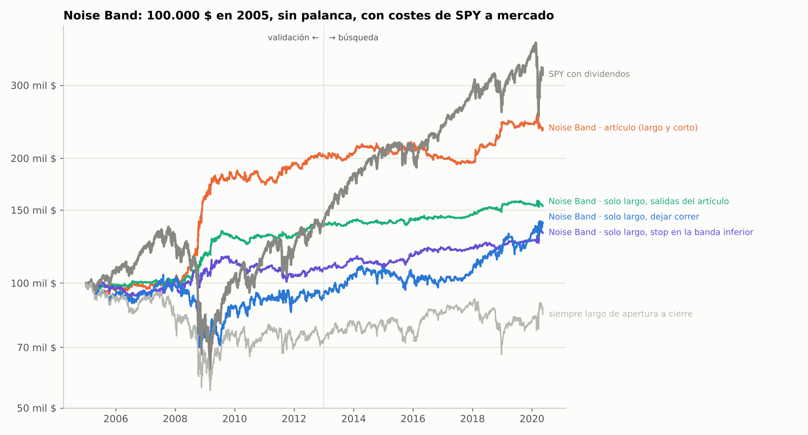

# Dossier · Noise Band: momentum intradía del S&P 500

**Qué es esto.** Todo lo necesario para llevarse Noise Band a otro sitio, replicarla y
compararla con otras estrategias bajo las mismas reglas: qué hace cada versión (reglas
exactas, paso a paso), por qué, cómo llegamos a ella, qué resultados da con las métricas del
dossier de caídas, qué falló y qué queda por hacer.

- Datos intradía del **3-ene-2005 al 13-may-2020** (la red de este entorno no deja descargar
  datos más recientes). Dossier generado el 27-oct-2026.
- Código: rama `claude/trading-earnings-reports-p6qt2c`, carpeta `research/noise_band/`. Los
  datos de esta carpeta se regeneran con `python research/noise_band/dossier.py`.
- Todas las cifras son **simuladas** (backtest), netas de costes y sin impuestos.
- Es el complemento del **dossier de caídas** (`research/caidas/dossier/DOSSIER.md`): usa su
  marco (métricas de su sección 2.3, niveles de evidencia de la 2.4, formato de datos de la
  2.7). Aquí se dice en qué cambia.

## Índice

0. [Cómo usar este dossier](#0-cómo-usar-este-dossier)
1. [Resumen en un minuto](#1-resumen-en-un-minuto)
2. [Convenciones y diferencias con el marco de caídas](#2-convenciones-y-diferencias-con-el-marco-de-caídas)
3. [Teoría: por qué funciona y cuándo falla](#3-teoría-por-qué-funciona-y-cuándo-falla)
4. [Reglas replicables](#4-reglas-replicables)
5. [Resultados en el marco común](#5-resultados-en-el-marco-común)
6. [Cómo llegamos aquí: historia por rondas](#6-cómo-llegamos-aquí-historia-por-rondas)
7. [Lo que no funcionó](#7-lo-que-no-funcionó)
8. [Lecciones de método](#8-lecciones-de-método)
9. [Cómo juntarla con otras estrategias](#9-cómo-juntarla-con-otras-estrategias)
10. [Próximos pasos](#10-próximos-pasos)
11. [Reproducir](#11-reproducir)
12. [Glosario](#12-glosario)

---

## 0. Cómo usar este dossier

**Archivos** (todo en esta carpeta):

| Archivo | Contenido |
|---|---|
| `DOSSIER.md` | este documento |
| `datos/diario.csv` | rentabilidad **diaria** neta de las 11 versiones de Noise Band (`NB_*`), de 8 mezclas con el nivel 1 de caídas (`CAI_N1_NB_*`) y de `CAI_N1` y `SPY`, en las sesiones de NYSE del 21-ene-2005 al 13-may-2020 |
| `datos/mensual.csv`, `datos/anual.csv` | rentabilidad por mes y por año natural |
| `datos/metricas.csv` | métricas estándar del marco común (sección 2.3 del dossier de caídas) en las ventanas de la sección 2.2 de este |
| `datos/crisis.csv` | rentabilidad en los tramos de crisis del dossier de caídas que caen dentro de estos datos |
| `datos/correlaciones_mensuales.csv` | correlaciones mensuales entre todas |
| `datos/exposicion_diaria.csv` | para cada versión y día: fracción de la sesión con posición y palanca usada |
| `datos/operaciones.csv` | **cada operación** de `NB_ART`, `NB_F03`, `NB_PUNT`, `NB_PUNT_VOL` y `NB_PUNT_AA`: fecha, hora de decisión, de entrada y de salida, lado, precios, palanca y retorno neto (para comprobar una réplica) |
| `datos/entrenamiento.csv` | las 3.627 operaciones del artículo con sus 25 rasgos y su retorno: con esto se rehace el modelo de la puntuación |
| `datos/puntuacion_coeficientes.csv` | el modelo para operar: coeficiente de cada rasgo, constante, corte y penalización |
| `datos/puntuacion_percentiles.csv` | percentiles 0-100 de cada rasgo en el entrenamiento (para aproximar el paso a percentil sin `entrenamiento.csv`) |
| `datos/ejemplo_puntuacion.csv` | dos rupturas reales calculadas paso a paso (una entra y otra no) |
| `datos/estrategias.json` | convenciones y métricas de cada versión en formato máquina |
| `referencia.py` | **implementación de referencia** en Python legible (numpy y pandas), escrita solo con la sección 4 de este dossier: lee velas de 1 minuto de un CSV y da las operaciones de `NB_ART`, `NB_F03` o `NB_PUNT`; también reentrena la puntuación |
| `graficas/` | curvas de valor y caídas: ronda 1 (`curvas.png`, `combinar.png`) y ronda 2 (`ronda2_curvas.png`, `ronda2_cono.png`, `ronda2_combinar.png`) |

**Cómo comprobar que se ha entendido.** Una réplica correcta debe (1) dar la misma lista de
operaciones de `NB_ART` que `datos/operaciones.csv` con los mismos datos, (2) reproducir los
dos ejemplos de `datos/ejemplo_puntuacion.csv` y (3) dar una rentabilidad diaria con
correlación > 0,99 con la columna de `datos/diario.csv`.

**Comprobado:** `referencia.py`, escrito solo con las reglas de la sección 4, da con los datos
del estudio **las mismas 3.627 operaciones de `NB_ART` y las mismas 2.410 de `NB_F03`**
(fecha, hora, lado y precio; rentabilidad diaria con correlación 1,000000), los 25 rasgos de
los dos ejemplos sin ninguna diferencia, el 99,9 % de las operaciones de la puntuación (2.126
de 2.129: las otras quedan justo en el corte por el redondeo de los CSV) y los mismos
coeficientes al reentrenar (diferencias < 0,001 pb).

---

## 1. Resumen en un minuto

**La idea.** Cada día nace en la apertura un **cono** que se abre con las horas: el
movimiento "normal" del S&P 500 desde la apertura a esa hora del día (la media de las 14
sesiones anteriores). Mientras el precio está dentro, se considera ruido. Si a una hora en
punto o y media (de 10:00 a 15:30) el precio sale del cono, se apuesta a que sigue en esa
dirección: **largo si sale por arriba, corto si sale por abajo**. Se sale si vuelve dentro
del cono o cruza la VWAP del día, y **todo se cierra al cierre**: nunca duerme. Viene de
Zarattini, Aziz y Barbon (2024), que la llaman *Noise Area*; aquí se llama Noise Band.

**Lo que añadimos (ronda 2), siempre fuera de muestra:**

- **Fuerza ≥ 0,3** (`NB_F03`): entrar solo si el precio pasa la banda en al menos 0,3
  sigmas, es decir, con un cono de entrada 1,3 veces más ancho. La salida no cambia.
- **Puntuación** (`NB_PUNT`): cada ruptura recibe una puntuación con 25 indicadores (fuerza,
  hueco de la noche, volatilidad de los días previos, caída desde máximos, lo que hizo el
  mercado ayer, volumen, calendario...) y solo se entra si supera un corte.

**Versiones** (largo y corto salvo `_L`; costes de SPY a mercado; 2005 → may-2020):

| ID | Versión | CAGR | Peor caída | Sharpe | Calmar | Veredicto |
|---|---|---|---|---|---|---|
| `NB_ART` | artículo, 1× | 5,8 % | -11,8 % | 0,77 | 0,49 | base de comparación |
| `NB_ART_VOL` | artículo, volatilidad 2 % (máx. 4×) | 9,1 % | -33,9 % | 0,66 | 0,27 | no: la palanca empeora el riesgo |
| `NB_F03` | fuerza ≥ 0,3, 1× | 7,1 % | -8,5 % | 1,02 | 0,83 | **sí, versión simple** |
| `NB_F03_VOL` | fuerza ≥ 0,3, volatilidad 2 % | 13,5 % | -22,3 % | 1,00 | 0,61 | quizás |
| `NB_PUNT` | puntuación, 1× | **7,9 %** | **-6,5 %** | **1,18** | **1,22** | **sí, la mejor** |
| `NB_PUNT_VOL` | puntuación, volatilidad 2 % (máx. 4×) | **15,3 %** | -14,2 % | **1,20** | 1,08 | **sí, si se acepta palanca** |
| `NB_PUNT_AA` | puntuación reentrenada año a año, 1× (desde 2008) | 8,2 % | -7,1 % | 1,22 | 1,16 | la forma real de operarla |
| `NB_PUNT_L` | puntuación, solo largo, 1× | 3,4 % | -3,6 % | 0,83 | 0,93 | no: sin cortos no protege |
| `CAI_N1` | nivel 1 de caídas (referencia) | 16,6 % | -45,1 % | 0,74 | 0,37 | |
| `CAI_N1_NB_PUNT` | **nivel 1 + `NB_PUNT` encima (peso 1)** | **26,0 %** | **-28,7 %** | **1,04** | **0,91** | **sí: la cartera recomendada** |
| `CAI_N1_NB_PUNT_VOL` | nivel 1 + `NB_PUNT_VOL` encima | 34,9 % | -34,2 % | 1,25 | 1,02 | quizás (exposición dentro del día de hasta 5×) |
| `SPY` | referencia | 8,1 % | -55,2 % | 0,49 | 0,15 | |

**Lo que hay que saber antes de fiarse:**

- **Los datos acaban en mayo de 2020.** Falta la prueba de verdad: 2020-2026, y además
  después de que se publicara el artículo (2024).
- **Fuera de muestra de verdad:** las mejoras de la ronda 2 se miden siempre en años que el
  modelo no vio (dos mitades: 2005-2012 con lo aprendido en 2013-2020 y al revés; o año a
  año desde 2008). Pero los parámetros de la base (14 sesiones, controles cada 30 minutos,
  salida por VWAP) son los del artículo, que los eligió con 2007-2024: para la base no hay
  ventana limpia.
- **Sharpe deflactado en zona gris:** 0,93 contando las 128 pruebas como independientes y
  0,95-0,96 con las 21 efectivas. **Evidencia C** (prometedora).
- **Hacen falta cortos** (con futuros): son los que ganan en las crisis. La versión solo
  largo rinde la mitad y no protege.
- **Los costes lo deciden todo:** con 1 pb por lado, el artículo cae a un Sharpe de 0,49; la
  puntuación, que opera menos y gana más por operación, aguanta (1,03).
- **No usa ETFs ni deja efectivo parado** si se hace como en la recomendada: el capital está
  en las acciones del nivel 1 y Noise Band va encima con futuros (MES/ES), solo dentro del
  día.

---

## 2. Convenciones y diferencias con el marco de caídas

### 2.1 Reglas de juego

| Aspecto | Noise Band | En el dossier de caídas |
|---|---|---|
| Instrumento | el índice S&P 500 dentro del día; para operar, futuros MES/ES (o SPY) | acciones del S&P 500 point-in-time |
| Datos | OANDA SPX500_USD (CFD sobre el S&P 500, precio medio), velas de 1 minuto, repositorio público `FutureSharks/financial-data`; contrastado con SPY diario (correlación de 0,988 apertura → cierre) y con HistData SPXUSD (0,998) | Yahoo + CRSP + Tiingo |
| Periodo | 3-ene-2005 → 13-may-2020 (3.846 sesiones; 23 sin datos al abrir o con menos de 200 velas: cuentan como días sin operar) | 2002 → 2026 |
| Sesión | 9:30-16:00 de Nueva York, 390 velas de 1 minuto; las velas sin cotización se rellenan con el último cierre | diaria |
| Señal | en los controles de las 10:00, 10:30, ..., 15:30, con el cierre de la vela que acaba a esa hora | al cierre de t |
| Ejecución | a la **apertura del minuto siguiente**; la salida del final del día, al cierre de las 16:00 | apertura de t+1 |
| Costes | **0,0085 $ por acción de SPY y por lado** (0,0035 de comisión + 0,005 de media horquilla), con SPY = índice / 10: entre 0,25 y 1,3 pb por lado, 0,55 de media. Los futuros MES/ES cuestan ~0,4-0,6 pb | 10 pb por lado |
| Riesgo de noche | ninguno: todo se cierra cada día | sí |
| Dividendos | no aplican (posiciones de minutos u horas) | incluidos |
| Dinero sin posición | sola, rinde 0 % (está sin posición el 74-83 % del tiempo de sesión); en la mezcla con el nivel 1, el capital está siempre en sus acciones y Noise Band va encima con futuros | reserva de acciones |
| Palanca | 1× = posición de valor igual al capital mientras está abierta; o volatilidad objetivo del 2 % diario (máx. 4×) | exposición real |
| Rentabilidad | neta de costes, sobre el capital al cierre; sin impuestos | igual |

### 2.2 Ventanas

| Ventana | Fechas | Uso |
|---|---|---|
| Total | 21-ene-2005 → 13-may-2020 | resumen (la base es el cierre del 21-ene, antes de la primera sesión con cono) |
| **Validación** | 2005 → 2012 | comprobar lo elegido en la búsqueda |
| **Búsqueda** | 2013 → may-2020, mitades 2013-2016 y 2017-2020 | elegir reglas: una regla solo se acepta si mejora en las dos mitades |
| Desde 2008 | 2008 → may-2020 | la versión año a año (necesita 3 años de entrenamiento) |
| Crisis | tramos del dossier de caídas dentro de 2005-2020 | estrés y complementariedad |

**Toda esta historia está dentro de la ventana fuera de muestra del dossier de caídas**
(2002 → sep-2021), así que la mezcla `CAI_N1_NB_*` es fuera de muestra para el nivel 1 y,
para la puntuación, fuera de muestra por construcción.

**"Dos mitades" y "año a año"** son las dos formas de medir la puntuación sin trampa:

- **Dos mitades** (validación cruzada): 2005-2012 se opera con el modelo entrenado en
  2013-2020 y 2013-2020 con el entrenado en 2005-2012. Da 15 años fuera de muestra, pero la
  primera mitad no se habría podido operar así en su día (usa datos futuros para entrenar).
- **Año a año** (como en real): cada año se opera con el modelo entrenado con todos los años
  anteriores. Empieza en 2008. Da casi lo mismo (Sharpe 1,22 frente a 1,20 de dos mitades
  en la misma ventana).

### 2.3 Métricas

Las mismas del dossier de caídas (su sección 2.3, función `estandar`: CAGR, volatilidad,
Sharpe y Sortino con tipo libre 0, peor caída con fechas, Calmar, días bajo máximos, úlcera,
meses, VaR y CVaR del 5 %, beta y correlación con SPY), más las de las operaciones
(operaciones al año, acierto, retorno neto medio en pb) y la exposición (tiempo con
posición). Sharpe deflactado con el número de pruebas de las rondas 1 y 2.

### 2.4 Nivel de evidencia

La escala del dossier de caídas (A probada, B sólida en histórico, C prometedora, D sin
validar, X descartada). Aquí:

| Versión | Nivel | Por qué |
|---|---|---|
| `NB_PUNT`, `NB_PUNT_VOL`, `NB_PUNT_AA` | **C** | positiva fuera de muestra, robusta en vecinos y con costes casi ×2, pero DSR 0,93 con N bruto (0,95-0,96 con N efectivo: zona gris), base con parámetros del artículo y sin datos después de 2020 |
| `NB_F03`, `NB_F03_VOL` | C | igual, con un DSR más bajo (0,79 / 0,84) |
| `NB_ART`, `NB_ART_VOL` | C | réplica del artículo: buena hasta 2020, frágil a los costes; DSR 0,40 |
| `CAI_N1_NB_PUNT` | C | la pieza más floja manda |
| Solo largo (`_L`) | X como protección | rinde la mitad y no gana en las crisis |

### 2.5 Diferencias que hay que tener en cuenta al comparar

1. **No ocupa capital:** sola, solo tiene posición el 17-26 % del tiempo de sesión; su CAGR
   no es comparable con el de una estrategia siempre invertida. Compárala por Sharpe y
   Calmar, o como capa encima de otra (sección 9).
2. **Dentro del día:** sin riesgo de noche ni huecos; su peor caída viene de rachas de
   rupturas falsas, no de un crash.
3. **Datos de un CFD**, no del futuro ni de SPY: muy parecidos (correlación de 0,988 con SPY
   de apertura a cierre), pero no iguales; en los pánicos, la "apertura" del CFD es más
   realista que la del índice.
4. **Historia corta:** 15 años, que acaban en 2020.
5. **Correlación negativa con la renta variable** (-0,30 a -0,37 mensual con SPY): para
   combinar es una virtud.

---

## 3. Teoría: por qué funciona y cuándo falla

### 3.1 De dónde sale la rentabilidad

- **Momentum intradía del mercado** (Gao, Han, Li y Zhou, 2018): la rentabilidad de la
  primera media hora predice la de la última. Se atribuye a inversores que reequilibran
  tarde y a información que se incorpora poco a poco.
- **Coberturas que empujan en la misma dirección** (Baltussen, Da, Lammers y Martens, 2021):
  cuando los creadores de mercado de opciones tienen gamma negativa, se cubren comprando lo
  que sube y vendiendo lo que cae; los ETFs apalancados y los fondos con volatilidad
  objetivo reequilibran al final del día en la dirección del movimiento. Por eso el efecto
  es más fuerte en las caídas y con volatilidad alta.
- **El cono separa el ruido de la información** (Zarattini, Aziz y Barbon, 2024): un
  movimiento dentro de lo normal para esa hora es ruido; uno fuera suele traer noticia o
  flujo, y sigue. El cono se ajusta solo a la volatilidad (14 sesiones) y a la hora del día.
- **Quién pierde:** quien vende volatilidad intradía y quien apuesta a que el precio vuelve
  (proveedores de liquidez, reversión a la media) en los días de tendencia.

### 3.2 Lo que confirman los datos de este estudio

| Hallazgo | Evidencia |
|---|---|
| El artículo funciona hasta 2020 con costes realistas | Sharpe 0,77 sin palanca (SPY 0,49); +60 % en 2008 y +24 % en 2018 |
| Las rupturas más claras ganan más | pendiente del retorno sobre el percentil de la fuerza: +7,9 pb en la búsqueda (t 2,96) y +11,6 pb en la validación (t 2,51); el único rasgo que pasa el FDR |
| El hueco de la noche a favor ayuda | +22 pb en la validación (t 3,96), más flojo en la búsqueda; dentro de la puntuación, el rasgo de más peso (+5,1 pb) |
| Va mejor con el mercado en caída | cercanía al máximo anual: -17 pb en la validación (t -3,3); -3,7 pb en la puntuación |
| Ir a favor de lo que hizo ayer es peor | ayer de apertura a cierre a favor: -12 pb en la validación (t -2,3) |
| El volumen apenas informa | pendientes de -3 a +4 pb, \|t\| < 1,2; casi nada en la puntuación |
| Varios indicadores juntos generalizan mejor que uno | el modelo lineal con 25 rasgos supera a la fuerza sola en las dos direcciones (sección 5) y en dos índices que nunca vio |

### 3.3 Por qué encaja con las caídas

- **Gana cuando la compra de caídas pierde:** en la crisis de 2008, el nivel 1 cayó un -42 % y
  Noise Band ganó un +51-61 %; en el cuarto trimestre de 2018, -29 % frente a +10 %.
- **Correlación mensual de -0,39 a -0,47 con el nivel 1.**
- **No compite por el capital:** el nivel 1 está siempre invertido en acciones y Noise Band
  usa futuros solo dentro del día.

### 3.4 Cuándo falla

- **Mercados tranquilos y sin tendencia:** rupturas falsas una tras otra. 2016-2017 (artículo
  -6,8 % y -2,8 %), 2019-2020 (planos). La puntuación lo suaviza (2016 +2,4 %, 2017 +1,8 %).
- **Crash que llega de noche:** el Covid se produjo en gran parte con huecos de apertura que el
  cono ya absorbe (max/min con el cierre anterior), así que no ganó (-1,6 %).
- **Costes:** cada 0,1 pb por lado de más cuesta ~1,4 puntos al año al artículo con palanca.
- **Que se haya publicado:** el artículo es de 2024; si muchos lo operan, la ventaja puede
  bajar. Por eso hacen falta los datos de 2020-2026.

---

## 4. Reglas replicables

### 4.1 Datos y sesión

1. Velas de 1 minuto con OHLC y volumen, en hora de Nueva York, de 9:30 a 16:00: 390 velas
   por día; la vela k (k = 0, ..., 389) abre a las 9:30 + k minutos.
2. Las velas sin cotización se rellenan con el último cierre del día (H = L = O = C = ese
   cierre, volumen 0); antes de la primera cotización, con su apertura.
3. Se descarta el día si la primera cotización llega después de las 9:35 o si tiene menos de
   200 velas con cotización (23 días en 2005-2020, entre ellos el 9 y el 16 de marzo de 2020).
4. **Apertura** = la de la primera vela; **cierre** = el de la última vela con cotización
   (16:00; en las medias sesiones, la de las 13:00). **Cierre anterior** = el de la sesión
   previa.

### 4.2 El cono

Para cada día d y vela k:

- **sigma(d, k)** = media, en las 14 sesiones anteriores, de |cierre de la vela k / apertura
  − 1|. Hacen falta 14 sesiones; antes no se opera.
- **Banda superior** UB(d, k) = max(apertura, cierre anterior) × (1 + sigma(d, k)).
- **Banda inferior** LB(d, k) = min(apertura, cierre anterior) × (1 − sigma(d, k)).

El max/min con el cierre anterior hace que el cono "absorba" el hueco de la noche: si abre
un 1 % arriba, para romper por arriba hay que sumar a la apertura el movimiento típico, y para
romper por abajo hay que bajar desde el cierre anterior.

Orden de magnitud (2005-2020): sigma ≈ 0,22 % a las 10:00, 0,34 % a las 11:00, 0,50 % a las
14:30 y 0,62 % al cierre.

### 4.3 VWAP

VWAP(d, k) = Σ precio típico × volumen / Σ volumen, de la vela 0 a la k, con precio típico =
(H + L + C) / 3. Con los datos de OANDA el volumen es el número de cotizaciones; con futuros,
el volumen real. Si aún no hay volumen, la media simple del precio típico.

### 4.4 Controles y ejecución

- **Controles** al cierre de las velas k = 29, 59, ..., 359 (las que acaban a las 10:00,
  10:30, ..., 15:30): 12 al día. Solo en ellos se decide (entrar, salir o girar), con
  p = cierre de esa vela.
- Lo decidido se ejecuta a la **apertura de la vela siguiente** (en real: orden a mercado nada
  más acabar el minuto).
- **Al final del día** se cierra todo al cierre de la última vela (16:00).

### 4.5 Entradas

En cada control, **sin posición**:

- **Artículo:** si p > UB → largo; si no, si p < LB → corto (en las versiones solo largo, no
  hay cortos).
- **Fuerza ≥ 0,3 (`NB_F03`):** además, la fuerza del lado tiene que ser ≥ 0,3 (sección 4.9).
- **Puntuación (`NB_PUNT`):** además, la puntuación de esa ruptura tiene que ser ≥ el corte
  (sección 4.10).

Si una ruptura no pasa el filtro, no se entra en ese control, pero se vuelve a mirar en el
siguiente.

### 4.6 Salidas

En cada control, **con posición**:

- **Largo:** se sale si p < max(UB, VWAP) (stop móvil: la banda superior o la VWAP, la más
  alta). Si además p < LB, se gira a corto en la misma ejecución, siempre que el corto pase el
  mismo filtro de su versión.
- **Corto:** se sale si p > min(LB, VWAP); si además p > UB, se gira a largo con el mismo
  filtro.
- **Al cierre (16:00)** se cierra lo que quede.

No hay stop ni objetivo dentro de la vela: solo se mira en los controles.

### 4.7 Tamaño

- **1×:** al entrar, posición de valor igual al capital (capital / precio unidades).
- **Volatilidad objetivo (`_VOL`):** palanca del día = min(4; 0,02 / vol14), con vol14 = la
  desviación típica de la rentabilidad diaria de cierre a cierre de las 14 sesiones
  anteriores. Se decide antes de abrir y vale para todo el día.

Con futuros: contratos = redondear(capital × palanca / (multiplicador × índice)), con
multiplicador 5 $ en MES y 50 $ en ES. Con 100.000 $ y el S&P en 6.000, 1× son 3 MES (90.000 $).

### 4.8 Costes

Por lado, sobre lo negociado: coste = 0,0085 $ / (cierre anterior del índice / 10). Con el
S&P en 1.500 son 0,57 pb; en 3.000, 0,28 pb. Se cobra al entrar y al salir (también en los
giros). Para futuros, usar 0,5 pb fijos por lado da prácticamente lo mismo (sección 5.5).

### 4.9 El filtro de fuerza (`NB_F03`)

- **Fuerza de un largo** = (p / max(apertura, cierre anterior) − 1) / sigma − 1.
- **Fuerza de un corto** = (1 − p / min(apertura, cierre anterior)) / sigma − 1.
- Fuerza > 0 equivale a estar fuera del cono; **fuerza ≥ 0,3** equivale a romper un cono 1,3
  veces más ancho: p ≥ max(apertura, cierre anterior) × (1 + 1,3 × sigma) para un largo.
- El 0,3 es la mediana de la fuerza de las rupturas del artículo (0,30 en la búsqueda y 0,31
  en la validación); cualquier valor entre 0,1 y 1 mejora en la validación, y en la búsqueda
  el máximo está en 0,3-0,4 (sección 5.5).

### 4.10 La puntuación (`NB_PUNT`)

**4.10.1 Los 25 rasgos.** Se calculan en el control con lo que se sabe en ese momento. Los
marcados "con signo" se multiplican por +1 si la ruptura es al alza (largo) y por −1 si es a
la baja (corto), para que "a favor" sea siempre positivo.

| Rasgo | Definición | Con signo |
|---|---|---|
| `hora` | número del control: 0 = 10:00, 1 = 10:30, ..., 11 = 15:30 | no |
| `fuerza` | la del lado de la ruptura (4.9) | (ya es del lado) |
| `mov` | (p / apertura − 1) / sigma | sí |
| `hueco` | (apertura / cierre anterior − 1) / sigma de la última vela (el movimiento típico de un día entero) | sí |
| `hueco_abs` | valor absoluto de `hueco` | no |
| `sigma_rel` | media de \|cierre / apertura − 1\| de las 14 sesiones anteriores / la misma media de las 60 anteriores | no |
| `vol5`, `vol14`, `vol60` | desviación típica (con n − 1) de la rentabilidad diaria de cierre a cierre de las 5, 14 y 60 sesiones anteriores × √252 | no |
| `vol5_60` | vol5 / vol60 | no |
| `dd252` | cierre anterior / máximo de los cierres de las 252 sesiones anteriores − 1 (≤ 0; mínimo 60 sesiones) | no |
| `tend50`, `tend200` | cierre anterior / media de los cierres de las 50 o 200 sesiones anteriores − 1 | sí |
| `ret1` | rentabilidad de ayer, de cierre a cierre | sí |
| `ret1_dia` | rentabilidad de ayer, de apertura a cierre | sí |
| `vrel` | volumen acumulado desde la apertura hasta el control / la media del mismo acumulado a esa hora en las 14 sesiones anteriores | no |
| `vrel30` | volumen de las 30 velas que acaban en el control / la media de lo mismo en las 14 sesiones anteriores | no |
| `vwap` | (p − VWAP) / p / sigma | sí |
| `rango` | (máximo − mínimo desde la apertura hasta el control) / apertura / sigma | no |
| `volmin30` | desviación típica (con n) de las 30 rentabilidades logarítmicas de 1 minuto que acaban en el control / la media de lo mismo en las 14 sesiones anteriores | no |
| `dia_semana` | 0 = lunes, ..., 4 = viernes | no |
| `vencimiento` | 1 si es el tercer viernes del mes | no |
| `fin_mes`, `inicio_mes` | 1 si es la última / primera sesión del mes (calendario de NYSE) | no |
| `lado` | +1 largo, −1 corto | (ya es del lado) |

Si falta un dato (por ejemplo, al principio de la historia), el rasgo cuenta como la mediana.

**4.10.2 De rasgo a percentil.** Cada rasgo x se pasa a su percentil centrado respecto a las
operaciones de entrenamiento:

q(x) = (nº de valores de entrenamiento < x + nº de valores ≤ x) / 2 / n − 0,5, entre −0,5 y
+0,5 (0 si falta el dato).

Con `datos/entrenamiento.csv` sale exacto. Sin él, `datos/puntuacion_percentiles.csv` da los
percentiles 0-100 de cada rasgo para interpolar (vale para los continuos; para los
discretos, como `vencimiento` o `dia_semana`, hay que contar valores).

**4.10.3 La fórmula y el corte** (modelo entrenado con todas las operaciones de 2005 →
may-2020, `datos/puntuacion_coeficientes.csv`):

**puntuación = 2,01 + Σ coeficiente × q(rasgo)**, en pb de retorno neto esperado.
**Se entra si puntuación ≥ 1,90.**

| Rasgo | Coeficiente (pb) | Lectura |
|---|---|---|
| `hueco` (con signo) | +5,09 | a favor del hueco de la noche |
| `fuerza` | +4,97 | rupturas más claras |
| `dd252` | −3,71 | mejor con el mercado lejos de su máximo anual |
| `ret1_dia` (con signo) | −3,47 | mejor si ayer fue en contra |
| `vol5_60` | −2,14 | mejor con la volatilidad reciente baja frente a la de 60 días |
| `hueco_abs` | +1,96 | mejor con huecos grandes |
| `dia_semana` | −1,85 | algo mejor al principio de la semana |
| `tend200` (con signo) | −1,75 | algo contraria a la tendencia larga |
| `ret1` (con signo) | −1,50 | ídem con ayer de cierre a cierre |
| `mov` (con signo) | +1,32 | movimiento desde la apertura grande |
| `vol14` | +1,26 | |
| `inicio_mes` | +1,16 | |
| `rango` | −1,08 | |
| `volmin30` | −1,06 | |
| `fin_mes` | −0,99 | |
| `sigma_rel` | +0,90 | |
| `vwap` (con signo) | −0,89 | |
| `hora` | +0,79 | |
| `vrel` | +0,52 | |
| `tend50` (con signo) | +0,51 | |
| `vencimiento` | −0,40 | |
| `vol5` | +0,27 | |
| `vol60` | +0,26 | |
| `vrel30` | +0,13 | |
| `lado` | −0,04 | |

El coeficiente es lo que cambia la puntuación entre el percentil más bajo y el más alto del
rasgo, con los demás iguales.

**4.10.4 Cómo se entrena (y se reentrena cada enero).**

1. Simular el **artículo** (largo y corto, 1×, costes de 4.8) y tomar todas sus operaciones,
   con los 25 rasgos medidos en el control en que se decidió cada una (los giros cuentan como
   una operación nueva en ese control). Es `datos/entrenamiento.csv`: 3.627 operaciones.
2. Objetivo = retorno neto de cada operación en pb, recortado a los percentiles 1 y 99 del
   entrenamiento.
3. Rasgos a percentil centrado (4.10.2) con las propias operaciones de entrenamiento.
4. Ridge con constante (scikit-learn `RidgeCV`), penalización elegida entre 25 valores de
   10^−1 a 10^5 (equiespaciados en logaritmo) por validación cruzada dejando fuera un año
   cada vez. Con toda la historia sale 316.
5. **Corte = mediana de las predicciones** del modelo en las operaciones de entrenamiento.
6. En operación: cada enero, repetir 1-5 con todas las operaciones hasta el 31 de diciembre
   anterior (esquema "año a año").

Importante: se entrena con las operaciones del **artículo**, no con las de la propia
puntuación.

**4.10.5 Ejemplo paso a paso** (`datos/ejemplo_puntuacion.csv`, modelo final):

| | Ejemplo 1 | Ejemplo 2 |
|---|---|---|
| Fecha y control | 12-may-2020, 15:30 | 13-may-2020, 11:00 |
| Ruptura | por abajo (corto) | por abajo (corto) |
| Apertura / cierre anterior / precio | 2.941,3 / 2.928,8 / 2.900,0 | 2.864,1 / 2.868,6 / 2.850,4 |
| sigma / banda inferior / VWAP | 0,66 % / 2.909,4 / 2.922,3 | 0,41 % / 2.852,5 / 2.856,9 |
| Fuerza (percentil centrado) | 0,49 (+0,15) | 0,18 (−0,17) |
| Hueco con signo | −0,60 (abrió al alza y se rompe por abajo: en contra) | +0,18 |
| Mayores aportaciones (pb) | `hueco` −2,12, `dd252` +1,41, `ret1_dia` +1,25, `vol5_60` +1,03, `fuerza` +0,76 | `ret1_dia` −1,67, `dd252` +1,48, `vol5_60` +0,86, `fuerza` −0,85, `ret1` −0,70 |
| **Puntuación** | 2,01 + 3,14 = **5,15 ≥ 1,90 → entra** | 2,01 − 2,44 = **−0,43 < 1,90 → no entra** |

(En el ejemplo 2 la operación del artículo acabó ganando +111 pb: el filtro también deja
pasar perdedoras y quita ganadoras; lo que mejora es la media.)

### 4.11 Plan de acción diario (con futuros MES o ES)

1. **Antes de abrir:** actualizar las velas de 1 minuto; calcular sigma(k) para los 390
   minutos con las 14 sesiones anteriores; los rasgos de días previos (`vol5`, `vol14`,
   `vol60`, `vol5_60`, `sigma_rel`, `dd252`, `tend50`, `tend200`, `ret1`, `ret1_dia`) y del
   calendario; la palanca del día si se usa volatilidad objetivo; el volumen medio por hora
   de las 14 sesiones anteriores.
2. **9:30:** apertura → vértices del cono (max y min con el cierre anterior) y `hueco`.
3. **En cada control (10:00, 10:30, ..., 15:30)**, al acabar el minuto:
   - sin posición: ¿p fuera del cono? → fuerza (y puntuación) del lado → si pasa, **orden a
     mercado** del número de contratos de 4.7;
   - con posición: ¿p cruzó el stop móvil (max(UB, VWAP) para un largo, min(LB, VWAP) para
     un corto)? → cerrar; si además rompe por el otro lado y pasa el filtro, girar.
4. **15:59-16:00:** cerrar lo que quede (orden a mercado justo antes de las 16:00; los
   futuros siguen cotizando después, pero la simulación cierra a las 16:00).
5. **Cada enero:** reentrenar la puntuación (4.10.4).
6. **Registrar** cada señal, precio de ejecución frente al de la simulación y comisiones.

Datos en vivo: hacen falta velas de 1 minuto con volumen (las da cualquier bróker de
futuros). Si el volumen del bróker no es comparable con el del CFD de OANDA, `vrel` y `vrel30`
son cocientes frente a su propia historia, así que valen igual con la historia del bróker.

### 4.12 Encima del nivel 1 (la cartera recomendada)

- El capital está **siempre en las acciones del nivel 1** (dossier de caídas, ficha
  `CAI_N1`), con su rutina diaria a la apertura.
- Noise Band se opera en la misma cuenta con **futuros MES** dentro del día, con un nocional
  de peso × capital (peso 1 = 1×). Como no duerme, solo necesita el margen intradía, que es
  pequeño; no hacen falta ETFs ni efectivo parado.
- **Fórmula de la mezcla:** r(t) = r_CAI_N1(t) + peso × r_NB(t). Supone que lo que gana o
  pierde Noise Band se reinvierte o se cubre con acciones del nivel 1 cada día; en la
  práctica basta con ajustarlo una vez al mes.
- Con la versión de palanca (`NB_PUNT_VOL`), la exposición dentro del día llega a 5× el
  capital (1× de acciones + hasta 4× de futuros).

### 4.13 Fichas

#### `NB_PUNT` · Noise Band con puntuación (recomendada como capa)

| Campo | Contenido |
|---|---|
| Familia | momentum intradía del índice |
| Hipótesis | las salidas del cono traen información o flujo y siguen; la puntuación descarta las rupturas débiles, contra el hueco, con el mercado en máximos o tras un día a favor |
| Universo y datos | S&P 500 en velas de 1 minuto (OANDA, 2005 → may-2020) |
| Entrada | 4.5 con puntuación ≥ 1,90 (4.10) |
| Salida | 4.6 |
| Tamaño | 1× (`NB_PUNT`) o volatilidad 2 %, máx. 4× (`NB_PUNT_VOL`) |
| Dinero sin posición | sola, 0 %; encima del nivel 1, en sus acciones |
| Ejecución y costes | apertura del minuto siguiente al control; 0,0085 $ por acción de SPY por lado (~0,55 pb) |
| Ventanas | búsqueda 2013 → may-2020, validación 2005-2012; medida siempre fuera de muestra (dos mitades y año a año) |
| Variantes probadas | 128 pruebas distintas en las rondas 1 y 2 (21 efectivas) |
| Métricas (2005 → may-2020) | CAGR 7,9 % (validación 10,9 %, búsqueda 4,7 %), peor caída -6,5 %, Sharpe 1,18, Sortino 2,30, Calmar 1,22, volatilidad 6,6 %, correlación mensual con SPY -0,30 |
| Operaciones | 136 al año (opera el 40 % de los días), acierto del 39 %, ganadora media +52 pb y perdedora media -24 pb, +5,7 pb netos de media; mediana de 90 minutos en el mercado; el 39 % llega al cierre |
| Robustez | sigma de 10 / 20 sesiones: Sharpe 1,08 / 1,26; costes del artículo: 1,30; 1 pb por lado: 1,03; corte en el 40 % / 60 %: 1,09 / 1,36; penalización ×10 / ÷10: 1,21 / 1,24; aprendida en el S&P 500 y aplicada al Nasdaq-100 y al Russell 2000: de 0,44 a 0,74 y de 0,56 a 0,92 |
| DSR | 0,93 con N bruto (128) y 0,95 con N efectivo (21) |
| Qué esperar | 59 % de meses positivos, peor mes -4,0 %, hasta 4 meses negativos seguidos; a 12 meses, mediana +5,8 % y un 6 % de tramos en negativo; años negativos: 2005 (-0,6 %), 2019 (0,0 %) y 2020 hasta mayo (-1,9 %) |
| Riesgos | 3.4; su peor caída (-6,5 %) fue la última: mar-may 2020, sin recuperar al acabar los datos |
| Evidencia y veredicto | C · **sí, como capa encima del nivel 1** |
| Código | `elegida.versiones(d)` con `esquemas=("dos mitades",)`; para operar, `elegida.puntuacion_final` |

#### `NB_PUNT_VOL` · la misma con volatilidad objetivo

Igual que `NB_PUNT` con palanca = min(4; 0,02 / vol14). CAGR 15,3 % (validación 18,1 %,
búsqueda 12,4 %), peor caída -14,2 %, Sharpe 1,20, Calmar 1,08; 60 % de meses positivos, peor
mes -9,9 %; a 12 meses, mediana +15,2 % y un 5 % de tramos negativos. DSR 0,94 / 0,96.
Evidencia C · **sí, si se acepta la palanca**.

#### `NB_PUNT_AA` · la puntuación reentrenada cada año (cómo se operaría de verdad)

Cada año con el modelo entrenado con todas las operaciones del artículo de los años
anteriores (desde 2005; primera prueba en 2008). Desde 2008: CAGR 8,2 %, peor caída -7,1 %,
Sharpe 1,22 (dos mitades en la misma ventana: 8,4 % y 1,20). Con volatilidad objetivo: 14,8 %,
-16,7 %, 1,22. DSR 0,94 / 0,96. Confirma que la validación cruzada no engaña.

#### `NB_F03` · Noise Band con fuerza ≥ 0,3 (la versión simple, sin modelo)

Entrada 4.5 con fuerza ≥ 0,3 (4.9); lo demás como el artículo. CAGR 7,1 % (validación
10,0 %, búsqueda 4,0 %), peor caída -8,5 %, Sharpe 1,02, Calmar 0,83; 158 operaciones al año,
acierto del 38 %, +4,5 pb de media. Con volatilidad objetivo (`NB_F03_VOL`): 13,5 %, -22,3 %,
1,00. DSR 0,79 / 0,84. Evidencia C · **sí, si se quiere algo que se pueda hacer a mano**.

#### `NB_ART` · la del artículo

Reglas 4.1-4.8 sin filtro. CAGR 5,8 % (validación 9,4 %, búsqueda 2,1 %; 2013-2016: -0,3 %),
peor caída -11,8 %, Sharpe 0,77; 237 operaciones al año, acierto del 36 %, +2,5 pb de media.
Con su palanca (`NB_ART_VOL`): 9,1 % y -33,9 %. Con los costes del propio artículo (0,0045 $
por acción), 14,1 % al año en 2007-2020 con palanca; sin costes, 17,7 %. DSR 0,40. Evidencia
C · base de comparación.

#### `NB_PUNT_L`, `NB_F03_L`, `NB_ART_L` · solo largo

Las mismas reglas sin cortos. Sharpe 0,83 / 0,87 / 0,62 y CAGR 3,4 / 3,4 / 2,8 %; correlación
con SPY ~0 y en 2008 ganan poco (+11 % frente a +51-61 % con cortos). Encima del nivel 1, la
peor caída queda en -40 % (frente a -29 % con cortos). Evidencia X como protección.

#### `CAI_N1_NB_PUNT` · nivel 1 de caídas con `NB_PUNT` encima (la cartera recomendada)

| Campo | Contenido |
|---|---|
| Cómo | 4.12, peso 1 |
| Métricas (2005 → may-2020) | CAGR **26,0 %** (nivel 1 solo 16,6 %; validación 23,8 %, búsqueda 28,3 %), peor caída **-28,7 %** (nivel 1: -45,1 %), Sharpe 1,04 (0,74), Sortino 1,61, Calmar 0,91 (0,37) |
| Qué esperar | 74 % de meses positivos, peor mes -17,4 %, hasta 3 meses negativos seguidos; a 12 meses, mediana +27,7 % y un 6 % de tramos en negativo; **un solo año negativo: 2018 (-0,2 %)**; el nivel 1 solo perdió en 2008 (-26,8 %), 2011 (-2,8 %) y 2018 (-18,2 %) |
| Crisis | 2008: -10,8 % (nivel 1: -41,7 %); cuarto trimestre de 2018: -21,4 % (-29,0 %); Covid: -27,6 % (-26,5 %) |
| Con palanca | `CAI_N1_NB_PUNT_VOL`: 34,9 %, peor caída -34,2 %, Sharpe 1,25, ningún año negativo; exposición dentro del día de hasta 5× |
| Año a año | `CAI_N1_NB_PUNT_AA` (desde 2008): 26,7 %, -31,7 %, 1,03 (nivel 1 solo: 17,0 %, -45,1 %, 0,74) |
| Evidencia y veredicto | C · **sí**: mejora rentabilidad y riesgo a la vez; pendiente de datos 2020-2026 |

---

## 5. Resultados en el marco común

### 5.1 Todas (21-ene-2005 → 13-may-2020; las de año a año, desde 2008)

| ID | CAGR | Volatilidad | Sharpe | Sortino | Peor caída | Calmar | Meses positivos | Peor mes | Corr. mensual SPY | Evidencia |
|---|---|---|---|---|---|---|---|---|---|---|
| `NB_ART` | 5,8 % | 7,7 % | 0,77 | 1,42 | -11,8 % | 0,49 | 56 % | -3,2 % | -0,37 | C |
| `NB_ART_VOL` | 9,1 % | 14,9 % | 0,66 | 1,21 | -33,9 % | 0,27 | 57 % | -9,8 % | -0,29 | C |
| `NB_ART_L` | 2,8 % | 4,7 % | 0,62 | 1,22 | -7,0 % | 0,41 | 56 % | -2,3 % | 0,06 | X |
| `NB_F03` | 7,1 % | 6,9 % | 1,02 | 1,90 | -8,5 % | 0,83 | 58 % | -2,9 % | -0,37 | C |
| `NB_F03_VOL` | 13,5 % | 13,6 % | 1,00 | 1,91 | -22,3 % | 0,61 | 61 % | -7,6 % | -0,26 | C |
| `NB_F03_L` | 3,4 % | 3,9 % | 0,87 | 1,72 | -3,7 % | 0,92 | 57 % | -2,5 % | -0,01 | X |
| `NB_PUNT` | **7,9 %** | 6,6 % | **1,18** | 2,30 | **-6,5 %** | **1,22** | 59 % | -4,0 % | -0,30 | C |
| `NB_PUNT_VOL` | **15,3 %** | 12,6 % | **1,20** | 2,40 | -14,2 % | 1,08 | 60 % | -9,9 % | -0,24 | C |
| `NB_PUNT_L` | 3,4 % | 4,1 % | 0,83 | 1,72 | -3,6 % | 0,93 | 57 % | -2,2 % | -0,05 | X |
| `NB_PUNT_AA` (desde 2008) | 8,2 % | 6,6 % | 1,22 | 2,46 | -7,1 % | 1,16 | 61 % | -3,2 % | -0,35 | C |
| `NB_PUNT_AA_VOL` (desde 2008) | 14,8 % | 11,9 % | 1,22 | 2,45 | -16,7 % | 0,89 | 61 % | -10,5 % | -0,29 | C |
| `CAI_N1` | 16,6 % | 25,0 % | 0,74 | 1,07 | -45,1 % | 0,37 | 69 % | -22,2 % | 0,70 | B |
| `CAI_N1_NB_ART` | 23,6 % | 25,4 % | 0,96 | 1,51 | -28,6 % | 0,83 | 74 % | -18,3 % | 0,63 | C |
| `CAI_N1_NB_F03` | 25,1 % | 25,3 % | 1,01 | 1,57 | -28,9 % | 0,87 | 74 % | -18,6 % | 0,64 | C |
| `CAI_N1_NB_PUNT` | **26,0 %** | 25,4 % | **1,04** | 1,61 | **-28,7 %** | **0,91** | 74 % | -17,4 % | 0,65 | C |
| `CAI_N1_NB_PUNT_05` (peso 0,5) | 21,3 % | 25,0 % | 0,90 | 1,34 | -36,4 % | 0,59 | 71 % | -19,5 % | 0,69 | C |
| `CAI_N1_NB_PUNT_VOL` | **34,9 %** | 27,0 % | **1,25** | 1,98 | -34,2 % | 1,02 | 72 % | -17,0 % | 0,52 | C |
| `CAI_N1_NB_PUNT_L` | 20,3 % | 26,3 % | 0,84 | 1,25 | -40,4 % | 0,50 | 70 % | -21,4 % | 0,69 | X |
| `CAI_N1_NB_PUNT_AA` (desde 2008) | 26,7 % | 26,3 % | 1,03 | 1,60 | -31,7 % | 0,84 | 73 % | -18,1 % | 0,65 | C |
| `CAI_N1_NB_PUNT_AA_VOL` (desde 2008) | 34,8 % | 27,4 % | 1,23 | 1,94 | -35,4 % | 0,98 | 71 % | -19,5 % | 0,52 | C |
| `SPY` | 8,1 % | 19,7 % | 0,49 | 0,69 | -55,2 % | 0,15 | 67 % | -16,5 % | 1,00 | — |

### 5.2 Por ventana

CAGR:

| ID | Total | Validación 2005-12 | Búsqueda 2013-20 | 2013-16 | 2017-20 | Desde 2008 |
|---|---|---|---|---|---|---|
| `NB_ART` | 5,8 % | 9,4 % | 2,1 % | -0,3 % | 4,9 % | 7,2 % |
| `NB_ART_VOL` | 9,1 % | 11,6 % | 6,6 % | -0,1 % | 15,1 % | 10,9 % |
| `NB_F03` | 7,1 % | 10,0 % | 4,0 % | 1,3 % | 7,3 % | 8,3 % |
| `NB_F03_VOL` | 13,5 % | 14,9 % | 12,0 % | 4,9 % | 21,1 % | 15,4 % |
| `NB_PUNT` | 7,9 % | 10,9 % | 4,7 % | 3,7 % | 5,8 % | 8,4 % |
| `NB_PUNT_VOL` | 15,3 % | 18,1 % | 12,4 % | 10,6 % | 14,6 % | 15,2 % |
| `NB_PUNT_AA` | — | — | 4,2 % | 3,3 % | 5,2 % | 8,2 % |
| `CAI_N1` | 16,6 % | 11,5 % | 22,4 % | 28,0 % | 16,2 % | 17,0 % |
| `CAI_N1_NB_PUNT` | 26,0 % | 23,8 % | 28,3 % | 32,8 % | 23,2 % | 27,1 % |
| `CAI_N1_NB_PUNT_VOL` | 34,9 % | 32,0 % | 38,0 % | 41,8 % | 33,7 % | 35,2 % |
| `SPY` | 8,1 % | 4,7 % | 11,9 % | 14,2 % | 9,1 % | 7,6 % |

Sharpe:

| ID | Total | Validación | Búsqueda | 2013-16 | 2017-20 | Desde 2008 |
|---|---|---|---|---|---|---|
| `NB_ART` | 0,77 | 1,05 | 0,36 | -0,03 | 0,74 | 0,90 |
| `NB_F03` | 1,02 | 1,26 | 0,71 | 0,29 | 1,08 | 1,14 |
| `NB_PUNT` | 1,18 | 1,39 | 0,90 | 0,90 | 0,94 | 1,20 |
| `NB_PUNT_VOL` | 1,20 | 1,33 | 1,05 | 0,93 | 1,17 | 1,23 |
| `NB_PUNT_AA` | — | — | 0,80 | 0,78 | 0,85 | 1,22 |
| `CAI_N1` | 0,74 | 0,53 | 1,03 | 1,63 | 0,68 | 0,74 |
| `CAI_N1_NB_PUNT` | 1,04 | 0,90 | 1,23 | 1,84 | 0,89 | 1,05 |
| `CAI_N1_NB_PUNT_VOL` | 1,24 | 1,09 | 1,47 | 1,95 | 1,16 | 1,24 |
| `SPY` | 0,49 | 0,32 | 0,76 | 1,10 | 0,53 | 0,45 |

La puntuación mejora al artículo en todas las ventanas; donde más, en 2013-2016 (de -0,03 a
0,90), los años de rupturas falsas.

### 5.3 Crisis y rebotes (rentabilidad en el tramo)

| Tramo | `NB_ART` | `NB_PUNT` | `NB_PUNT_VOL` | `NB_PUNT_L` | `CAI_N1` | `CAI_N1_NB_PUNT` | `CAI_N1_NB_PUNT_VOL` | `SPY` |
|---|---|---|---|---|---|---|---|---|
| Crisis financiera (9-oct-07 → 9-mar-09) | +61,4 % | +51,3 % | +48,9 % | +10,7 % | -41,7 % | **-10,8 %** | -12,1 % | -55,2 % |
| Flash crash (2010) | +0,1 % | -0,5 % | +3,7 % | -0,7 % | -10,6 % | -11,0 % | -6,9 % | -15,7 % |
| Deuda de EE. UU. y del euro (2011) | +7,8 % | +2,2 % | +5,8 % | -2,7 % | -15,5 % | -13,5 % | -10,1 % | -18,6 % |
| China y petróleo (2015-16) | +2,9 % | +5,6 % | +15,5 % | +2,3 % | +4,7 % | +10,6 % | +21,2 % | -13,0 % |
| Cuarto trimestre de 2018 | +10,0 % | +10,1 % | +24,6 % | -1,0 % | -29,0 % | -21,4 % | -10,6 % | -19,3 % |
| Covid (19-feb → 23-mar-2020) | -2,9 % | -1,6 % | +1,1 % | +2,6 % | -26,5 % | -27,6 % | -25,7 % | -33,7 % |
| Rebote: 12 meses desde el mínimo de 2009 | +11,3 % | +13,3 % | +19,2 % | +9,3 % | +86,1 % | +110,5 % | +122,0 % | +71,9 % |

### 5.4 Año a año

| Año | `NB_ART` | `NB_F03` | `NB_PUNT` | `NB_PUNT_VOL` | `NB_PUNT_AA` | `CAI_N1` | `CAI_N1_NB_PUNT` | `CAI_N1_NB_PUNT_VOL` | `SPY` |
|---|---|---|---|---|---|---|---|---|---|
| 2005 | -3,3 % | -3,5 % | -0,6 % | -2,1 % | — | +12,9 % | +12,2 % | +10,5 % | +8,5 % |
| 2006 | +1,7 % | +3,8 % | +6,1 % | +20,3 % | — | +18,6 % | +25,7 % | +42,3 % | +15,8 % |
| 2007 | +1,8 % | +5,5 % | +11,1 % | +31,8 % | — | +12,7 % | +25,4 % | +49,3 % | +5,1 % |
| 2008 | +59,9 % | +47,7 % | +50,2 % | +49,6 % | +34,5 % | -26,8 % | +11,1 % | +10,7 % | -36,8 % |
| 2009 | +12,0 % | +13,3 % | +11,5 % | +14,9 % | +12,4 % | +43,3 % | +59,5 % | +64,6 % | +26,4 % |
| 2010 | -2,3 % | +2,8 % | +1,7 % | +6,5 % | +4,8 % | +33,2 % | +35,7 % | +42,2 % | +15,1 % |
| 2011 | +11,2 % | +11,7 % | +8,7 % | +18,5 % | +15,8 % | -2,8 % | +6,0 % | +16,1 % | +1,9 % |
| 2012 | +4,6 % | +5,0 % | +4,9 % | +11,5 % | +6,8 % | +15,6 % | +21,3 % | +28,9 % | +16,0 % |
| 2013 | +0,8 % | +3,7 % | +1,6 % | +3,3 % | +1,6 % | +43,7 % | +46,1 % | +48,9 % | +32,3 % |
| 2014 | +0,9 % | +2,3 % | +9,4 % | +29,5 % | +7,6 % | +23,4 % | +35,2 % | +60,5 % | +13,5 % |
| 2015 | +4,2 % | +2,1 % | +1,7 % | +10,2 % | +2,6 % | +21,0 % | +23,2 % | +33,5 % | +1,2 % |
| 2016 | -6,8 % | -2,8 % | +2,4 % | +1,5 % | +1,5 % | +25,0 % | +27,9 % | +26,6 % | +12,0 % |
| 2017 | -2,8 % | -0,6 % | +1,8 % | +6,8 % | +0,7 % | +34,5 % | +37,0 % | +43,9 % | +21,7 % |
| 2018 | +23,6 % | +21,5 % | +21,1 % | +45,9 % | +21,1 % | -18,2 % | -0,2 % | +21,1 % | -4,6 % |
| 2019 | +0,3 % | +3,6 % | -0,0 % | -1,1 % | +0,1 % | +31,9 % | +31,8 % | +30,4 % | +31,2 % |
| 2020 (hasta 13-may) | -2,4 % | +1,3 % | -1,9 % | +2,7 % | -2,7 % | +14,1 % | +11,8 % | +17,2 % | -12,0 % |

### 5.5 Estrés y robustez

**Costes** (artículo con su palanca, 2007-2020, CAGR): sin costes 17,7 %; 0,2 pb por lado
14,9 %; 0,3 pb 13,6 %; 0,5 pb 10,9 %; 1 pb 4,6 %; los del artículo (0,0045 $ por acción)
14,1 %; SPY a mercado (base) 11,0 %.

**Robustez de las versiones** (Sharpe 2005-2020, sin palanca):

| Prueba | `NB_ART` | `NB_F03` | `NB_PUNT` |
|---|---|---|---|
| Base | 0,77 | 1,03 | 1,18 |
| Sigma de 10 / 20 sesiones | 0,72 / 0,89 | 0,93 / 1,11 | 1,08 / 1,26 |
| Costes del artículo (0,29 pb por lado) | 0,93 | 1,14 | 1,30 |
| Costes de 1 pb por lado (casi ×2) | 0,49 | 0,82 | 1,03 |
| Corte de la puntuación en el 40 % / 60 % | — | — | 1,09 / 1,36 |
| Penalización del ridge ×10 / ÷10 | — | — | 1,21 / 1,24 |
| Controles cada 15 / 60 minutos (CAGR) | 3,8 / 4,3 % (base 5,8 %) | — | — |
| Otra fuente: HistData 2010-2018 (CAGR, días comunes) | 3,1 % (OANDA 4,0 %) | — | — |

**Ancho del cono de entrada** (fuerza mínima de 0 a 1; Sharpe sin palanca):

| Ancho | 1,0 | 1,1 | 1,2 | 1,3 | 1,4 | 1,5 | 1,75 | 2,0 |
|---|---|---|---|---|---|---|---|---|
| Búsqueda | 0,37 | 0,48 | 0,56 | **0,71** | 0,71 | 0,68 | 0,61 | 0,53 |
| Validación | 1,05 | 1,24 | 1,21 | 1,26 | 1,24 | 1,33 | 1,29 | 1,20 |
| Operaciones al año | 239 | 207 | 182 | 158 | 141 | 126 | 94 | 72 |

Una meseta, no un pico: cualquier ancho de 1,1 a 2 mejora en la validación.

**Otros índices** (la puntuación aprendida solo con operaciones del S&P 500 y en dos mitades:
fuera de muestra por índice y por fechas; 0,55 pb por lado; Sharpe):

| Índice | Artículo | Fuerza ≥ 0,3 | Puntuación del S&P 500 |
|---|---|---|---|
| S&P 500 | 0,77 | 1,03 | 1,19 |
| Nasdaq-100 | 0,44 | 0,59 | 0,74 |
| Russell 2000 | 0,56 | 0,48 | 0,92 |
| Los tres a partes iguales | 0,67 | 0,78 | 1,11 |

### 5.6 Operaciones y exposición

| ID | Operaciones al año | Días con operación | Acierto | Ganadora / perdedora media | Retorno neto medio / mediano | Minutos en el mercado (mediana) | Llegan al cierre | Tiempo con posición |
|---|---|---|---|---|---|---|---|---|
| `NB_ART` | 237 | 62 % | 36 % | +44,5 / -20,9 pb | +2,5 / -6,6 pb | 60 | 32 % | 26 % |
| `NB_F03` | 158 | 48 % | 38 % | +50,8 / -24,4 pb | +4,5 / -7,6 pb | 90 | 40 % | 21 % |
| `NB_PUNT` | 136 | 40 % | 39 % | +51,8 / -24,2 pb | +5,7 / -6,3 pb | 90 | 39 % | 18 % |
| `NB_PUNT_AA` (desde 2008) | 136 | 39 % | 39 % | +53,2 / -23,8 pb | +6,0 / -6,0 pb | 90 | 38 % | 17 % |

Pierde poco muchas veces y gana mucho pocas: el acierto ronda el 36-39 % y la mediana de cada
operación es negativa; la ganancia está en la cola derecha (días de tendencia). La mitad de
las operaciones son largas y la mitad cortas.

### 5.7 Correlaciones mensuales

| | `NB_ART` | `NB_F03` | `NB_PUNT` | `NB_PUNT_L` | `CAI_N1` | `CAI_N1_NB_PUNT` | `SPY` |
|---|---|---|---|---|---|---|---|
| `NB_ART` | 1,00 | 0,93 | 0,86 | 0,48 | -0,47 | -0,19 | -0,37 |
| `NB_F03` | 0,93 | 1,00 | 0,89 | 0,52 | -0,44 | -0,14 | -0,36 |
| `NB_PUNT` | 0,86 | 0,89 | 1,00 | 0,64 | -0,39 | -0,05 | -0,30 |
| `NB_PUNT_L` | 0,48 | 0,52 | 0,64 | 1,00 | -0,09 | 0,14 | -0,05 |
| `CAI_N1` | -0,47 | -0,44 | -0,39 | -0,09 | 1,00 | 0,94 | 0,70 |
| `CAI_N1_NB_PUNT` | -0,19 | -0,14 | -0,05 | 0,14 | 0,94 | 1,00 | 0,65 |
| `SPY` | -0,37 | -0,36 | -0,30 | -0,05 | 0,70 | 0,65 | 1,00 |

### 5.8 Sharpe deflactado

128 pruebas distintas en las rondas 1 y 2, todas con costes de SPY a mercado; 21 grupos con
correlación diaria > 0,9 (la regla del repositorio, la misma que en el dossier de caídas).

| Versión | Sharpe | DSR con 128 | DSR con 21 efectivas |
|---|---|---|---|
| `NB_ART` | 0,77 | 0,40 | 0,48 |
| `NB_F03` | 1,03 | 0,79 | 0,84 |
| `NB_PUNT` | 1,18 | 0,93 | 0,95 |
| `NB_PUNT_AA` (desde 2008) | 1,22 | 0,94 | 0,96 |
| `NB_PUNT_VOL` | 1,20 | 0,94 | 0,96 |

El mejor de tantos intentos sacaría por azar un Sharpe de 0,79-0,83. La puntuación lo supera
con un 93-96 % de confianza: **zona gris** (con N efectivo aprueba, con N bruto no). Por la
regla del repositorio, no se promociona hasta verla con datos nuevos.

### 5.9 Gráficas




---

## 6. Cómo llegamos aquí: historia por rondas

| Ronda | Pregunta | Qué se probó | Qué salió | Decisión y por qué |
|---|---|---|---|---|
| Datos | ¿Hay datos intradía del S&P 500? | OANDA SPX500_USD de un repositorio público; HistData para contrastar; Nasdaq-100 y Russell 2000 | 2005 → may-2020; correlación de 0,988 con SPY y de 0,998 con HistData; nada posterior (la red no deja) | trabajar con 2005-2020 y pedir datos nuevos |
| 1 | ¿Funciona el artículo? ¿Y solo largo con stop y objetivo, como era la idea? | réplica (largo y corto, 1× y con su palanca), 8 versiones solo largo (stops en la banda o en el vértice, objetivo +2 %, hasta el cierre, dejar correr días), costes, sigma, controles, otra fuente | artículo: 11,0 % al año con palanca desde 2007 (SPY 7,5 %), +60 % en 2008; solo largo: 1,4-4 % sin palanca; el stop y el objetivo no ayudan; dejar correr cambia de signo entre ventanas | el artículo como base; sin cortos se pierde lo mejor |
| Corrección | ¿Por qué da menos que lo publicado (~20 %)? | modelo de costes por acción de SPY en vez de 1 pb fijos (el error: 1 pb es coste de acción individual, no de SPY) | con costes del artículo, 14,1 % en 2007-2020 (17,7 % sin costes); lo que falta está en 2020-2024 y en unos costes muy bajos | base con SPY a mercado (0,55 pb de media) |
| Combinación | ¿Sirve como capa del nivel 1? | nivel 1 + Noise Band con futuros dentro del día, pesos 0,5 y 1 fijados de antemano | 16,6 % → 23,7 % y peor caída -45 % → -29 %; 2008 -4 % en vez de -42 % | su mejor uso es combinarla |
| 2a · rasgos | ¿Qué separa las rupturas buenas de las malas? | 24 rasgos en cada control, pendiente del retorno medio sobre el percentil, FDR 10 %, mismo signo en las dos mitades | solo la fuerza pasa; el hueco, fuerte en la validación; el volumen, nada | fuerza como filtro |
| 2b · variantes | ¿Filtros, tamaño, salidas, palanca, última media hora? | 63 pruebas fijadas de antemano | la fuerza mejora en búsqueda y validación; salir solo por la VWAP mejora en la búsqueda y se hunde en la validación; el resto no aguanta | `NB_F03` |
| 2c · modelos | ¿Todos los indicadores a la vez? | lineal y árboles, con y sin la fuerza, entrenados en una mitad y probados en la otra; curvas fuera de muestra en dos mitades y año a año | el lineal mejora a la fuerza sola en las dos direcciones; los árboles sobreajustan | `NB_PUNT` |
| 2d · comprobaciones | ¿Aguanta? | cono de 1 a 2 sigmas, sigma, costes, corte, penalización, Nasdaq-100 y Russell 2000, DSR, encima del nivel 1, solo largo | meseta; robusta; mejora índices que no vio; DSR 0,93 / 0,95; encima del nivel 1, 26,0 % y -29 % | evidencia C; recomendada como capa |

---

## 7. Lo que no funcionó

| Idea | Ronda | Resultado | Por qué falla |
|---|---|---|---|
| Solo largo con stop en la banda inferior o en el vértice | 1 | 1,4-2,3 % al año sin palanca | el stop salta en el ruido; sin cortos se pierde la crisis |
| Objetivo de +2 % | 1 | casi nunca se toca | la ganancia está en los días de tendencia |
| Dejar correr la posición varios días | 1 | -1,0 % al año en 2005-2012 y +5,3 % en 2013-2020; peor caída -35 % | el momentum intradía no es momentum de días |
| Entrada continua con orden stop en la banda (solo largo) | 1 | Sharpe 0,28 frente a 0,32 en los controles y peor caída (-16 % frente a -13 %) | más rupturas falsas y más costes |
| Controles cada 15 minutos | 1 | 3,8 % frente a 5,8 % | el doble de operaciones y de costes |
| Doble tamaño con el mercado ≥ 5 % bajo su máximo (Baltussen et al.) | 2 | más CAGR por más exposición, mismo Sharpe; falla en 2013-2016 | solo es palanca en el momento de 2008 |
| Tamaño por volatilidad relativa | 2 | peor Sharpe | |
| Momentum de la última media hora (Gao et al.) | 2 | se apaga en 2017-2020 | efecto publicado y arbitrado |
| Salir solo por la banda | 2 | falla en 2017-2020 | |
| Salir solo por la VWAP | 2 | mejora en la búsqueda; en la validación, Sharpe de 1,05 a 0,61 (t -2,5) | sobreajuste a una ventana |
| Más palanca (máximo de 3× o 4× en vez de 2×) | 2 | Sharpe 0,75 → 0,66, peor caída -22 % → -34 % | la palanca alta llega en mercados tranquilos, cuando menos gana |
| Evitar el 20 % de rupturas con más volumen o más volatilidad de los minutos | 2 | fallan en 2017-2020 | la U invertida de los quintiles no es estable |
| Modelo de árboles (gradient boosting) | 2 | Sharpe 2-2,7 dentro de muestra, como el lineal fuera | sobreajusta |
| Tamaño por la puntuación (1,5× / 0,5×) en vez de filtrar | 2 | más CAGR, menos Sharpe, más caída | |
| Operar los tres índices a la vez | 1-2 | Sharpe 1,11 frente a 1,19 del S&P 500 solo | Nasdaq-100 y Russell 2000 son peores y van juntos (0,63-0,68) |

---

## 8. Lecciones de método

1. **Modelar bien los costes antes de juzgar:** cobrar 1 pb por lado (coste de una acción
   suelta) en vez del de SPY (~0,3-0,5 pb) hacía parecer mala una estrategia buena; con
   palanca, cada 0,1 pb por lado son ~1,4 puntos al año.
2. **Con pagos asimétricos, mirar el retorno medio y no el orden:** con un 36 % de acierto,
   la correlación de rangos con el retorno engaña; la pendiente del retorno medio sobre el
   percentil, no.
3. **Toda mejora en la búsqueda es sospechosa hasta validarla:** salir solo por la VWAP
   mejoraba en la búsqueda y en sus dos mitades y se hundía en la validación.
4. **Medir los modelos siempre fuera de muestra** (dos mitades y año a año): los árboles
   parecían el doble de buenos dentro de muestra.
5. **Varios indicadores débiles, bien regularizados, ganan a uno fuerte** si se validan en
   las dos direcciones; aquí, al revés que en el estudio de caídas (donde la cuenta de
   módulos ganaba a los modelos): depende de cuántos casos hay (3.600 operaciones aquí).
6. **Probar en otro activo lo aprendido en uno** (Nasdaq-100, Russell 2000) es la mejor
   comprobación de que no es ruido.
7. **Una estrategia que no ocupa capital se juzga por Sharpe y por lo que aporta a otra**, no
   por su CAGR sola.
8. **Contar todas las pruebas para el DSR**, con N bruto y N efectivo; si difieren, zona
   gris.

---

## 9. Cómo juntarla con otras estrategias

### 9.1 Como capa encima de cualquier cartera

Noise Band no necesita capital propio: con futuros, se superpone a cualquier cartera que
pueda servir de garantía. Para una estrategia X con rentabilidad diaria r_X:

**r(t) = r_X(t) + peso × r_NB(t)**

con r_NB de `datos/diario.csv` (columna `NB_PUNT`, `NB_PUNT_VOL`...). Supone reinvertir o
cubrir cada día lo que gana o pierde Noise Band con la propia cartera X (en la práctica,
mensual). Pesos fijados de antemano: 0,5 y 1.

### 9.2 Qué buscar

- **Carteras que pierden en las ventas largas** (como la compra de caídas o cualquier cartera
  larga en acciones): Noise Band gana en ellas (2008, cuarto trimestre de 2018).
- **No ayuda en los crash que llegan de noche** (Covid): para eso hace falta otra cosa.
- **Mirar la correlación en los tramos de crisis** (`datos/crisis.csv`), no solo la media.

### 9.3 Cuidado

- La ventana común con otras estrategias será como mucho **2005-2020**.
- La palanca de la capa se suma a la de la cartera: con `NB_PUNT_VOL` encima de una cartera
  1×, la exposición dentro del día llega a 5×.
- Cada mezcla probada es una prueba más para el DSR.

---

## 10. Próximos pasos

| # | Paso | Para qué | Estado |
|---|---|---|---|
| 1 | **Datos de jun-2020 a hoy** (ES/MES o SPY en velas de 1 minuto con volumen) | la prueba de verdad, con el modelo congelado; también después de publicarse el artículo | pendiente: hace falta permitir un dominio de datos (por ejemplo, `datafeed.dukascopy.com`) o subir los archivos |
| 2 | **Paper trading** de `NB_PUNT` con MES encima del nivel 1 | medir deslizamiento y costes reales de futuros | pendiente |
| 3 | **Decidir cortos y palanca** | sin cortos no protege; con volatilidad objetivo, exposición dentro del día de hasta 5× | pendiente (decisión del usuario) |
| 4 | Reentrenar la puntuación cada enero | el esquema año a año | rutina |
| 5 | Señales de alarma en vivo: 12 meses por debajo de -4 % (el peor tramo de 12 meses de `NB_PUNT` en 2005-2020 fue -3,3 %, hasta mayo de 2020; el percentil 5, -0,4 %), acierto < 33 % en 200 operaciones (su media es del 39 %), costes medios > 1 pb por lado | saber cuándo revisar | por definir con el paper trading |

---

## 11. Reproducir

```bash
python research/noise_band/datos.py      # clona los datos (≈330 MB) y prepara la sesión regular
python research/noise_band/ronda1.py     # réplica, variantes solo largo y ventanas
python research/noise_band/costes.py     # comparación fina de costes con el modelo del artículo
python research/noise_band/robustez.py   # sigma, controles y otra fuente
python research/noise_band/combinar.py   # como complemento del nivel 1 (usa el dossier de caídas)
python research/noise_band/rasgos.py     # 24 rasgos en cada control
python research/noise_band/eventos.py    # qué rasgos separan las buenas rupturas de las malas
python research/noise_band/ronda2.py     # variantes fijadas de antemano
python research/noise_band/modelos.py    # todos los indicadores a la vez, fuera de muestra
python research/noise_band/elegida.py    # versiones elegidas, cono, robustez, DSR, encima del nivel 1, puntuación para operar
python research/noise_band/indices.py    # las mismas reglas en el Nasdaq-100 y el Russell 2000
python research/noise_band/dossier.py    # los datos de este dossier
```

Comprobación de la implementación de referencia frente al motor:
`python research/noise_band/verificar_referencia.py`.

Motor: `motor.py` (numba), ~6 ms por backtest de 15 años en velas de 1 minuto. Los datos
crudos y los intermedios van a `data/cache/noise_band/` (fuera de git). Detalle por rondas en
`research/noise_band/README.md`.

---

## 12. Glosario

| Término | Significado |
|---|---|
| Cono / zona de ruido | el rango de movimiento normal desde la apertura a cada hora: max/min(apertura, cierre anterior) × (1 ± sigma) |
| sigma(d, k) | media de \|precio a esa hora / apertura − 1\| en las 14 sesiones anteriores |
| Control | momento de decisión: 10:00, 10:30, ..., 15:30 |
| Ruptura | el precio de un control fuera del cono |
| Fuerza | cuántas sigmas pasa el precio de la banda: 0 = en la banda, 0,3 = un cono 1,3 veces más ancho |
| Stop móvil | la salida: max(banda superior, VWAP) para un largo, min(banda inferior, VWAP) para un corto |
| Giro | salir de un largo y entrar corto (o al revés) en la misma ejecución |
| VWAP | precio medio del día ponderado por volumen |
| Volatilidad objetivo | palanca = min(4; 2 % / volatilidad diaria de 14 sesiones) |
| Puntuación | retorno neto esperado de una ruptura según 25 rasgos (modelo lineal ridge sobre percentiles) |
| Percentil centrado | posición de un valor entre los del entrenamiento, de −0,5 a +0,5 |
| Dos mitades | cada mitad de la historia se opera con el modelo entrenado en la otra |
| Año a año | cada año se opera con el modelo entrenado con todos los anteriores |
| MES / ES | futuros micro (5 $ por punto) y E-mini (50 $ por punto) del S&P 500 |
| pb | punto básico: 0,01 % |
| Capa / superposición | estrategia con futuros encima de una cartera, sin capital propio |
| DSR, FDR, Newey-West | como en el dossier de caídas |
